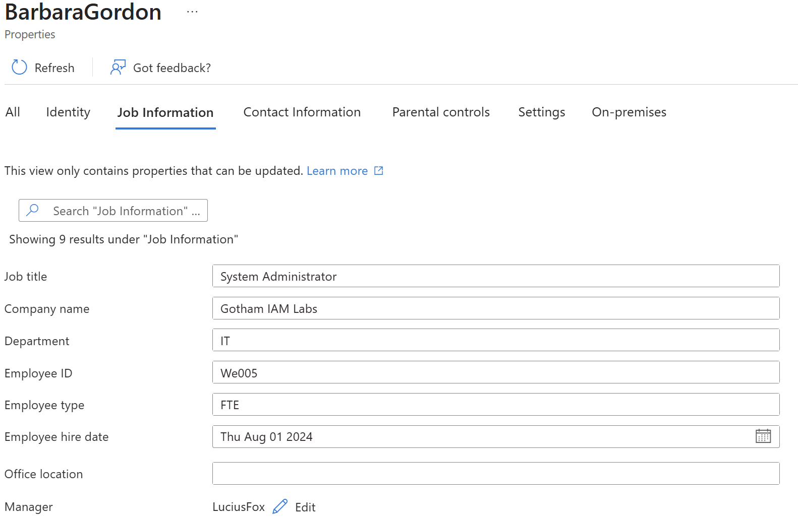
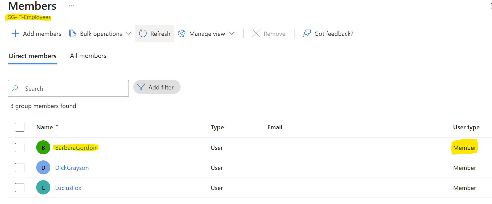
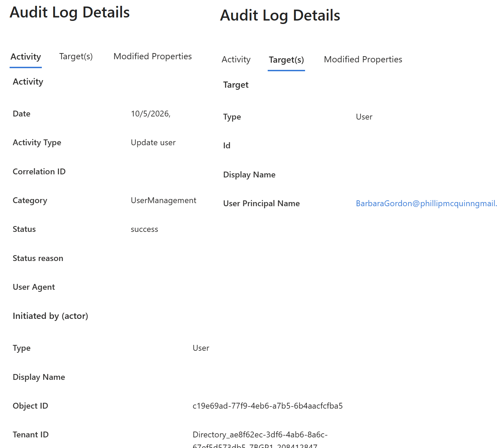
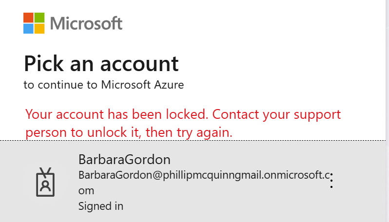
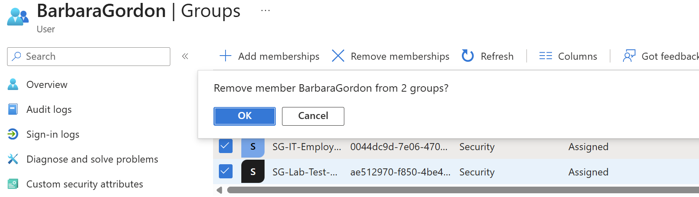
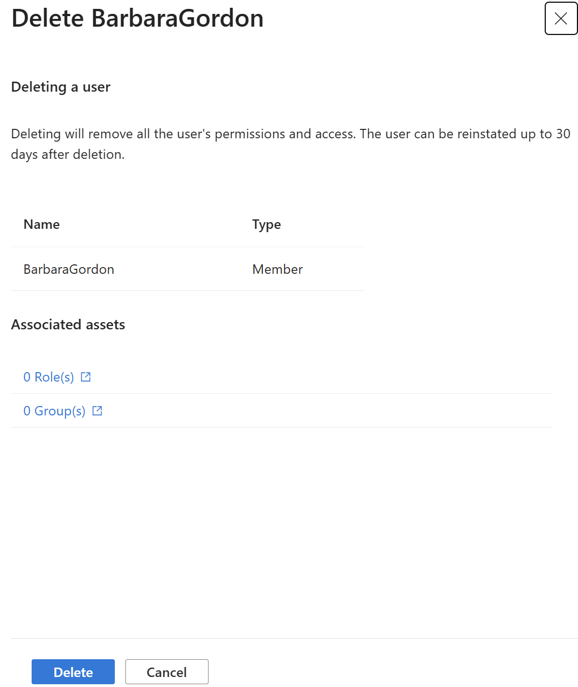

# Lab 01: Employee Onboarding and Offboarding

I performed all administration and testing myself, using my administrator account for configuration and the relevant test accounts for sign-in and permission checks.

## Objective

I practiced foundational Microsoft Entra ID user lifecycle administration by creating a fictional employee account, updating employee attributes, assigning department group membership, verifying interactive sign-in, blocking sign-in, revoking sessions, removing group membership, and deleting the account after testing.

## Status

**Completed.** This lab was conducted in the original Microsoft Entra ID Free environment. The results below distinguish actions recorded in the lab from behavior directly observed during sign-in testing.

## Employee Scenario

Barbara Gordon joins Gotham IAM Lab as a System Administrator in the IT department. I used her account to test onboarding, access verification, and subsequent offboarding.

| Attribute | Value |
|---|---|
| Display name | Barbara Gordon |
| User principal name | `BarbaraGordon@phillipmcquinngmail.onmicrosoft.com` |
| Job title | System Administrator |
| Department | IT |
| Manager | Lucius Fox |
| Employee ID | WE005 |
| Hire date (scenario) | August 1, 2024 |
| Department group | `SG-IT-Employees` |

## Lab Environment and Prerequisites

| Setting | Value |
|---|---|
| Tenant | `phillipmcquinngmail.onmicrosoft.com` |
| License edition | Microsoft Entra ID Free |
| Administrator role used | Global Administrator |
| Test account | Barbara Gordon |
| Verification | Separate private browser session |

The employee and organization details are fictional and used exclusively for personal lab training.

## Part 1: Joiner — Onboarding

### 1. Create the employee account

I created Barbara Gordon's user account through **Microsoft Entra admin center → Users → All users → New user**.

### 2. Populate employee attributes

I configured employee details including job title, department, employee ID, and manager. The hire date is included in the scenario; the published notes do not independently confirm that it was saved as an Entra ID attribute.

**Evidence:**

### 3. Assign IT department group membership

I added Barbara Gordon to `SG-IT-Employees` and reviewed the account's group membership.

**Evidence:**

### 4. Verify interactive employee sign-in

I opened a separate private browser session and signed in with Barbara Gordon's test account.

**Observed results:**
- I was prompted to change the initial password when signing in as Barbara.
- I was prompted to register Microsoft Authenticator for Barbara.
- After I completed the prompts, interactive sign-in succeeded.

These observations verify onboarding sign-in behavior. They do not by themselves establish that any specific application role or resource entitlement was granted.

### 5. Review onboarding audit evidence

I reviewed available Microsoft Entra audit information related to the onboarding activities.

**Evidence:**

## Part 2: Leaver — Offboarding

### 1. Review the account before offboarding

I confirmed the employee account was available for the offboarding exercise and reviewed its IT group membership.

### 2. Block employee sign-in

I blocked sign-in for Barbara Gordon and reviewed the disabled account state in Microsoft Entra ID.

**Evidence:**

### 3. Revoke sign-in sessions and validate subsequent authentication

I performed the session-revocation step as documented in the original exercise.

After I removed the sign-in block for testing, I signed in again as Barbara Gordon using her username, password, and MFA. This showed that the account could authenticate after being re-enabled; it does **not** prove that every previously established application session was immediately terminated by the revocation action.

I did not retain a separate screenshot or timestamp proving completion of the session-revocation operation, so I do not make a more specific enforcement claim.

### 4. Remove IT group membership

I removed Barbara Gordon from `SG-IT-Employees` during offboarding.

**Evidence:**

## Cleanup

I deleted the test employee account after the offboarding exercises. My original notes also record session revocation as part of cleanup. Deleting the test account was the final documented state; it was **not** left disabled or retained for another lab.

**Evidence:**

## Issues and Troubleshooting

I did not record significant issues during user creation, account changes, sign-in verification, or offboarding.

During verification, I could sign in again after removing the sign-in block. This helped distinguish an account-level sign-in block from session revocation: re-enabling an account permits new authentication, while revoking sessions generally requires renewed authentication but is not equivalent to disabling the account.

## Lessons Learned

- **Identity lifecycle administration involves more than account creation.** Employee attributes, department group membership, sign-in behavior, access removal, and final cleanup each require attention.
- **Blocking sign-in differs from revoking sessions.** Blocking sign-in prevents new authentication while the block remains in effect. Revoking sessions invalidates supported sign-in sessions or refresh tokens, but does not by itself disable the user account or guarantee immediate termination of every application session.
- **Access changes should be validated.** Reviewing group membership and performing actual sign-in tests provides stronger evidence than recording configuration changes alone.
- **Audit logs support accountability.** Microsoft Entra audit records can help identify which changes occurred and which administrator performed them; the available evidence should be interpreted according to what the logs actually show.
- **Cleanup matters in a lab.** Deleting test accounts after completing an exercise keeps the training environment organized and avoids leaving unnecessary identities active.

---

**Lab scope:** Microsoft Entra ID Free in the `phillipmcquinngmail.onmicrosoft.com` tenant. The separate GothamLabz Microsoft Entra ID P2 environment is used for later labs.
