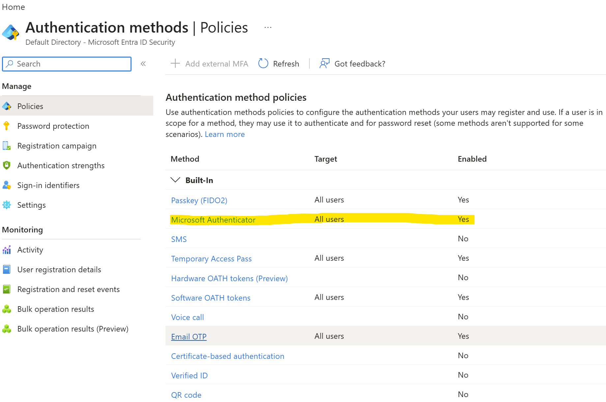
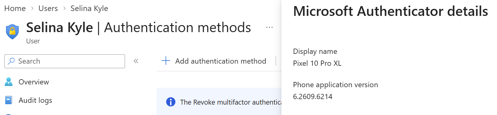
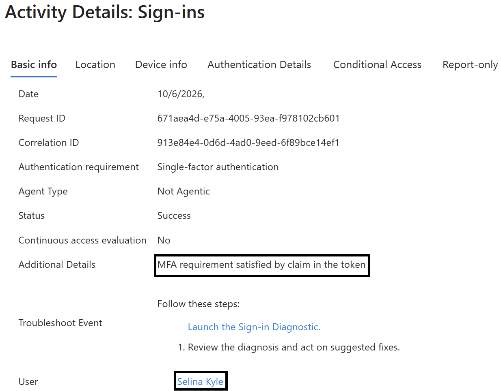
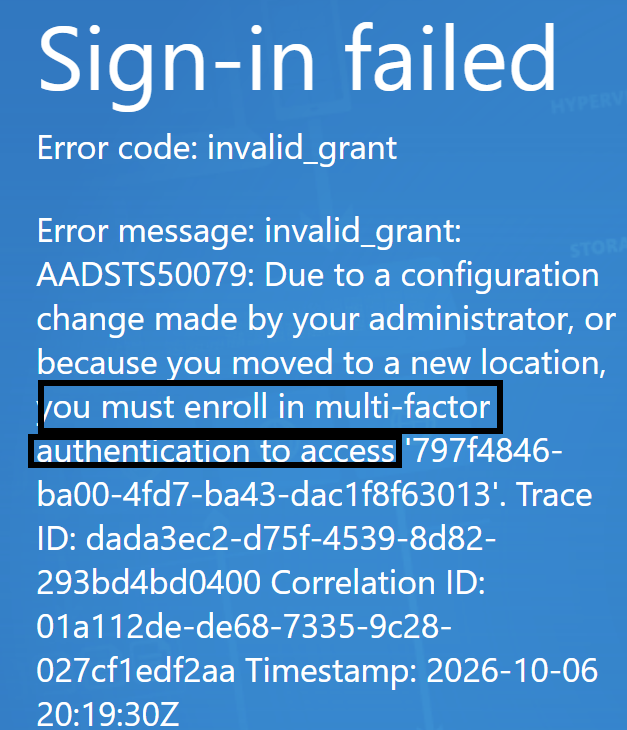
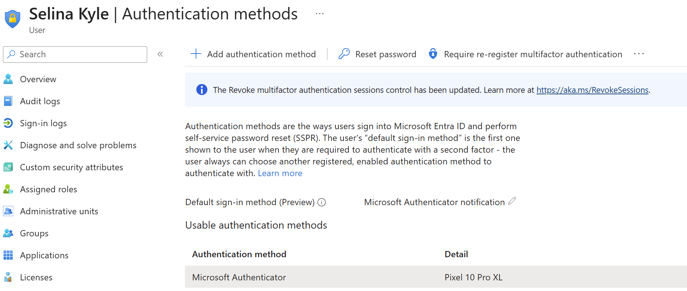
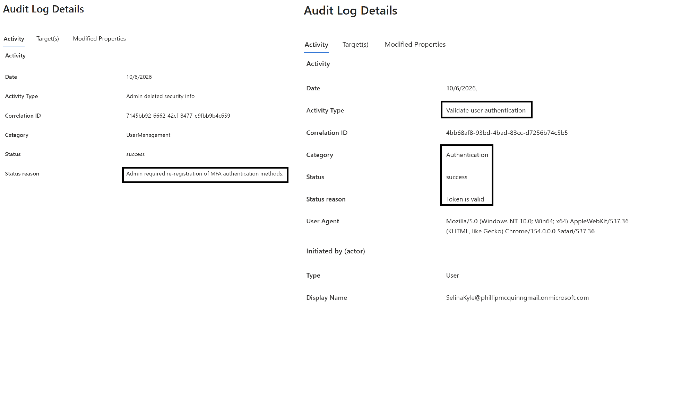

# Lab 04: MFA Registration and Recovery

**Lab date:** October 6, 2026.

I performed all administration and testing myself, using my administrator account for configuration and the relevant test accounts for sign-in and permission checks.

## Objective

I practiced Microsoft Authenticator enrollment and recovery using a standard Microsoft Entra ID account. I reviewed Security Defaults, inspected authentication details, required MFA re-registration to simulate replacing a phone, and verified that I could authenticate again as the test user.

## Status

**Completed — October 6, 2026.** I completed and documented registration, re-registration, and a successful post-recovery MFA sign-in. My original notes do not identify the exact error code from the interim failed sign-in.

## Environment

| Setting | Value |
|---|---|
| Tenant | `phillipmcquinngmail.onmicrosoft.com` (original Gotham IAM Lab environment) |
| License | Microsoft Entra ID Free |
| Date performed | October 6, 2026 |
| Test user | Selina Kyle |
| Test user's admin roles | None |
| Authentication method | Microsoft Authenticator |
| MFA enforcement configuration | Security Defaults |
| Administrator role used | Global Administrator |

## Scenario

Selina Kyle is a fictional standard user who needs to enroll Microsoft Authenticator. A simulated phone replacement then requires her existing MFA registration to be reset so she can enroll the method again and regain normal sign-in capability.

The scenario uses a personal lab account and a test device; it does not involve an actual employee's lost or replaced phone.

## Prerequisites

- An enabled Selina Kyle account without assigned administrator roles.
- Microsoft Authenticator on the test mobile device.
- A separate browser session for testing Selina's sign-in.
- An authorized administrator able to review and manage user authentication methods.
- Continued access to the primary administrator account.

## Part 1: Review MFA Configuration

I reviewed the tenant's MFA configuration and identified **Security Defaults** as the mechanism applicable to this exercise. My original notes state that the setting was already configured at tenant creation and no changes were needed.

**Evidence:**

**Important distinction:** Security Defaults is a tenant-level security setting; registering an authentication method does not, by itself, define when an MFA challenge is required.

## Part 2: Register Microsoft Authenticator

I signed in using Selina's standard account and completed the registration process for Microsoft Authenticator. I confirmed that the authentication method appeared in the user's account information.

**Observed result:** I successfully registered the method. My original notes also describe a password change during the initial account sign-in; this was an onboarding sign-in step, not proof that changing a password resets MFA.

**Evidence:**

For security, registration QR codes, setup secrets, recovery codes, and passwords should not be included in public evidence.

## Part 3: Review Sign-In Authentication Details

I reviewed Selina's sign-in records and their authentication details to correlate the recorded event with the sign-in test.

**Observed result:** I recorded a successful sign-in with authentication details available for review. My notes do not specify the precise sequence of authentication methods or whether a particular event used a fresh Microsoft Authenticator challenge versus a previously satisfied MFA claim. Those distinctions should be taken from the screenshot or full log rather than assumed.

**Evidence:**

## Part 4: Simulate Phone Replacement and Re-Registration

From my administrator session, I used **Require re-register multifactor authentication** for Selina's account to simulate the need to enroll a replacement device.

**Observed sequence:**

1. I initiated the MFA re-registration action from my administrator account.
2. During the subsequent sign-in attempt as Selina, I encountered an MFA-related error, which I recorded in my validation table.
3. I completed Microsoft Authenticator setup for Selina on the intended mobile device.
4. The new registration succeeded.

I did not record an error code or detailed failure reason for the interim error. It should not be attributed to a particular Entra policy or service condition without the corresponding sign-in details.

**Evidence:**

## Part 5: Verify Recovery

I repeated the sign-in test after completing re-registration.

**Observed result:** I successfully signed in as Selina and completed the required MFA authentication. This confirms the recovery flow returned the lab account to a usable state.

**Evidence:**

## Validation Results

| Test | Expected result | Observed result | Status |
|---|---|---|---|
| Security Defaults review | Identify the applicable MFA configuration | Existing configuration reviewed; no change required | Passed |
| Initial Authenticator enrollment | Method registered on Selina's account | Authentication method appeared in account details | Passed |
| Initial sign-in log review | Locate authentication-related sign-in evidence | Successful sign-in and authentication details recorded | Passed |
| Require MFA re-registration | Trigger a new registration process | Re-registration initiated; an interim MFA-related sign-in error was reported | Completed with observation |
| Authenticator re-enrollment | Method successfully registered again | Setup succeeded on intended mobile device | Passed |
| Recovery sign-in | User signs in with required MFA | Successful sign-in following MFA verification | Passed |

## Issues and Troubleshooting

**Observed issue:** I encountered an MFA-related error while signing in as Selina after requiring re-registration from my administrator account.

**Action taken:** I completed Microsoft Authenticator registration again on the intended mobile device.

**Result:** I signed in successfully with MFA on a later attempt.

**Evidence limitation:** My original written results do not include the interim error code, exact on-screen wording, or a confirmed underlying cause. No specific failure diagnosis is claimed.

I did not document other unexpected issues.

## Cleanup

Selina's lab account remained available after successful MFA recovery. The final documented outcome was a usable account with Microsoft Authenticator re-registered.

My original cleanup checklist recommended confirming primary administrator access and ensuring no secrets were visible in screenshots; it does not independently record screenshots or separate results for those checks. No temporary administrator role assignment was described for the test user.

## Lessons Learned

- **Registration and enforcement are different.** Enrolling Microsoft Authenticator makes the method available; the applicable authentication configuration determines when MFA is required.
- **Authentication Details provide verification context.** Sign-in logs help distinguish successful authentication, a newly performed challenge, and MFA satisfied by an existing claim when those details are available.
- **Re-registration supports account recovery.** Requiring MFA re-registration can be part of an administrator-assisted recovery workflow when a user changes devices or must reset their authentication methods.
- **Password changes and MFA recovery are separate actions.** Changing a password does not automatically establish or replace an Authenticator registration.
- **Evidence must support the diagnosis.** An observed MFA error should be recorded with its exact code and failure details before claiming a specific cause.

---

**Lab scope:** Microsoft Entra ID Free in the `phillipmcquinngmail.onmicrosoft.com` tenant. Labs 06–08 use the separate GothamLabz Microsoft Entra ID P2 environment.
