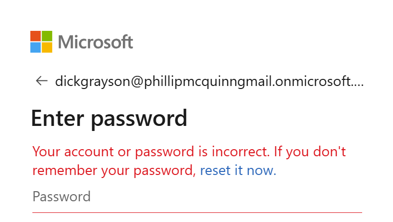
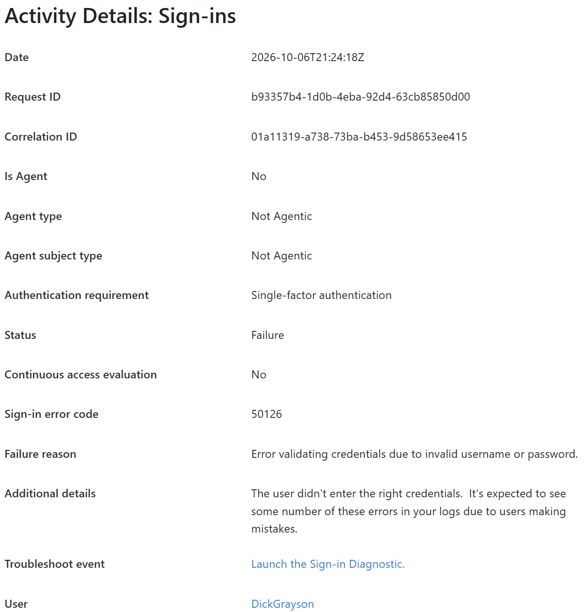
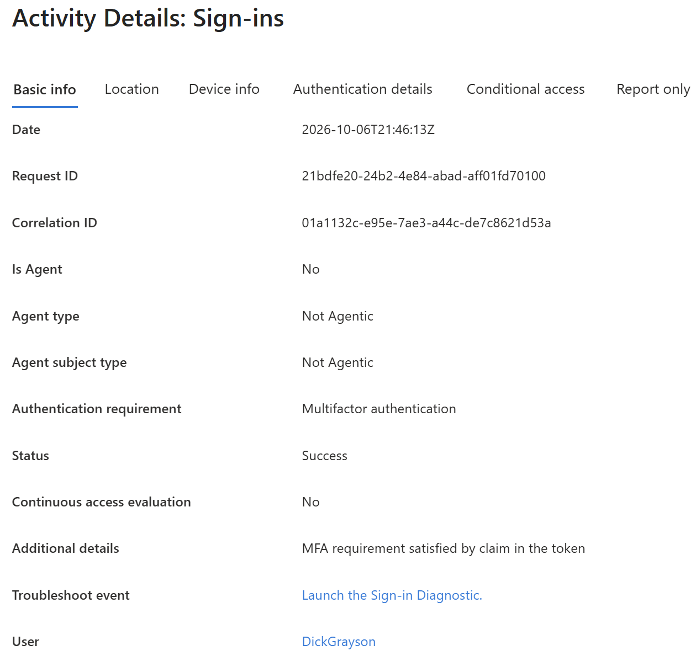
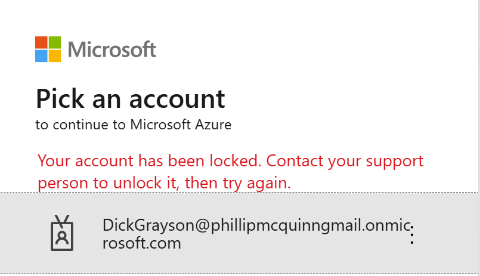
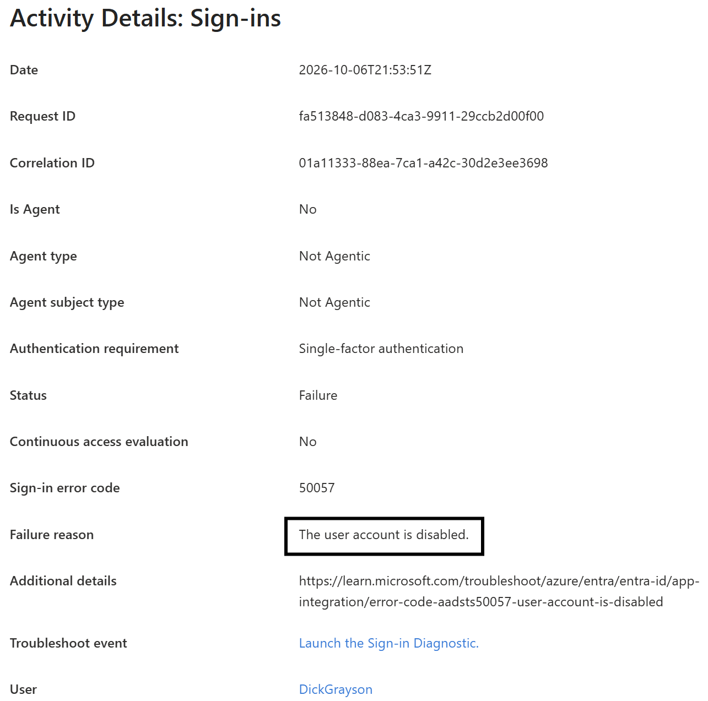
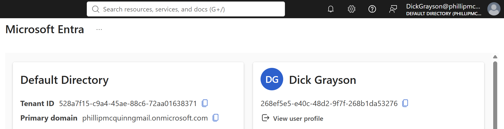

# Lab 05: Microsoft Entra ID Sign-In Troubleshooting

**Lab date:** October 6, 2026.

I performed all administration and testing myself, using my administrator account for configuration and the relevant test accounts for sign-in and permission checks.

## Objective

I investigated Microsoft Entra ID sign-in failures by comparing the errors I reproduced with sign-in logs and account settings. I applied a targeted correction for each scenario and confirmed recovery through a successful fresh sign-in.

## Status

**Completed — both test scenarios were diagnosed and successfully retested.**

## Environment

| Setting | Value |
|---|---|
| Lab environment | Original Gotham IAM Lab |
| Tenant | `phillipmcquinngmail.onmicrosoft.com` |
| License | Microsoft Entra ID Free |
| Date performed | October 6, 2026 |
| Test user | Dick Grayson |
| Administrator role used | Global Administrator |
| Sign-in event time zone | UTC |

This exercise used the original Free-license tenant for Labs 01–05, not the separate GothamLabz P2 tenant used in later labs. Accounts and scenarios are fictional.

## Prerequisites

- Dick Grayson's account existed and initially permitted sign-in.

- A successful baseline sign-in had been established.

- An authorized administrator could inspect sign-in logs and update the test account.

- Separate administrator and employee browser sessions were available.

## Investigation Method

For each scenario, I reproduced a failed sign-in, compared the error with the corresponding sign-in event, and reviewed the account configuration before applying a correction. I verified the outcome with another sign-in attempt.

Sign-in logs can have a short reporting delay, so I used the event timestamp, user identity, and failure reason together to identify the relevant record. I did not assume an MFA cause without supporting evidence.

## Part 1: Incorrect Password

### 1. Reproduce the authentication failure

I attempted to sign in as Dick Grayson using an intentionally incorrect password. The sign-in page reported:

> Your account or password is incorrect.

Only a controlled test attempt was required; repeated invalid-password attempts were avoided to reduce the risk of account lockout.

**Evidence:**

### 2. Investigate the sign-in event

I located the corresponding failure in Microsoft Entra ID sign-in logs.

| Field | Recorded observation |
|---|---|
| User | Dick Grayson |
| Event time (UTC) | `2026-10-06T21:24:18Z` |
| Recorded event identifier | `b93357b4-1d0b-4e4a-92d4-63cb85850d00` |
| Error code | **50126** |
| Failure reason | Error validating credentials due to an invalid username or password |

The event identifier is retained as recorded in my original lab notes; its precise log-field type was not specified.

**Evidence:**

### 3. Diagnosis and resolution

The failed sign-in and error **50126** were consistent with the deliberately incorrect password. No account-setting change was needed. I retried authentication as Dick using the known correct password.

### 4. Verify recovery

I signed in successfully after entering the correct password.

**Evidence:**

## Part 2: Disabled User Account

### 1. Reproduce blocked sign-in

I blocked sign-in for Dick Grayson's test account using my administrator account, then attempted a fresh sign-in as Dick in a separate browser session.

**Evidence:**

### 2. Investigate the sign-in event and account state

The failed sign-in record reported **50057** and identified the user account as disabled. An account review independently showed that Dick's sign-in was blocked.

| Field | Recorded observation |
|---|---|
| User | Dick Grayson |
| Recorded event identifier | `fa513848-d083-4ca3-9911-29ccb2d00f00` |
| Error code | **50057** |
| Failure reason | User account is disabled |
| Account setting | Sign-in blocked |

The event identifier is preserved from the lab notes without assuming its precise field type. I did not record a timestamp for this specific event.

**Evidence:**

### 3. Diagnosis and resolution

The account's disabled state explained why the test user could not sign in. Because this was my controlled lab scenario, I restored the account to an enabled state.

In an operational environment, restoring an offboarded employee's account would require appropriate authorization and identity verification before access was reinstated.

### 4. Verify recovery

I completed a successful fresh sign-in as Dick Grayson after re-enabling the account. This confirmed the observed issue was resolved in the lab.

**Evidence:**

## Validation Results

| Scenario | Observed cause | Corrective action | Retest result |
|---|---|---|---|
| Incorrect password | Sign-in failure **50126** indicated invalid credentials | Entered the correct password | **Passed:** Sign-in successful |
| Blocked sign-in | Sign-in failure **50057** and disabled account setting | Re-enabled the authorized test account | **Passed:** Sign-in successful |

## Issues and Troubleshooting

- **Sign-in log reporting delay:** Events sometimes took a couple of minutes to become visible in the Entra admin center. The relevant event was identified by matching user and event details rather than assuming immediate log availability.

- **Event selection:** Matching timestamps and failure information helped distinguish the intended test events from other sign-ins.

- **Browser sessions:** No browser-session interference was reported during this exercise.

- **Permissions:** No issues accessing sign-in logs or performing the authorized lab changes were reported.

- **Additional failures:** No additional failure condition was observed during the successful retests.

## Cleanup

I returned Dick Grayson's account to an **enabled** state after the disabled-account test. My original notes do not independently confirm session sign-out, other configuration restoration, or screenshot redaction as separate completed cleanup actions, so those are not claimed as verified results.

**Scope note:** This lab documents basic troubleshooting in a personal Microsoft Entra ID Free environment. It does not claim production incident response or advanced P2 sign-in risk testing.

## Skills Practiced

- **Controlled authentication testing:** I reproduced incorrect-password and disabled-account sign-in failures with a fictional user.

- **Sign-in log investigation:** I matched user identity, timestamps, and failure details to the test attempts.

- **Error interpretation:** I distinguished error 50126 for invalid credentials from 50057 for a disabled account.

- **Targeted remediation:** I used the correct password for the first scenario and re-enabled the authorized test account for the second.

- **Recovery verification:** I performed fresh successful sign-ins after both corrections and accounted for delayed log visibility.

## Lessons Learned

- **Correlate user reports with the correct sign-in event.** User identity, timestamps, application context, and failure information help narrow an investigation when logs contain multiple records.

- **Read the error code alongside its failure reason.** Error **50126** was consistent with invalid credentials; error **50057** indicated a disabled user account. The diagnosis should be supported by the surrounding context.

- **Check account configuration.** Sign-in logs identified the failure, while account settings independently confirmed that the test user was blocked in the second scenario.

- **Choose targeted fixes.** Re-entering a correct password and re-enabling an authorized test account addressed different causes; neither required changing MFA settings.

- **Verify a fix with a fresh test.** A successful sign-in after remediation demonstrated recovery for both scenarios. If the retest had failed, further investigation would have been necessary.

- **Account for log delays.** Sign-in activity may not appear instantaneously in the admin center, so recorded event times and careful matching improve troubleshooting accuracy.

## References

Microsoft documentation supporting the procedures and behavior discussed in this lab:

- [Troubleshoot Microsoft Entra sign-in errors](https://learn.microsoft.com/en-us/entra/identity/monitoring-health/howto-troubleshoot-sign-in-errors)

- [Authentication and authorization error codes](https://learn.microsoft.com/en-us/entra/identity-platform/reference-error-codes)

---

[Return to portfolio](../../README.md)
