# Lab 07: Conditional Access and Identity Protection

**Lab dates:** October 8–9, 2026. **Licensing:** Microsoft Entra ID P2 free trial. Results reflect testing during the active trial.

I performed all administration and testing myself, using my administrator account for configuration and the relevant test accounts for sign-in and permission checks.

## Objective

I configured Microsoft Entra Conditional Access policies for user MFA, administrator phishing-resistant MFA, legacy authentication blocking, and risk-based access. I checked group and role targeting with What If simulations, transitioned from Security Defaults to enforced policies, and validated selected results in actual sign-in logs.

I distinguish policy configuration, simulated evaluation, and real enforcement. I did not observe an actual blocked legacy sign-in or risky sign-in, so I do not claim those as enforcement successes.

## Status

Completed

## Lab Scenario

Gotham IAM Lab uses seven fictional regular users and two administrator accounts. Regular users require MFA. A regular Global Administrator must meet a phishing-resistant authentication strength requirement, while a separate Lab Recovery Administrator remains available for emergency access. A legacy-client policy blocks selected older authentication clients. A risk-based policy is evaluated in Report-only mode for Medium and High sign-in risk.

| Attribute | Lab configuration |
|---|---|
| Tenant | GothamLabz.onmicrosoft.com |
| Regular user test identity | Tim Drake |
| Regular administrator test identity | Phillip McQuinn |
| Emergency account | Lab Recovery Administrator |
| Regular-user group | `SG-CA-Lab-Users` (7 members) |
| Regular administrator passkey group | `SG-Auth-WindowsHello-Admins` |
| Recovery passkey group | `SG-Auth-WindowsHello-Recovery` |
| License edition | Microsoft Entra ID P2 |
| License inventory | 9 assigned |
| MFA registration report | 9 accounts listed as MFA capable |

## Prerequisites

- Access to the personal Gotham IAM Lab tenant.

- Global Administrator privileges for the administrator actions performed.

- Microsoft Entra ID P2 licenses for the targeted test accounts.

- `SG-CA-Lab-Users` with seven regular users.

- Microsoft Authenticator registered for the lab accounts.

- Windows Hello passkeys registered and independently tested for the regular and recovery administrators.

- A working recovery administrator session before enforcing Conditional Access.

- Access to Conditional Access, What If, sign-in logs, and Identity Protection.

Administrative environment used:

- **Administrator role:** Global Administrator

- **License edition:** Microsoft Entra ID P2

## Part 1: Identity, Licensing, and Authentication Preparation

### 1. Verify regular-user group membership

I confirmed seven direct members of `SG-CA-Lab-Users`. Membership establishes policy targeting; it does not by itself prove successful MFA or application access.

Evidence:

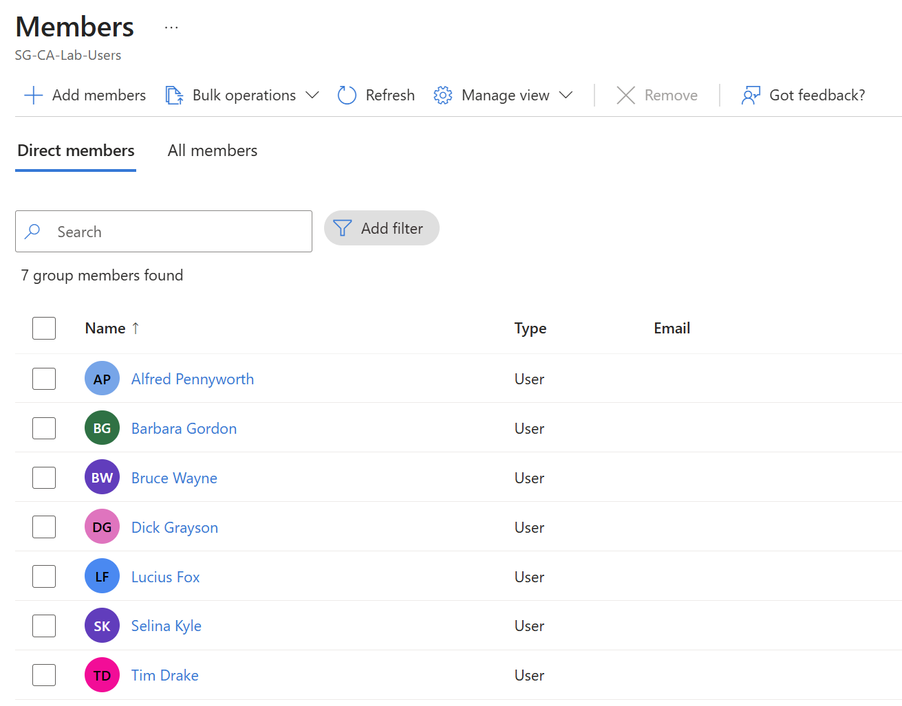

### 2. Verify license coverage

I reviewed the Microsoft Entra ID P2 license inventory: **25 total licenses, 9 assigned**.

Evidence:

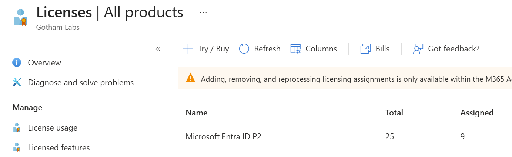

### 3. Review MFA registration

I inspected the user registration report. The nine lab accounts appear as **MFA capable**. I treated this as registration evidence; I checked Conditional Access enforcement separately.

Evidence:

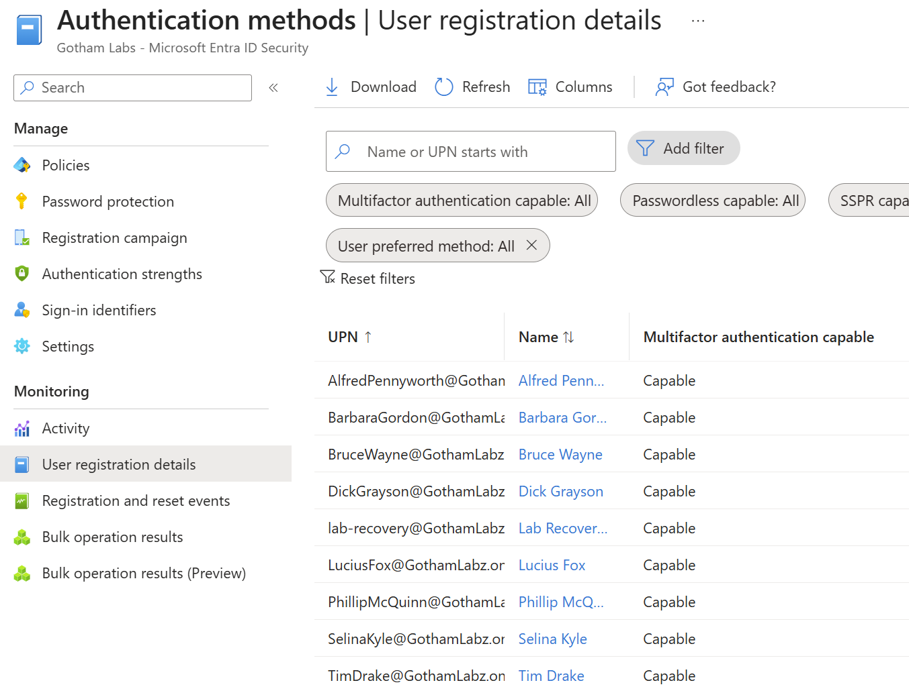

### 4. Verify Windows Hello passkeys

I verified the Lab Recovery Administrator and regular administrator each have a registered **device-bound Windows Hello passkey**. I also successfully tested Windows Hello sign-ins during the exercise, although the selected screenshots show registration rather than method-specific sign-in log proof.

Evidence:

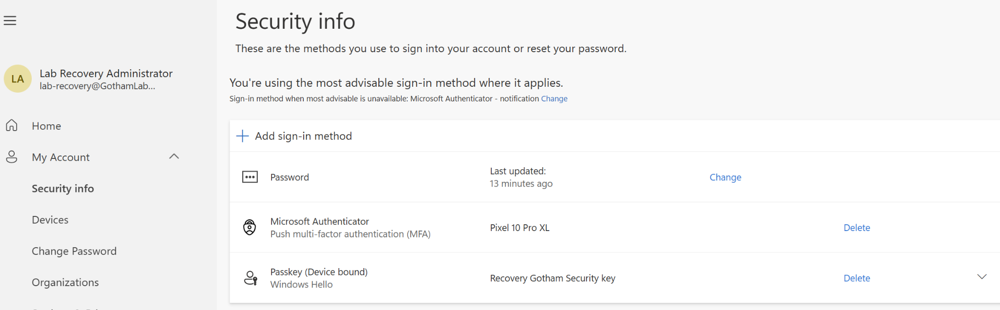

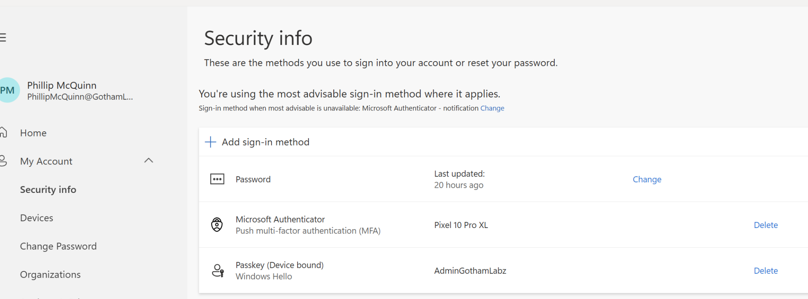

## Part 2: Conditional Access Policy Configuration

### 1. Configure the initial policy set in Report-only mode

I created and evaluated six policies, recording their intended identity scope, grants, conditions, exclusions, and policy states.

| Policy | Purpose | Final state |
|---|---|---|
| `CA-00-Lab-Admin-MFA` | Require MFA for the regular administrator | On |
| `CA-01-Lab-Users-MFA` | Require MFA for `SG-CA-Lab-Users` | On |
| `CA-02-Admins-PhishingResistant` | Require phishing-resistant MFA for selected directory roles; exclude recovery administrator | On |
| `CA-03-Lab-Block-Legacy` | Block Exchange ActiveSync and Other legacy clients for scoped users | On |
| `CA-04-Lab-Recovery-MFA` | Evaluate phishing-resistant authentication for recovery account | Report-only |
| `CA-05-Lab-SignInRisk-MFA` | Evaluate Medium- and High-risk sign-ins for the user group | Report-only |

The original six-policy list was captured while all policies were in **Report-only** mode.

Evidence:

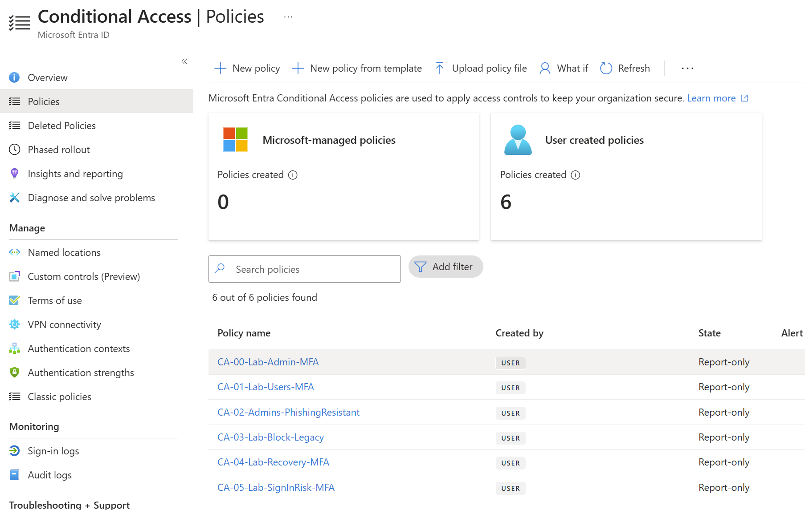

### 2. Verify user MFA policy targeting

I used **What If** to simulate a sign-in for Tim Drake. I confirmed that `CA-01-Lab-Users-MFA` applied. What If confirms targeting, not an enforced MFA challenge.

Evidence:

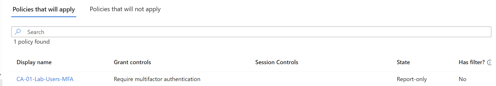

### 3. Verify legacy authentication blocking conditions

I simulated a legacy client using **Other clients** and verified that `CA-03-Lab-Block-Legacy` was evaluated with **Block**. I did not treat this as a real blocked protocol sign-in.

Evidence:

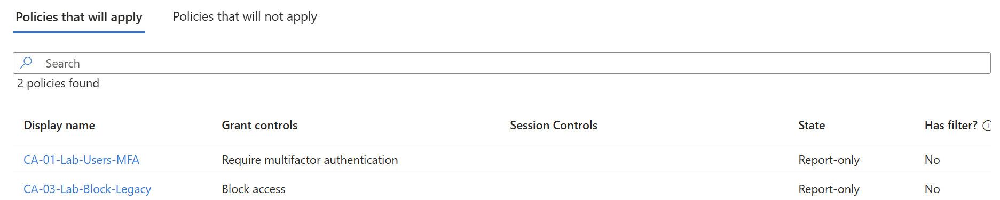

### 4. Verify recovery account exclusions

I ran What If for the Lab Recovery Administrator. I confirmed that `CA-02-Admins-PhishingResistant` did not apply due to **Users and groups** targeting/exclusion. `CA-04-Lab-Recovery-MFA` is separate and remains Report-only.

Evidence:

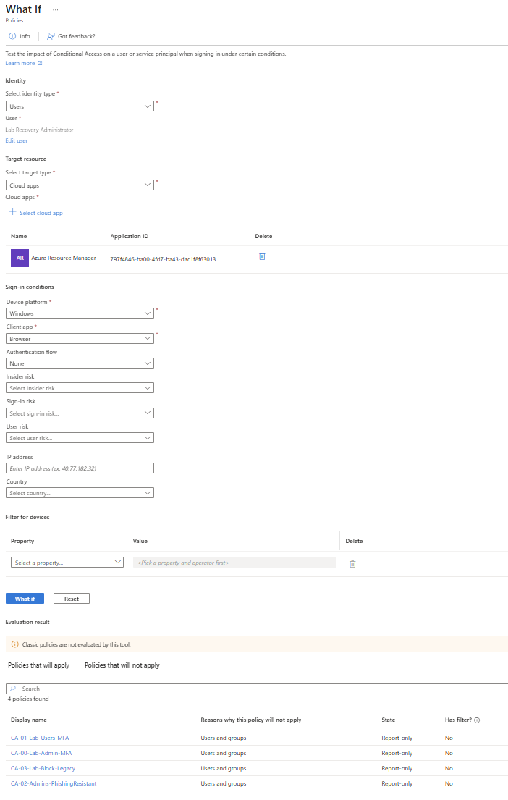

### 5. Verify administrator phishing-resistant targeting

I simulated regular administrator access to Azure Resource Manager. I verified that both `CA-00-Lab-Admin-MFA` and `CA-02-Admins-PhishingResistant` applied. The stronger authentication strength must be satisfied when enforcement is enabled.

Evidence:

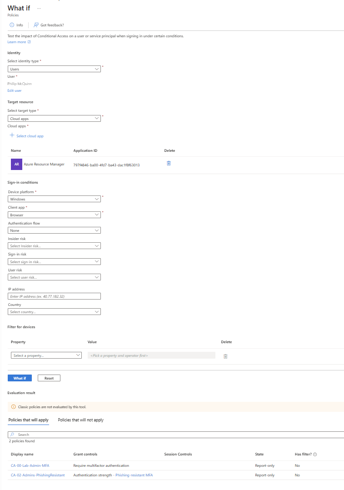

## Part 3: Identity Protection — Sign-In Risk

### 1. Test a simulated Medium-risk sign-in

I selected Tim Drake, Azure Resource Manager, Windows, Browser, and **Medium** sign-in risk. Both `CA-01` and `CA-05` match the simulation.

Evidence:

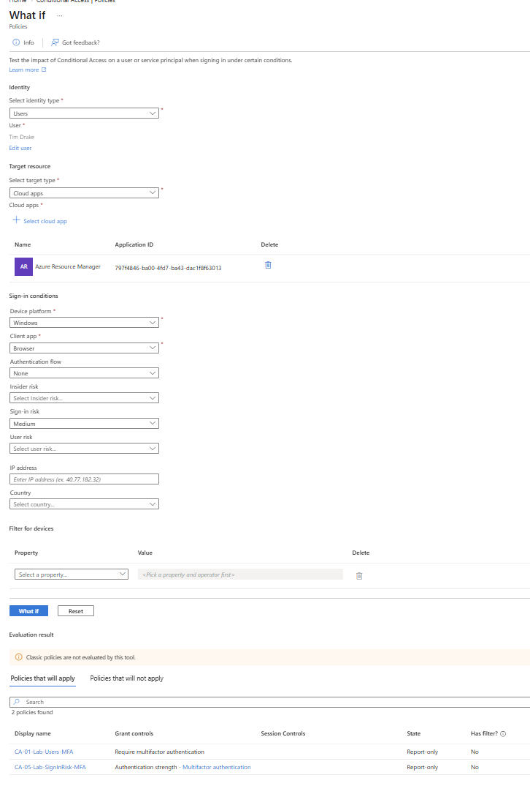

### 2. Test a simulated High-risk sign-in

I repeated the simulation with **High** sign-in risk. Both `CA-01` and `CA-05` match again.

Evidence:

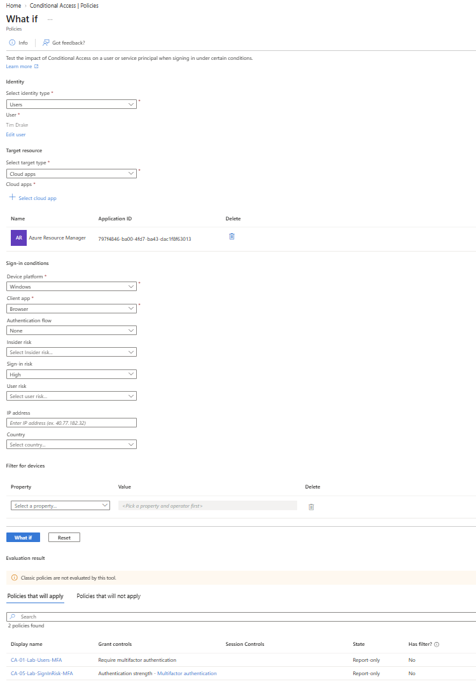

### 3. Record the limit of the simulations

What If does not generate a real Identity Protection risk detection or prove risk-policy enforcement. `CA-05` remains Report-only. No real risky-sign-in enforcement event was documented.

## Part 4: Security Defaults Transition and Policy Enforcement

### 1. Record the transition plan

Security Defaults was **Enabled** before the transition. After testing administrator recovery access and passkeys, I disabled Security Defaults and enabled replacement policies. I confirmed the Disabled state during the exercise, but it is not shown in the selected minimal screenshot set.

I prepared recovery access and replacement policies before disabling Security Defaults. A working recovery session should remain available during policy changes.

### 2. Verify enforced policy states

I confirmed `CA-00`, `CA-01`, `CA-02`, and `CA-03` show **On**. I confirmed that `CA-04` and `CA-05` remained **Report-only**.

Evidence:

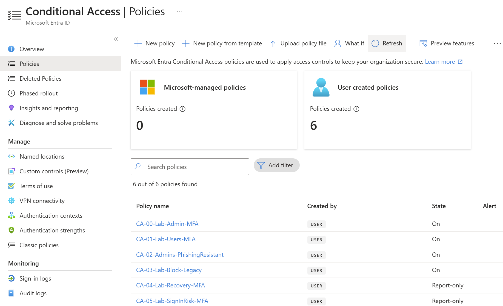

### 3. Test regular-user MFA enforcement

I performed a real sign-in as Tim Drake and inspected the **Conditional access** tab. The event shows `CA-01-Lab-Users-MFA` as **Success**. This is an actual enforced-policy result, not a What If simulation.

Evidence:

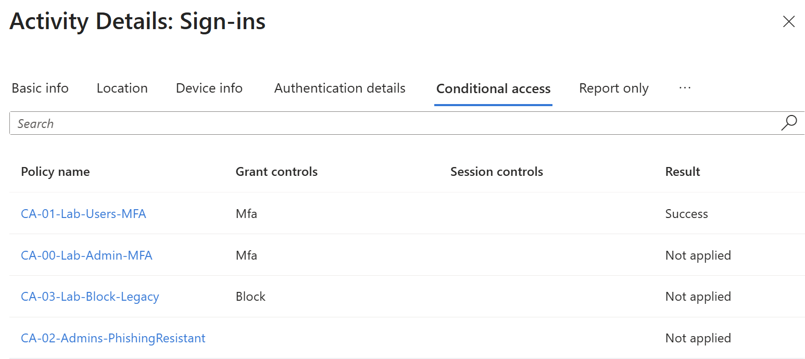

### 4. Test administrator phishing-resistant MFA enforcement

I performed a real administrator sign-in and inspected the sign-in event. `CA-00-Lab-Admin-MFA` and `CA-02-Admins-PhishingResistant` show **Success**.

The Authentication details page identifies a **phishing-resistant** requirement as satisfied, but shows **Previously satisfied**. That event does not, by itself, prove a new Windows Hello gesture occurred during this particular sign-in. Windows Hello capability was separately tested earlier.

Evidence:

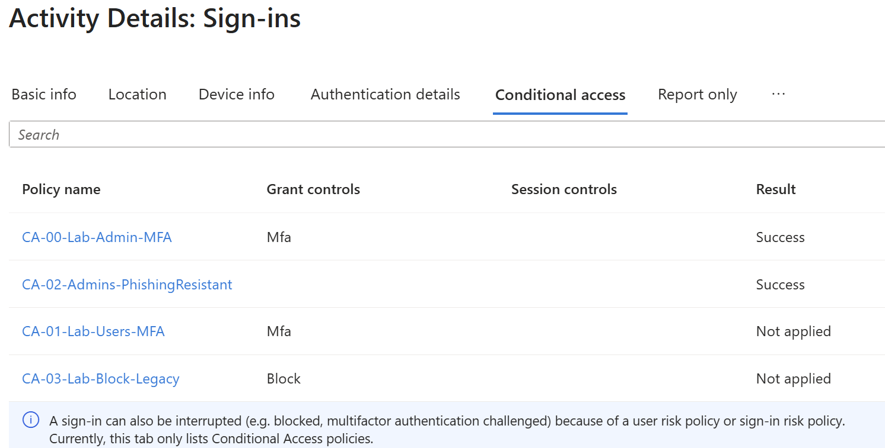

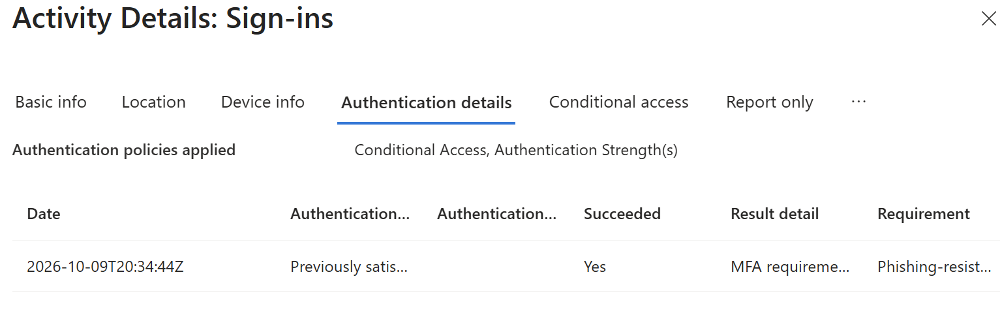

### 5. Confirm emergency administrative access

After enforcement, I signed in as the Lab Recovery Administrator using Windows Hello and accessed the Conditional Access policies page. I observed this directly during the exercise; the minimal screenshots document passkey registration but not a dedicated method-specific sign-in log for this test.

## Part 5: Legacy Authentication Investigation

### 1. Search for legacy client sign-in attempts

I filtered the sign-in logs for **Exchange ActiveSync** and **Other clients**. The available interactive sign-in screenshot shows **No results** for the filtered 24-hour period.

Evidence:

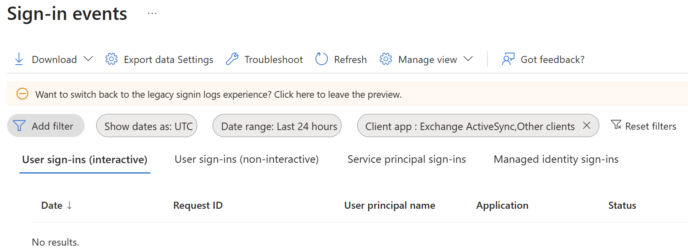

### 2. Document the enforcement-test limitation

The policy is configured and On, and its What If targeting was successful. However, no actual legacy client sign-in was captured with `CA-03` showing a blocked result.

**Actual blocked legacy sign-in: Not tested — no matching event available.**

## Cleanup

- Keep the four baseline protection policies **On** in the lab unless intentionally conducting a controlled change.

- Keep the recovery training policy and risk-policy simulation **Report-only** until their intended enforcement behavior is separately planned and tested.

- Keep the Lab Recovery Administrator available and its authentication methods intact.

- Record any future policy changes, exclusions, rollback actions, and timestamps.

- No deletion or restoration of these six policies was documented as part of this exercise.

## Issues and Troubleshooting

- **Security Defaults prevented custom Conditional Access enforcement.** The transition was deferred until replacement policies and recovery access were prepared.

- **Report-only and disabled sign-in log results initially caused confusion.** I verified targeting through What If and later verified actual enforcement separately.

- **Recovery passkey profile naming/assignment was confusing.** I confirmed the custom profile, group targeting, allowed Windows Hello authenticators, and successful passkey registration.
**Issue: Windows Hello Passkey Registration**

**Symptom:** Windows Hello passkey registration could not be completed using the DuckDuckGo browser.

**Investigation:** I retried registration and identified browser compatibility as a potential contributing factor.

**Resolution:** I switched to a compatible browser and successfully registered the Windows Hello passkey.

**Verification:** I confirmed successful authentication using the registered Windows Hello passkey to access the Microsoft Entra admin center.

**Lesson Learned:** Browser compatibility can affect passkey registration and authentication workflows. When troubleshooting passkey enrollment issues, verify browser support before investigating account configuration or tenant authentication policies.

- **Sign-in logs sometimes reported previously satisfied MFA.** I recorded that result without claiming a fresh prompt for the specific event.

- **No actual legacy-client event appeared in the filtered logs.** I recorded the protocol block as not tested rather than claiming a demonstrated denial.

## Skills Practiced

- **Conditional Access configuration:** I configured six policies for user/admin MFA, authentication strength, legacy clients, and sign-in risk.

- **Policy targeting and simulation:** I used What If to inspect user, administrator, recovery-account, client, and simulated risk conditions.

- **Authentication method preparation:** I verified MFA registration and registered and tested administrator Windows Hello passkeys.

- **Staged enforcement and recovery planning:** I prepared recovery access, transitioned from Security Defaults, and enabled four policies while retaining two in Report-only.

- **Sign-in evidence interpretation:** I reviewed actual Conditional Access results and separated Previously satisfied claims, simulations, and untested legacy/risky sign-in enforcement.

## Lessons Learned

- MFA-capable registration is different from MFA enforcement.

- Conditional Access What If confirms targeting but not successful real-world authentication.

- Phishing-resistant administrator access requires a compatible method such as a Windows Hello passkey; Authenticator push alone does not satisfy that authentication strength.

- Administrator recovery planning should precede policy activation.

- An enforced-policy Success result may be satisfied by a previously issued authentication claim.

- Legacy client blocking requires a matching real sign-in event to demonstrate actual denial.

- P2 Identity Protection simulations can validate risk-policy scope without creating risk detections.

## References

Microsoft documentation supporting the procedures and behavior discussed in this lab:

- [Conditional Access What If tool](https://learn.microsoft.com/en-us/entra/identity/conditional-access/what-if-tool)

- [Evaluate Conditional Access policy impact](https://learn.microsoft.com/en-us/entra/identity/conditional-access/concept-conditional-access-report-only)

- [Security Defaults](https://learn.microsoft.com/en-us/entra/fundamentals/security-defaults)

---

[Return to portfolio](../../README.md)
