# Lab 09: Privileged Identity Management — Just-in-Time Role Activation

## Objective

Configure a time-limited eligible Microsoft Entra role assignment, validate just-in-time administrative access, and verify that manual deactivation and automatic expiry remove the tested permission. Extend the exercise with approval-controlled activation and correlate the resulting audit events.

## Status

Completed — functional tests and cleanup confirmed on October 29, 2026.

## Environment

| Setting | Value |
|---|---|
| Environment | Personal, nonproduction IAM lab; fictional test identities |
| Tenant | Gotham Labs (`GothamLabz.onmicrosoft.com`) |
| License | Microsoft Entra ID P2 assigned to PIM Test Administrator |
| Date performed | October 29, 2026 |
| Configuring administrator and approver | Phillip McQuinn, Global Administrator |
| Eligible administrator | PIM Test Administrator (`Pim-Test@GothamLabz.onmicrosoft.com`) |
| Role | Helpdesk Administrator |
| Scope | Directory / Gotham Labs |
| Assignment | Direct, time-limited eligibility; October 29–30, 2026 |
| Password-reset target | Dick Grayson (`DickGrayson@GothamLabz.onmicrosoft.com`) |
| Registered authentication method | Microsoft Authenticator |
| Activation maximum duration | 1 hour |
| Activation requirements | Azure MFA and justification; approval added for the second test |

Times below reproduce the portal's displayed values. A timezone label was not captured in the audit screenshots; these times are not presented as UTC.

## Scenario

A helpdesk technician needs temporary permission to reset a fictional employee's password. The technician receives eligibility rather than standing active access. The exercise first validates self-activation and manual deactivation, then requires approval from a separate administrator account and allows the approved activation to expire automatically.

Both accounts were operated by the lab owner in separate browser sessions. The approval test demonstrates separation between requester and approver accounts, not independent human review.

## Preparation

- Created PIM Test Administrator as a standard user and assigned Entra ID P2.
- Signed in separately, changed the temporary password, and registered Microsoft Authenticator when prompted while accessing the Entra admin center.
- Kept the existing main administrator session and administrator assignments available throughout testing.
- Used Dick Grayson as the fictional password-reset target.

## Part 1: Establish the Permission Baseline

Before assigning eligibility or activating a role, Pim-Test opened Dick Grayson's user page and attempted a password reset. The Reset password control was visible, but the panel reported that the password could not be reset and cited administrative privilege as a possible reason.

**Finding:** A visible portal control did not establish authorization. The attempted operation was blocked.

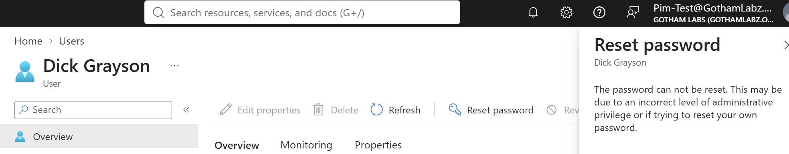

## Part 2: Assign Time-Limited Eligibility

The main administrator assigned Helpdesk Administrator directly to PIM Test Administrator at Directory scope. The assignment type was **Eligible**, permanent eligibility was unchecked, and the eligibility ended on October 30, 2026 at 8:16:36 AM as displayed.

The eligible-assignment list showed the saved assignment beginning October 29 at 8:21:09 AM. Eligibility made the role available for activation; it did not itself grant the tested administrative permission.

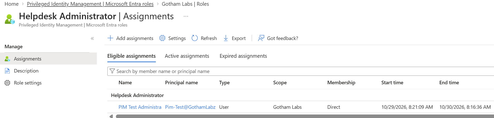

## Part 3: Configure and Activate the Role

The Helpdesk Administrator activation settings were configured as follows:

| Setting | First test |
|---|---|
| Maximum activation duration | 1 hour |
| On activation, require | Azure MFA |
| Require justification | Yes |
| Require ticket information | No |
| Require approval | No |
| Custom activation extensions | Not enabled |

These are role-level settings and apply to the role's eligible assignees.

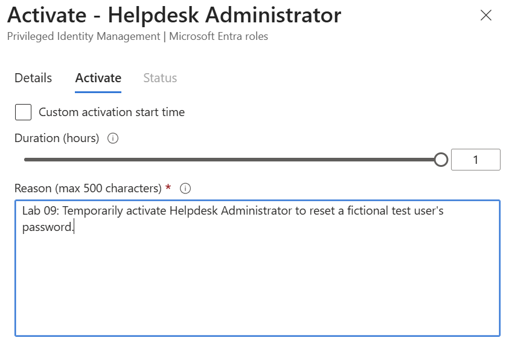

Pim-Test submitted an activation request for the password-reset exercise. The role appeared under Active assignments with state **Activated** and an end time of 9:31:00 AM.

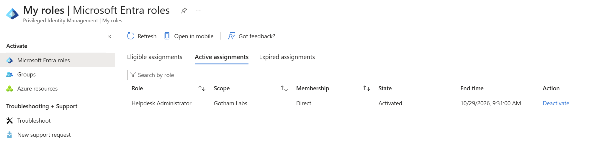

**MFA observation:** No fresh MFA prompt appeared during this activation. Microsoft Authenticator had already been registered during account setup. The lab confirms that MFA was configured as an activation requirement, but does not establish from the captured evidence whether an existing MFA claim satisfied it. Registration alone is not evidence of an MFA challenge at activation.

## Part 4: Validate Access and Manual Deactivation

While Helpdesk Administrator was active, Pim-Test reset Dick Grayson's password successfully.

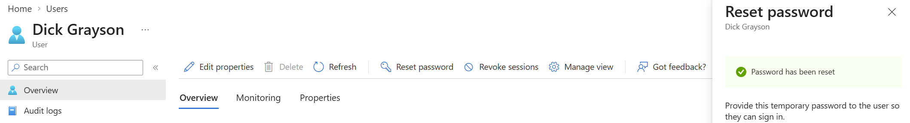

Pim-Test then manually deactivated the role and repeated the password-reset test. Entra reported that the current permissions did not allow the reset.

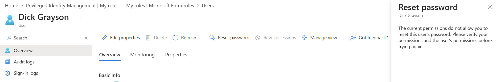

PIM audit history recorded successful activation and manual deactivation:

| Displayed time | Action | Result |
|---|---|---|
| 8:31:06 AM | Add member to role completed (PIM activation) | Succeeded |
| 8:40:36 AM | Remove member from role completed (PIM deactivate) | Succeeded |

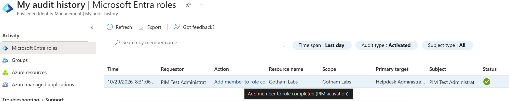

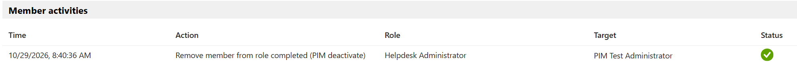

## Part 5: Require Approval for Activation

The main administrator enabled **Require approval to activate** for Helpdesk Administrator and selected the main administrator account as approver. The 1-hour maximum, MFA requirement, and justification requirement remained in place.

Pim-Test submitted a second request with this justification:

> Lab 09: Test approval-controlled activation for a fictional user password reset.

The request appeared as **Pending approval** at 9:02:25 AM.

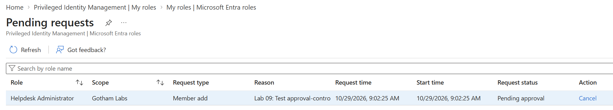

While the request was pending, Pim-Test attempted another password reset for Dick Grayson. The operation remained blocked.

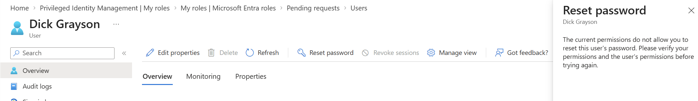

The main administrator approved the request. Pim-Test's role subsequently appeared as **Activated**, with an end time of 10:07:57 AM.

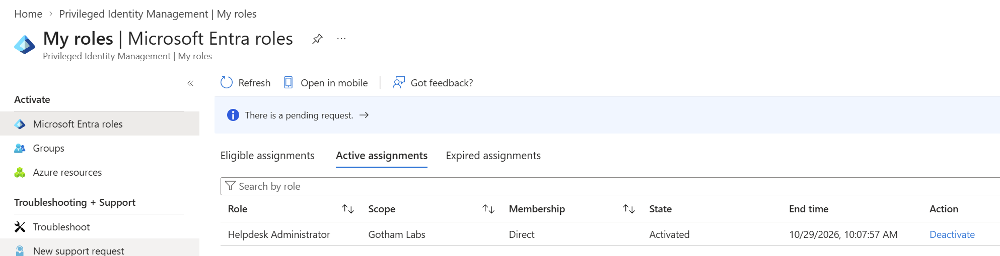

The captured page still displayed a pending-request banner alongside the active role. That banner alone was not treated as proof of request status; the successful approval audit and completed activation event below establish the approved request's outcome.

After approval and activation, Pim-Test successfully reset Dick Grayson's password again.

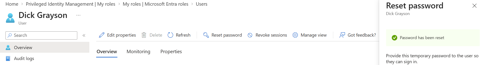

## Part 6: Correlate Approval and Activation Evidence

| Displayed time | Requestor shown | Action | Result |
|---|---|---|---|
| 9:07:57 AM | Phillip McQuinn | Add member to role request approved (PIM activation) | Succeeded |
| 9:08:03 AM | PIM Test Administrator | Add member to role completed (PIM activation) | Succeeded |

The approval event recorded this decision justification:

> Approved for Lab 09 password-reset validation on a fictional account.

The approval and completed activation events shared correlation ID `52955d7e-749c-4998-9b16-8936d33d957a`. The activation details also recorded the request justification and expiry time.

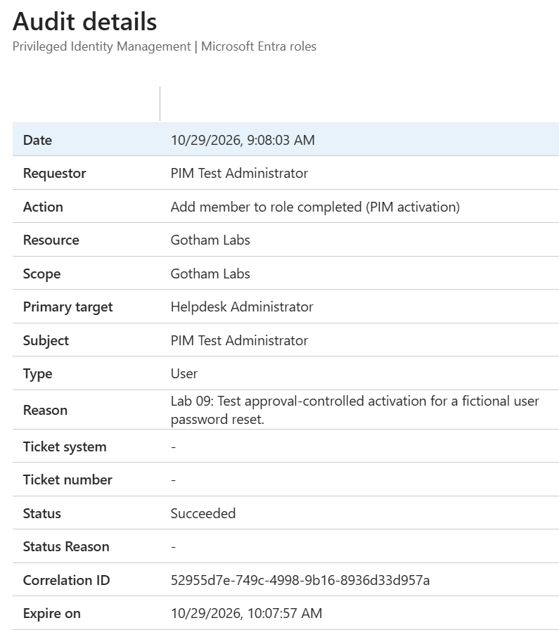

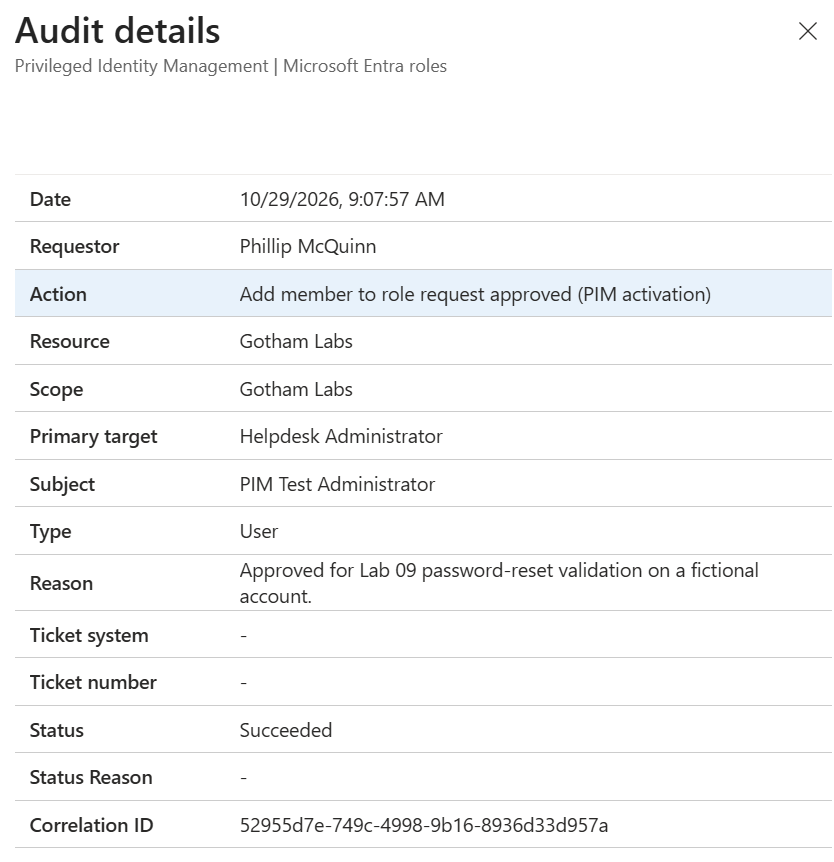

## Part 7: Verify Automatic Expiry

The second activation was left active to expire naturally, without manual deactivation. At 10:08:04 AM, PIM recorded **Remove member from role (PIM activation expired)** with status **Succeeded** and requestor **Azure AD PIM**, as named in the portal.

The expiry event shared the approved activation's correlation ID. Its recorded event time was seven seconds after the scheduled 10:07:57 AM expiry; this is an audit timestamp comparison, not a measured guarantee of permission-removal latency.

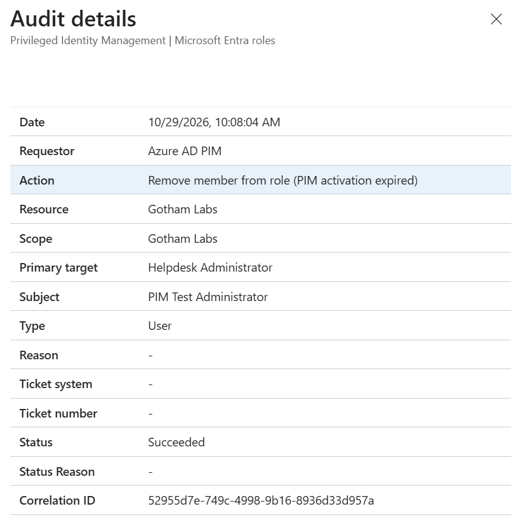

Pim-Test then retried Dick Grayson's password reset. Entra denied the operation because the current permissions did not allow it.

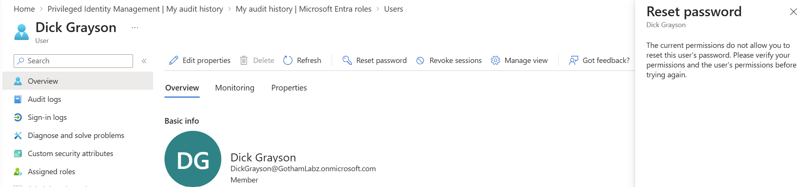

## Validation Results

| Test | Actual result |
|---|---|
| Before role activation | Password reset blocked |
| During first activation | Password reset succeeded |
| After manual deactivation | Password reset blocked |
| Approval-controlled request submitted | Request remained pending approval |
| While approval pending | Password reset blocked |
| After approval and activation | Password reset succeeded |
| Automatic expiry | Successful system-initiated role-removal audit event |
| After automatic expiry | Password reset blocked |
| Audit correlation | Approval, second activation, and expiry shared a correlation ID |
| Fresh MFA challenge on first activation | No new prompt observed; existing-claim explanation not independently verified |

## Troubleshooting and Evidence Limitations

- **Visible Reset password button:** The control was available before activation, but the operation was blocked. Permission testing relied on the operation's result rather than button appearance.
- **Audit-history account context:** The main administrator's My audit history initially showed assignment and settings changes. Switching to Pim-Test's history exposed the activation event. The observed issue was resolved by checking the relevant account's history; a log-ingestion delay was not established.
- **MFA prompt behavior:** A new MFA prompt was not observed during the first activation. Microsoft documents that prior MFA or strong authentication in the session can satisfy the requirement. That is a possible explanation here, not a verified finding from sign-in Authentication Details.
- **Pending banner after activation:** The active-role screenshot retained a pending banner. Approval and activation audit details were used to verify the request outcome.
- **Test scope:** The lab tested password resets against one fictional user. It did not test every Helpdesk Administrator permission, password resets against privileged administrators, approval rejection, or fresh authentication enforcement through Conditional Access authentication context.

## Cleanup

The lab owner confirmed completion of the following:

- Removed Pim-Test's eligible Helpdesk Administrator assignment.
- Confirmed no active administrator roles or pending requests remained for Pim-Test.
- Signed in as Dick Grayson with the latest temporary password and completed the password change to leave his account usable.

Account deletion was not part of the confirmed cleanup. The final Helpdesk Administrator activation configuration required MFA, justification, and approval with a 1-hour maximum; restoration of earlier role settings was not reported.

## Lessons Learned

- **Eligibility and active privilege are distinct.** Eligibility permits requesting activation; the tested password-reset permission became usable only while the role was active.
- **Approval controls when access begins.** A submitted request remained pending, and the administrative operation stayed blocked until approval and activation completed.
- **Privilege can end in multiple ways.** Both user-initiated deactivation and system-initiated expiry were supported by audit evidence and denied permission retests.
- **Audit evidence connects the access lifecycle.** Actor, role, result, justification, expiry, and correlation ID linked the approved activation to its removal.
- **MFA configuration and observed prompts must be documented separately.** Requiring MFA does not by itself demonstrate a new challenge at each activation.

## References

- [Configure Microsoft Entra role settings in PIM](https://learn.microsoft.com/en-us/entra/id-governance/privileged-identity-management/pim-how-to-change-default-settings)
- [Assign Microsoft Entra roles in PIM](https://learn.microsoft.com/en-us/entra/id-governance/privileged-identity-management/pim-how-to-add-role-to-user)
- [Activate Microsoft Entra roles in PIM](https://learn.microsoft.com/en-us/entra/id-governance/privileged-identity-management/pim-how-to-activate-role)
