# Lab 10: SAML 2.0 Single Sign-On

I performed all administration and testing myself, using my administrator account for configuration and the relevant test accounts for sign-in and permission checks.

## Objective

I integrated an enterprise application with Microsoft Entra ID using SAML 2.0, configured service-provider endpoints and NameID, established signing-certificate trust, and tested assignment-based access before and after removal.

## Status

Completed — SSO, certificate troubleshooting, and fresh-sign-in access-removal tests validated on October 29, 2026.

## Environment

| Setting | Value |
|---|---|
| Scope | Personal, nonproduction IAM lab with fictional test identity |
| Tenant | `GothamLabz.onmicrosoft.com` |
| Tenant licensing | Microsoft Entra ID P2 lab environment |
| Enterprise application | Gotham SAML Lab; Microsoft Entra SAML Toolkit gallery integration |
| Application ID | `6cc23aab-ec11-40bb-a9ae-9a5a1c9be07d` |
| Service principal object ID | `0780a006-5059-4c61-a8c0-b1fa2a7e6af0` |
| Test user | Dick Grayson (`DickGrayson@GothamLabz.onmicrosoft.com`) |
| Flow tested | Service-provider-initiated SAML SSO |
| Assignment required | Yes |
| Final assignment state | No users or groups assigned |

P2 describes the tenant used; this lab does not claim that basic SAML SSO requires P2. Portal times below are reproduced as displayed; a timezone label was not captured.

## Scenario

A fictional employee needs access to a SAML application. I configured trust between Entra (identity provider) and the toolkit (service provider), granted the employee access, troubleshot an application-side certificate mismatch, and removed access after validation.

## Part 1: Create the Enterprise Application

I added the Microsoft Entra SAML Toolkit gallery application, named it **Gotham SAML Lab**, and selected SAML as the sign-on method.

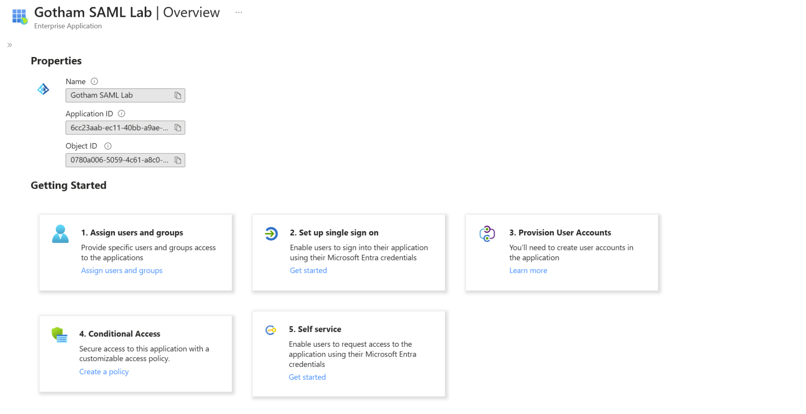

I registered a separate toolkit configuration-owner account and created a matching toolkit account for Dick Grayson during troubleshooting. The configuration owner's local toolkit login and Dick's Entra login served different purposes; creating a local toolkit account alone was not counted as an SSO success.

## Part 2: Configure Endpoints and Claims

The first toolkit connection was **22844**. The final working replacement was **22845**.

| Entra field | Final value |
|---|---|
| Identifier (Entity ID) | `https://samltoolkit.azurewebsites.net` |
| Reply URL / Assertion Consumer Service | `https://samltoolkit.azurewebsites.net/SAML/Consume/22845` |
| Sign on URL | `https://samltoolkit.azurewebsites.net/SAML/Login/22845` |
| Relay State | Blank |
| Basic configuration Logout URL | Blank |

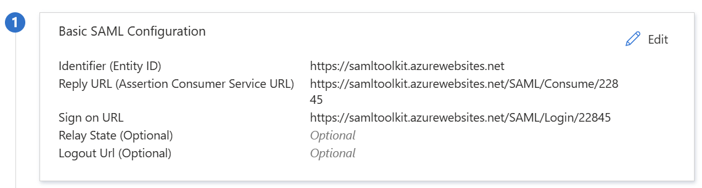

The required NameID claim used **Email address** format with attribute source **user.userprincipalname**. This sends Dick's Entra UPN as the identifier for matching the toolkit account. The separately listed email claim used user.mail; it was not the NameID source.

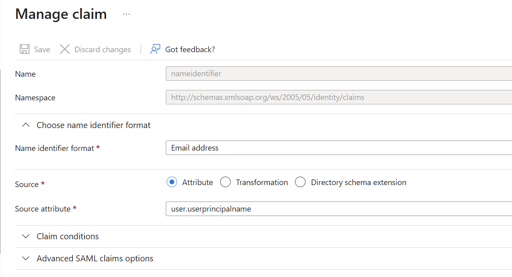

I enabled sign-in and set **Assignment required = Yes**. The application remained visible to users.

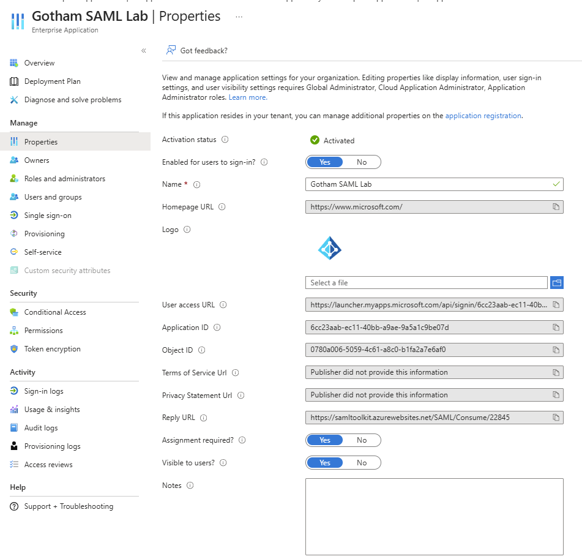

## Part 3: Verify Unassigned Access Is Denied

Before granting an assignment, I opened the toolkit's SP-initiated login URL in an Incognito session and signed in as Dick Grayson. Entra blocked the request with **AADSTS50105**, explicitly stating that the user lacked a direct or group-based application assignment.

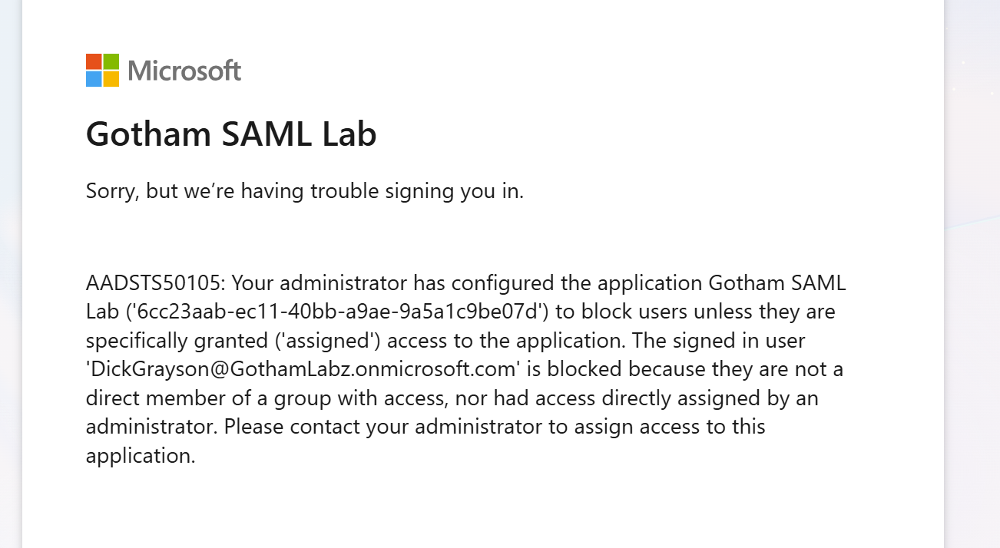

I assigned Dick Grayson directly under **Users and groups**.

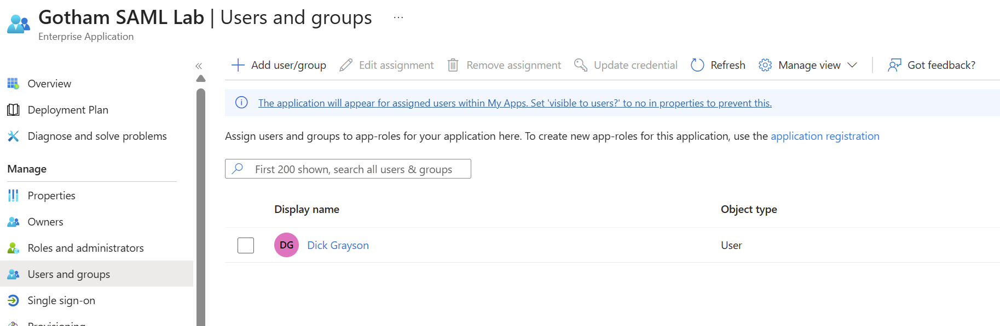

## Part 4: Troubleshoot Application-Side SAML Failure

After assignment, the request reached the toolkit, but the application displayed a generic processing error alongside an encoded SAML response. This did not establish successful application sign-in.

I created a matching local toolkit account for Dick, but my next attempt still failed. The evidence does not establish whether the missing counterpart account contributed to the original failure.

### Certificate mismatch

Inspection of connection 22844 showed a certificate with subject **accounts.accesscontrol.windows.net**, valid September 26, 2026 through September 26, 2031.

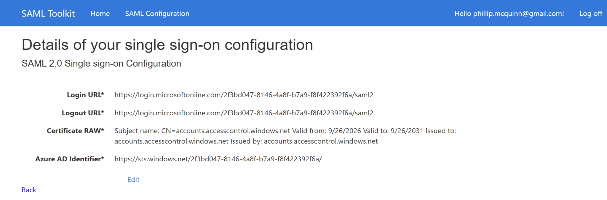

Entra's active application signing certificate instead expired **October 29, 2029**:

| Setting | Observed value |
|---|---|
| Status | Active |
| Thumbprint | `CDBEDB229D12F4AB16428023CD3AB28B7245CE4B` |
| Signing option | Sign SAML assertion |
| Signing algorithm | SHA-256 |

The certificates' different identities and validity periods established a mismatch. Matching expiration dates alone would not prove certificate equality.

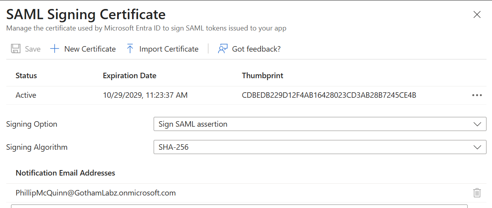

### Recovery

The toolkit's **Edit/22844** page itself returned a generic processing error. This was an observed failure of that edit operation; a broader service outage was not established.

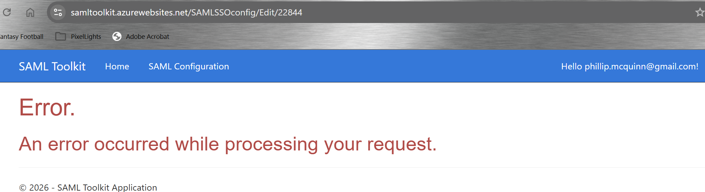

I downloaded **Certificate (Raw)** from the Gotham SAML Lab SAML sign-on page and created replacement connection **22845** using that certificate. Its displayed subject was **Microsoft Azure Federated SSO Certificate**, valid October 29, 2026 through October 29, 2029.

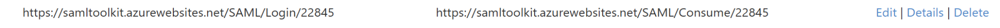

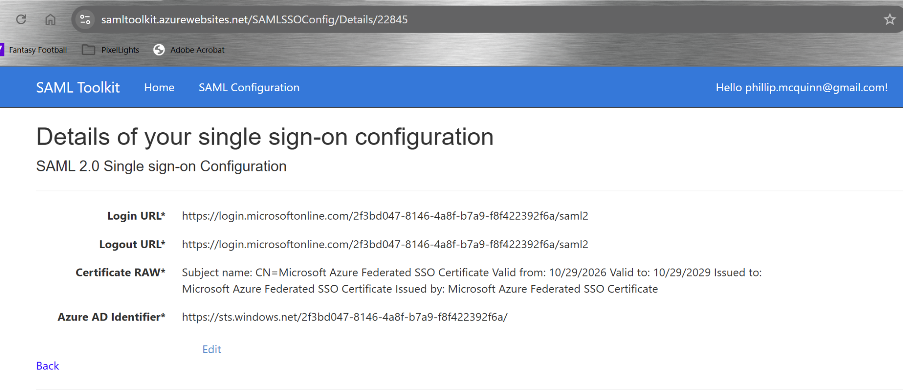

The toolkit connection used the following Entra values:

| Toolkit field | Value |
|---|---|
| Login URL | `https://login.microsoftonline.com/2f3bd047-8146-4a8f-b7a9-f8f422392f6a/saml2` |
| Azure AD Identifier | `https://sts.windows.net/2f3bd047-8146-4a8f-b7a9-f8f422392f6a/` |
| Logout URL | `https://login.microsoftonline.com/2f3bd047-8146-4a8f-b7a9-f8f422392f6a/saml2` |
| Certificate | Newly downloaded application Certificate (Raw) |

I replaced the Entra Reply URL and Sign on URL with connection 22845's generated endpoints. I kept the Entity ID, NameID source, assertion-signing option, and SHA-256 algorithm unchanged.

## Part 5: Verify SSO at Both Ends

I retried connection 22845 in a fresh Incognito window using Dick's Entra credentials. The toolkit returned its authenticated home page showing **DickGrayson@GothamLabz.onmicrosoft.com**.

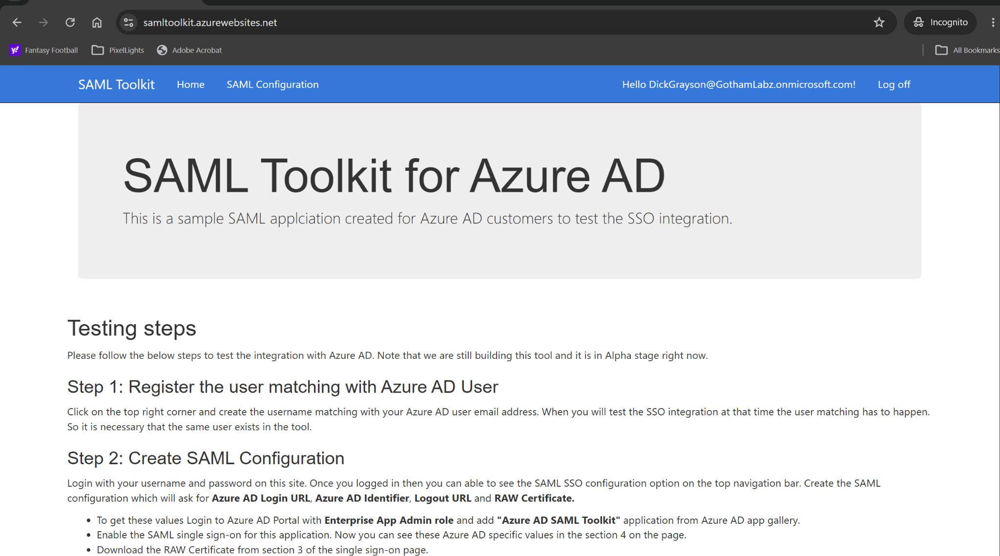

The corresponding Entra event showed:

| Field | Observed value |
|---|---|
| Date/time displayed | October 29, 2026, 12:25:17 PM |
| User | Dick Grayson |
| Application | Gotham SAML Lab |
| Status | Success |
| Authentication requirement | Multifactor authentication |
| Additional details | MFA requirement satisfied by claim in the token |

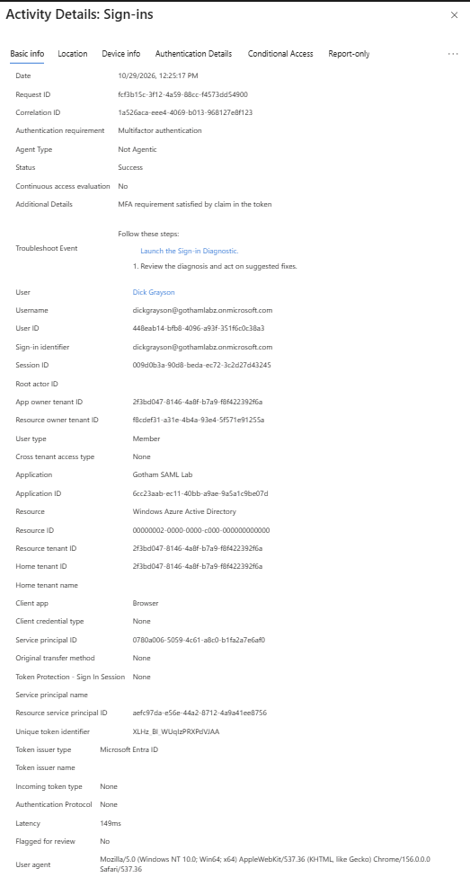

The log supports satisfaction through an existing MFA claim; this test does not claim a fresh Authenticator challenge occurred. Conditional Access policy-level evaluation was not captured for this event.

An earlier successful Entra event at 11:54:34 AM preceded the corrected-certificate test, so I did not use it as evidence of application recovery. Entra success alone did not prove that the toolkit accepted the response.

## Part 6: Remove Access and Retest

I removed Dick Grayson's direct application assignment, closed the Incognito windows, and repeated the SP-initiated sign-in in a fresh private session. Entra again returned **AADSTS50105**.

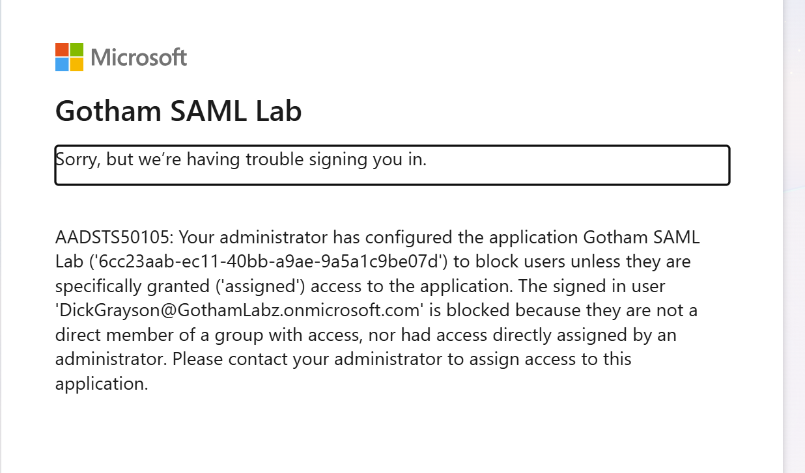

The final Users and groups page showed no application assignments.

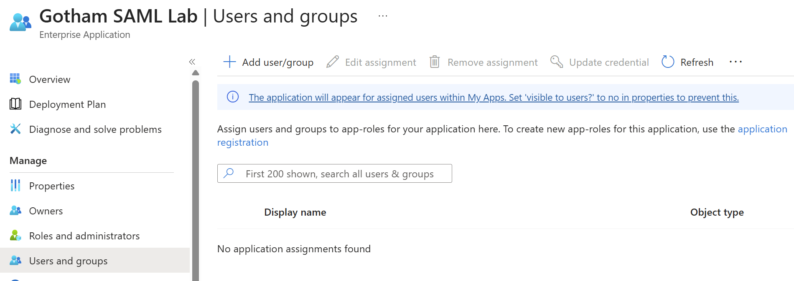

## Validation Results

| Test | Observed outcome |
|---|---|
| Before assignment | Entra denied access with AADSTS50105 |
| Direct assignment | Dick appeared in Users and groups |
| Initial application processing | Generic toolkit error despite receiving a SAML response |
| Trust inspection | Toolkit certificate differed from active Entra application signing certificate |
| Recovery | Replacement connection used the downloaded application certificate and updated endpoints |
| Assigned-user SP-initiated SSO | Authenticated toolkit page and corresponding successful Entra log |
| MFA | Existing token claim satisfied the requirement |
| After assignment removal | Fresh sign-in denied with AADSTS50105 |
| Final assignments | None |

## Final State and Limitations

- Gotham SAML Lab remains enabled, with assignment required and endpoints pointing to connection 22845.
- Dick's application assignment was removed; no application assignments remained.
- I did not confirm deletion of old connection 22844 or the local toolkit accounts.
- I did not test existing application-session termination after assignment removal. The removal result applies to a new sign-in.
- I did not test SAML logout, certificate rollover, group assignment, assertion encryption, or detailed assertion-content inspection.
- No full SAML responses, passwords, private keys, or cookies are included in this evidence package. Screenshots containing encoded responses were omitted.
- This lab adds federation and certificate-trust troubleshooting to the application-assignment controls practiced in Lab 08.

## Lessons Learned

- Application assignment and SAML trust are separate requirements.
- Entra can report a successful sign-in while the service provider rejects the response.
- The service provider must trust the certificate used by the enterprise application.
- Recreating a connection can change its ACS and login endpoints; both sides must agree.
- Validate access removal with a fresh sign-in and document session behavior separately.

## Reference

[Microsoft Learn: Configure Microsoft Entra SAML Toolkit SSO](https://learn.microsoft.com/en-us/entra/identity/saas-apps/saml-toolkit-tutorial)
