# Lab 12 — OAuth 2.0 API Authorization with Delegated Scopes

I performed all administration and testing myself, using my administrator account for configuration and the relevant test accounts for sign-in and permission checks.

I configured separate Microsoft Entra API and SPA client registrations, exposed read/write scopes, and validated access-token authentication and scope-based authorization in a local protected API. I demonstrated **401** for missing or invalid tokens, **403** for a valid token without write permission, and **200** after administrator consent and acquisition of a token containing the write scope.

**Environment:** personal GothamLabz Entra ID P2 tenant · **Test date:** October 29, 2026 · **Test user:** fictional employee Dick Grayson. P2 describes the environment; these OAuth features are not presented as P2-only functionality. This is independent hands-on lab work, not a production deployment.

## Configuration

| Setting | Recorded configuration |
|---|---|
| Tenant | `GothamLabz.onmicrosoft.com` |
| Tenant ID | `2f3bd047-8146-4a8f-b7a9-f8f422392f6a` |
| API registration | Gotham OAuth API Lab |
| API application/client ID | `487fb7d7-495e-4291-bf03-e0eba9367167` |
| API registration object ID | `69ba2b0f-c3fb-452f-b92a-acc1b25a8cc0` |
| Application ID URI | `api://487fb7d7-495e-4291-bf03-e0eba9367167` |
| Exposed delegated scopes | `Inventory.Read`, `Inventory.Write`; admins only; enabled |
| Access-token format | `api.requestedAccessTokenVersion: 2` |
| Client registration | Gotham OAuth Client Lab |
| SPA application/client ID | `529b206d-0fd4-4d9e-a31e-19a9e6177158` |
| Client registration object ID | `e7e8b174-670a-40ad-bf7b-8155e844517f` |
| Supported accounts | This organization only |
| SPA redirect URI | `http://localhost:3000/` |
| Local application / protected endpoint | `/lab.html` / `/api/inventory` on `http://localhost:3000` |
| Browser library | MSAL Browser 5.27.0; Authorization Code with PKCE |
| API validation libraries | PyJWT 2.15.1; cryptography 50.0.2 |
| Implicit access and ID token grants | Both unchecked |
| Allow public client flows | Disabled |
| Client secret | None used |
| Initial consent | Delegated Inventory.Read granted for Gotham Labs |
| Final API consent | Delegated Inventory.Read and Inventory.Write granted for Gotham Labs |

The root URL hosts the MSAL v5 redirect bridge; the interactive page is `lab.html`. The SPA and API share the loopback origin to avoid a separate cross-origin setup. Registration IDs are identifiers, not credentials. Lab 11 uses a separate client registration.

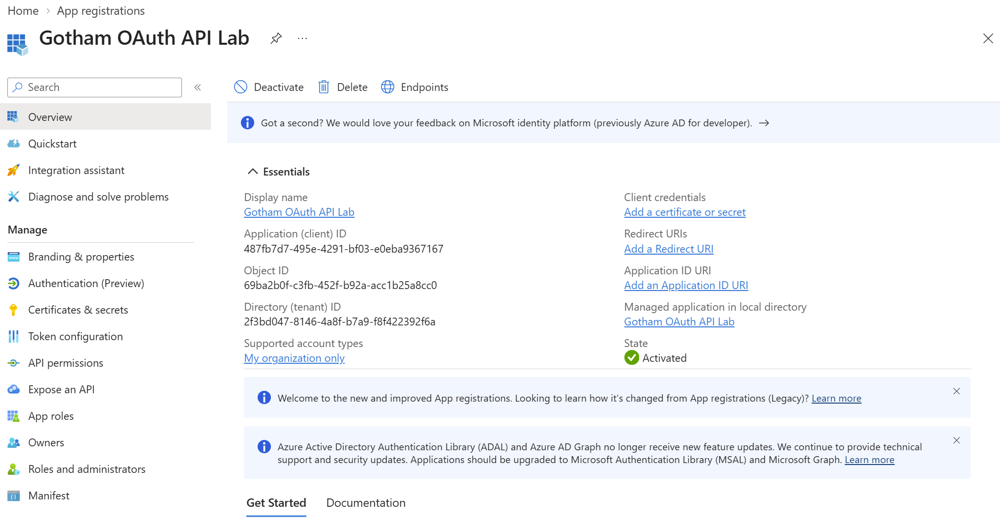
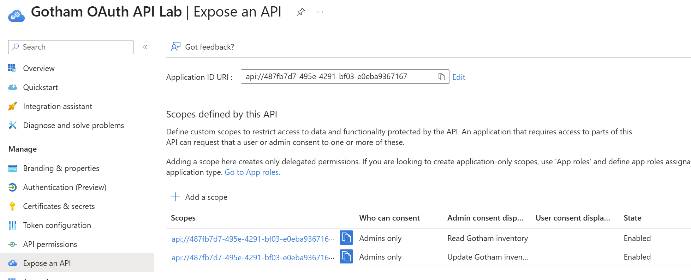
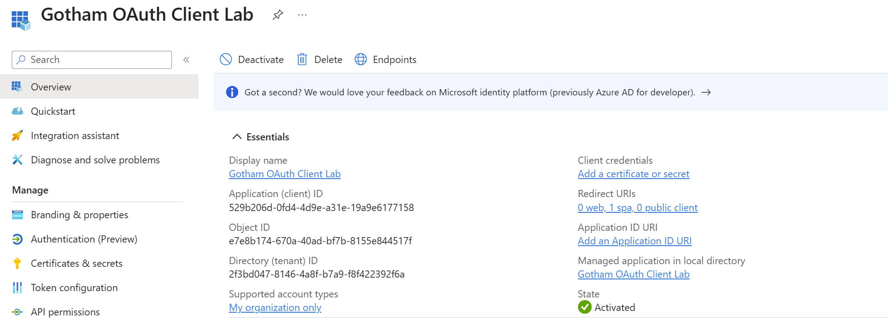

## Live Test Results

I captured all six API outcomes below during the live Entra-backed exercise. The timestamp column reproduces the API response in UTC; the browser history displays local Mountain Daylight Time (UTC−6).

| Test | HTTP | Observed result | UTC time |
|---|---|---|---|
| GET with read access token | **200** | Allowed; token validation passed; scp = Inventory.Read; quantity 10, updates 0 | 22:24:20.940414 |
| GET without bearer token | **401** | invalid_token; bearer access token required | 22:25:41.627383 |
| GET with altered token signature | **401** | invalid_token; token validation not passed | 22:26:43.222272 |
| GET using the client ID token | **401** | invalid_token; token validation not passed | 22:27:28.486043 |
| POST using the read-only access token | **403** | insufficient_scope; token validation passed; Inventory.Write required | 22:28:24.339398 |
| POST using a new read/write access token | **200** | Allowed; scp = Inventory.Read Inventory.Write; quantity 11, updates 1 | 22:43:49.530706 |

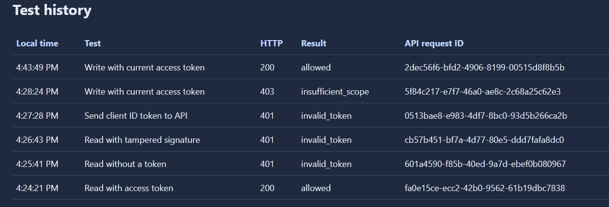

## Establish Read-Only Access

I began with administrator consent for **Inventory.Read only** on the client. I acquired that scope through the application while signed in as Dick Grayson and reported `fromCache: false`. That value describes MSAL token acquisition; it does not prove a fresh password or MFA challenge.

The read endpoint returned HTTP 200 with token validation passed. Server-verified claims included version 2.0, the tenant v2 issuer, the API's client ID as `aud`, the SPA's client ID as `azp`, the expected tenant, and `scp: Inventory.Read`. The returned fictional inventory started at quantity 10 with zero updates.

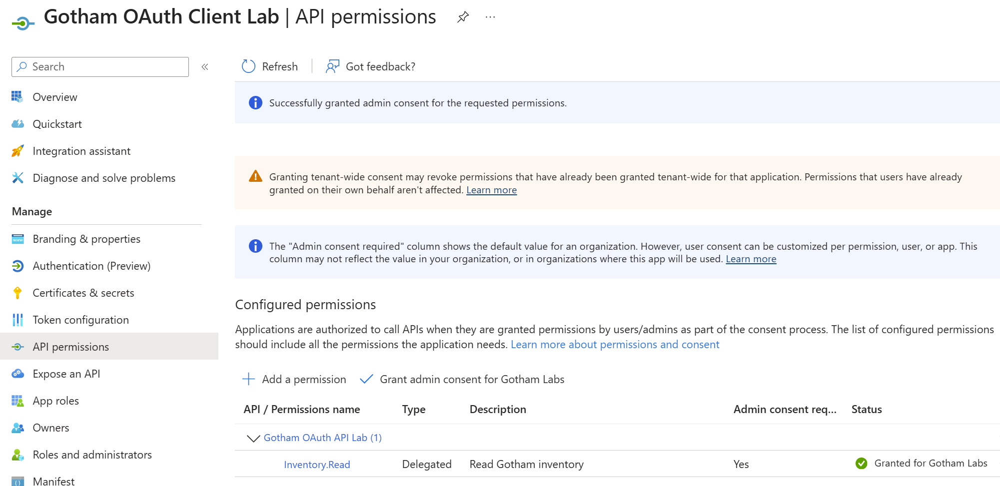
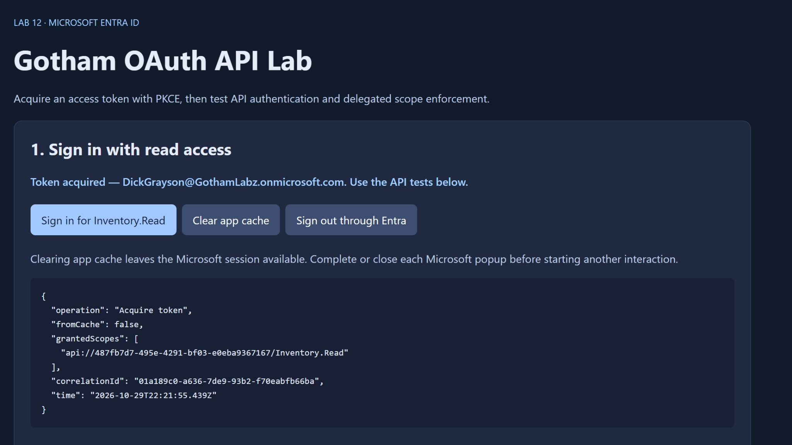
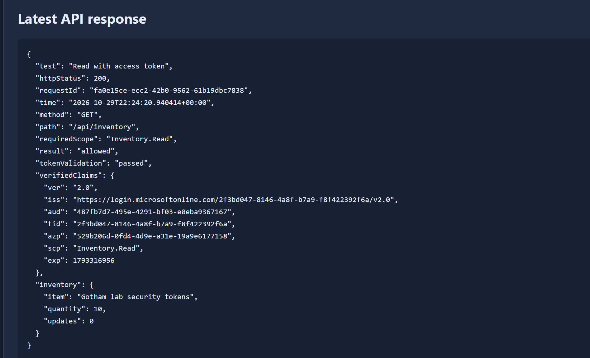

## Reject Missing and Invalid Tokens — 401

I tested three negative requests, all of which were rejected:

- **Missing token:** the request omitted the Authorization bearer header. The API returned 401 with a bearer-token-required message.
- **Tampered signature:** the test button changed a character in a copy of the access token's signature. The API returned 401; the application retained the unmodified valid token.
- **Client ID token:** the test sent the SPA's ID token to the API. The API returned 401. The client ID token targets the SPA, while the API expects its own audience and access-token claims. The public error intentionally combines validation failures rather than identifying a single failed check.

These are authentication failures at the API. An ID token cannot substitute for the API's access token.

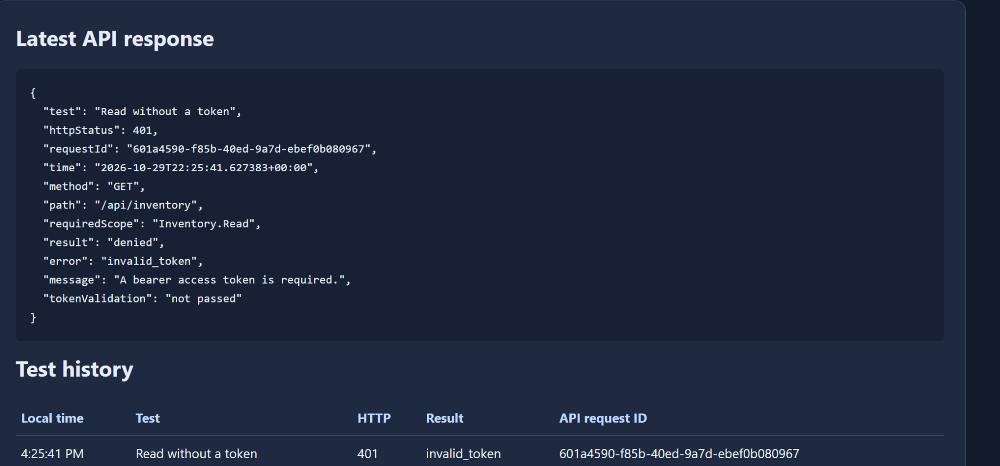
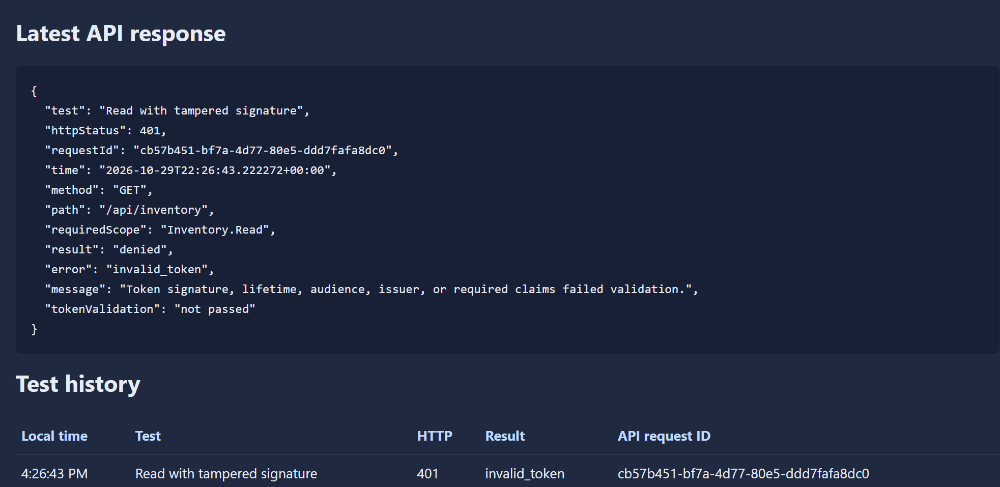
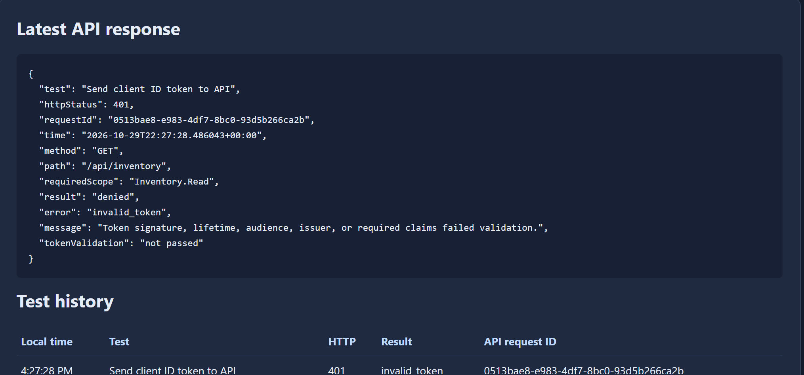

## Enforce Least Privilege — 403

I ran the write test with the same current access token without requesting another permission. Its signature and required token claims passed validation, but `scp` contained only Inventory.Read. The API required Inventory.Write and returned **403 insufficient_scope**.

The response explicitly showed **tokenValidation: passed**. This separates a valid token with insufficient authorization from the invalid-token 401 cases. The denied operation did not increment inventory; the subsequent first allowed update produced quantity 11 and updates 1.

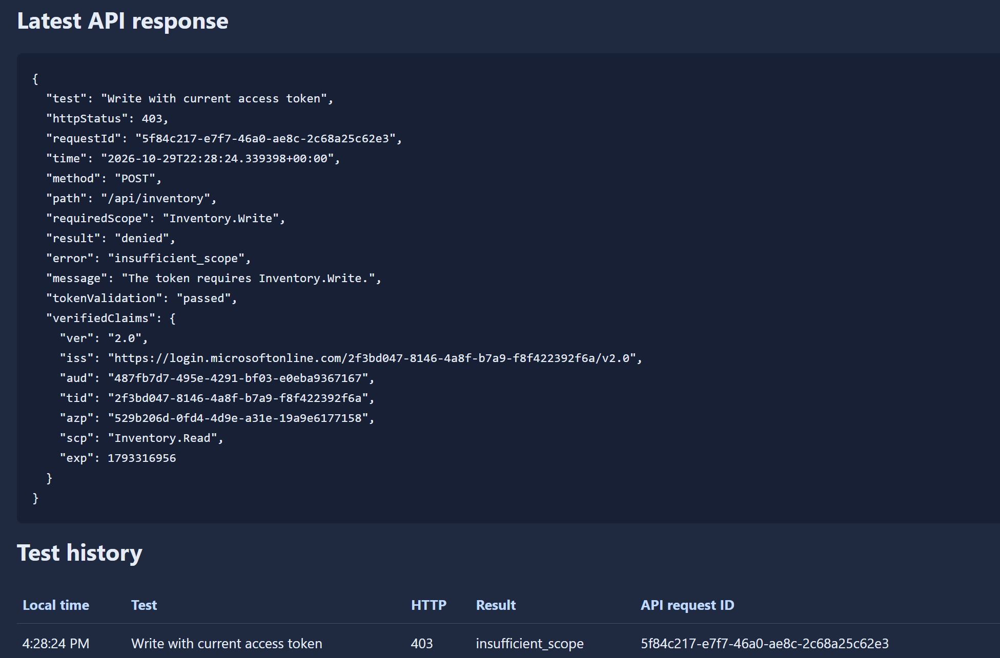

## Grant Write Consent and Verify Recovery — 200

I added the API's delegated Inventory.Write permission to the client registration and granted administrator consent. Both Inventory.Read and Inventory.Write then showed **Granted for Gotham Labs**. The consent dialog offered to retain other existing grants; I kept them. The published API screenshot establishes the two custom API permissions and does not inventory any rows outside the captured view.

Granting consent did not rewrite the token already held by the app. I used the app's **Request read + write token** action to acquire a token for both scopes. A repeated write returned HTTP 200 with `scp: Inventory.Read Inventory.Write`, quantity **11**, and updates **1**.

An intermediate screenshot still showed the original 22:28:24 response and identical request ID; I recognized it as the earlier result and did not treat it as a new failed write after consent. The final response has a new timestamp and request ID.

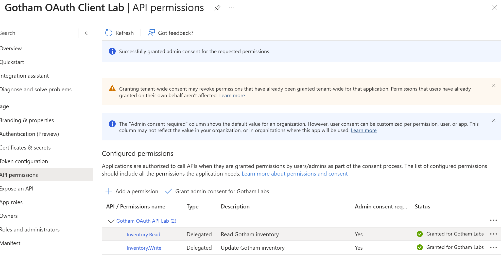
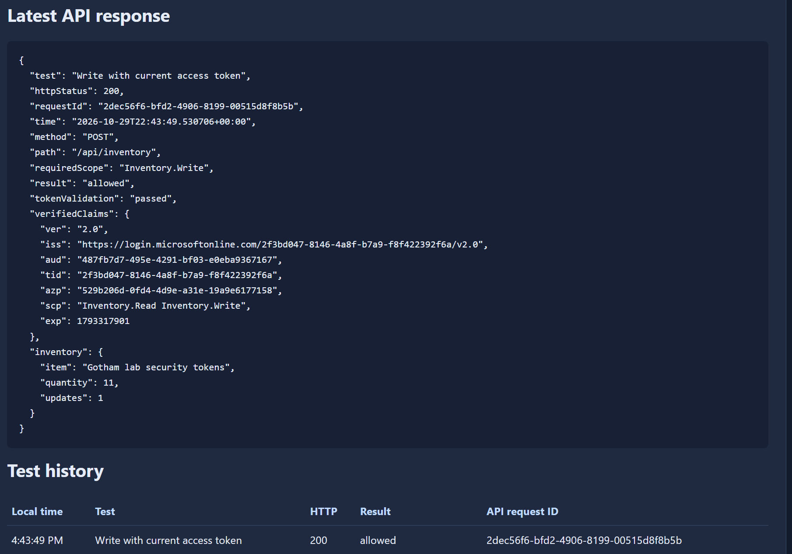

## Validation Implemented by the API

The Python API performs server-side cryptographic validation; it does not rely on browser claim decoding or the Lab 11 teaching comparisons.

| Layer | Implemented checks |
|---|---|
| Signing keys | Fixed tenant-specific HTTPS JWKS URL; cached public keys; signing-key issuer checked when supplied; token-supplied key URLs are not followed |
| Token authentication | RS256 signature; exact issuer and API audience; exp, nbf, iat; required claims; expected tenant and v2 token format |
| Caller authorization | Expected SPA client ID in azp |
| Delegated permission | Exact scope membership in the space-delimited scp claim; GET requires Inventory.Read, POST requires Inventory.Write |
| Error handling | Invalid/missing token 401; valid token without required authorization 403; unavailable signing-key retrieval 503 |

The API returns only selected validated claims. Raw access tokens, ID tokens, authorization codes, and code verifiers are not displayed or written to application logs. The SPA stores MSAL state in session storage and holds the current API test token in memory. The server limits static-file exposure, checks Host and browser Origin, disables response caching, and binds to localhost.

The write action increments only fictional in-memory data. Restarting the server resets it. Python's built-in HTTP server is used for local teaching; this is not a production API service or security certification.

## Request Correlation

| Live test | Local API request ID |
|---|---|
| Read 200 | `fa0e15ce-ecc2-42b0-9562-61b19dbc7838` |
| Missing token 401 | `601a4590-f85b-40ed-9a7d-ebef0b080967` |
| Tampered signature 401 | `cb57b451-bf7a-4d77-80e5-ddd7fafa8dc0` |
| Client ID token 401 | `0513bae8-e983-4df7-8bc0-93d5b266ca2b` |
| Read-only write 403 | `5f84c217-e7f7-46a0-ae8c-2c68a25c62e3` |
| Authorized write 200 | `2dec56f6-bfd2-4906-8199-00515d8f8b5b` |

These IDs correlate this application's API responses with its test history. They are not Entra sign-in correlation IDs. The initial token-acquisition operation had MSAL correlation ID `01a189c0-a636-7de9-93b2-f70eabfb66ba`; I did not collect a matching Entra sign-in-log event in Lab 12.

## Evidence Limits and Final State

- The six HTTP outcomes are live results backed by the screenshots above.
- Twenty offline regression tests passed using disposable fixture RSA keys. They cover validation and authorization branches, including expired tokens and wrong issuer/tenant/client. These are implementation checks, separate from live tenant evidence.
- The MSAL implementation uses Authorization Code with PKCE. I did not collect a separate Lab 12 network capture of the challenge or token exchange; the Lab 11 protocol capture is not presented as Lab 12 evidence.
- I did not verify a fresh MFA challenge, live expired-token rejection, consent revocation, or immediate invalidation of previously issued tokens in Lab 12.
- I signed out through Entra and stopped the local server. I did not collect a separate logout screenshot or sign-in-after-logout test for this lab.
- I retained both app registrations and the consent configuration for reproducibility. I did not report registration deletion or permission cleanup.

## Run the Application

The [app directory](app/) contains source, prebuilt MSAL bundles, pinned direct dependencies, licenses, regression tests, and a Windows launcher. Python 3.11 or newer is required; first launch installs Python packages into a local virtual environment. Internet access is also needed to retrieve Entra signing keys. Node.js is required only to rebuild browser bundles.

1. Stop any Lab 11 server using port 3000.
2. Download or clone the app files into a local folder.
3. Configure your own tenant/API/client IDs in `server.py` and `src/app.js` if reproducing in another tenant; rebuild browser assets after changing JavaScript source.
4. Register `http://localhost:3000/` as a SPA redirect and expose the exact API scopes.
5. Begin with Inventory.Read consent only to reproduce the 403 baseline.
6. Run `START-LAB.cmd` on Windows, or `python3 start_lab.py` on macOS/Linux.
7. Open `http://localhost:3000/lab.html` and follow the staged tests.
8. Stop the server with Ctrl+C after testing.

See [app instructions](app/README.md) for setup, the consent sequence, security boundaries, and troubleshooting. Never publish raw tokens, codes, verifiers, private keys, passwords, or full network exports.

## Additional Configuration Evidence

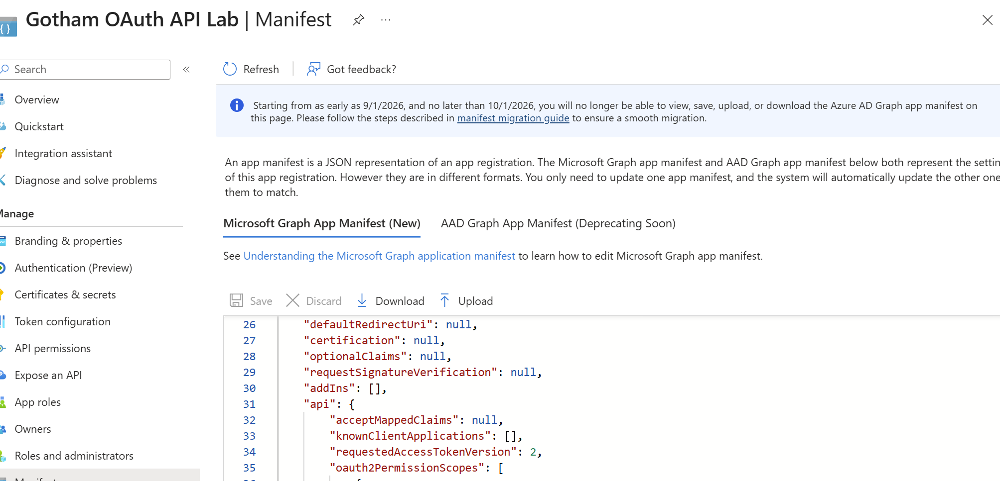
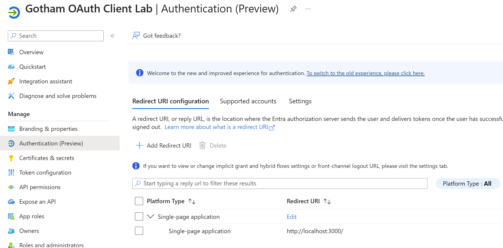
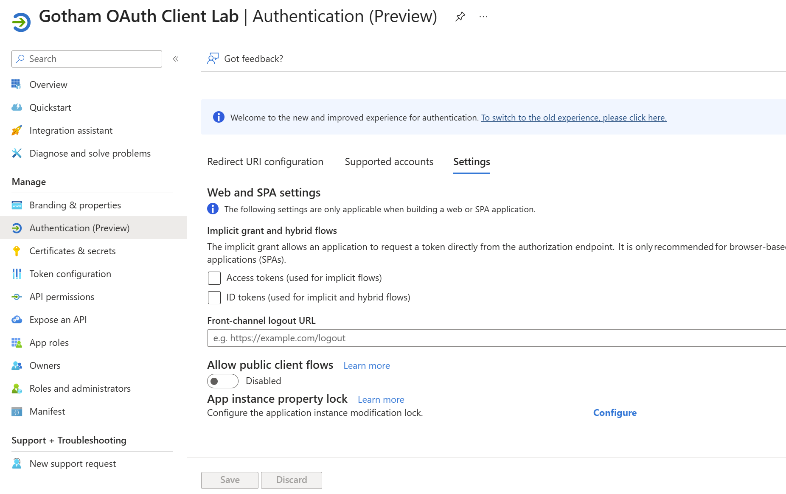

## Skills Demonstrated

- Separate client sign-in configuration from protected API registration and permissions.
- Expose delegated scopes and administer tenant consent using least privilege.
- Validate access tokens server-side and distinguish ID tokens from API access tokens.
- Diagnose 401 authentication failures versus 403 authorization failures.
- Verify access changes using a newly acquired token and compare before/after API results.
- Document evidence boundaries, request identifiers, cleanup, and retained configuration.

## References

- [Configure access to web APIs](https://learn.microsoft.com/en-us/entra/identity-platform/quickstart-configure-app-access-web-apis)
- [Access tokens](https://learn.microsoft.com/en-us/entra/identity-platform/access-tokens)
- [Validate token claims](https://learn.microsoft.com/en-us/entra/identity-platform/claims-validation)
- [PyJWT usage](https://pyjwt.readthedocs.io/en/stable/usage.html)

[Return to portfolio](../../README.MD)
