# Lab 13 — Software OATH-TOTP Registration and Recovery

I registered a separate software OATH time-based one-time password (TOTP) method for Selina Kyle, tested successful and unsuccessful verification codes, deleted the registration as an administrator, and verified that its old code was rejected. I then registered a replacement and successfully signed in with its new code while preserving the existing Microsoft Authenticator push registration.

I performed all administration and testing myself, using my administrator account for configuration and Selina's fictional employee account for user sign-in tests.

**Environment:** personal GothamLabz Microsoft Entra ID P2 tenant · **Test date:** October 30, 2026. P2 describes my lab environment; this exercise does not establish that software OATH requires P2. This is personal lab work, not a production recovery incident.

## Configuration and Starting State

| Setting | Recorded value |
|---|---|
| Tenant | `GothamLabz.onmicrosoft.com` |
| Test identity | `SelinaKyle@GothamLabz.onmicrosoft.com` |
| Software OATH policy | Enabled; All users; Registration Optional |
| Existing method | Microsoft Authenticator push MFA on Pixel 10 Pro XL |
| Default notification method | Microsoft Authenticator notification |
| Code generator | Microsoft Authenticator, using a separate Other account entry |
| Test application | My Apps (`https://myapps.microsoft.com`) |

I inspected the existing Software OATH policy and left it unchanged. Selina initially had a password and Microsoft Authenticator push registration. I retained the push method throughout the registration, deletion, and replacement tests.

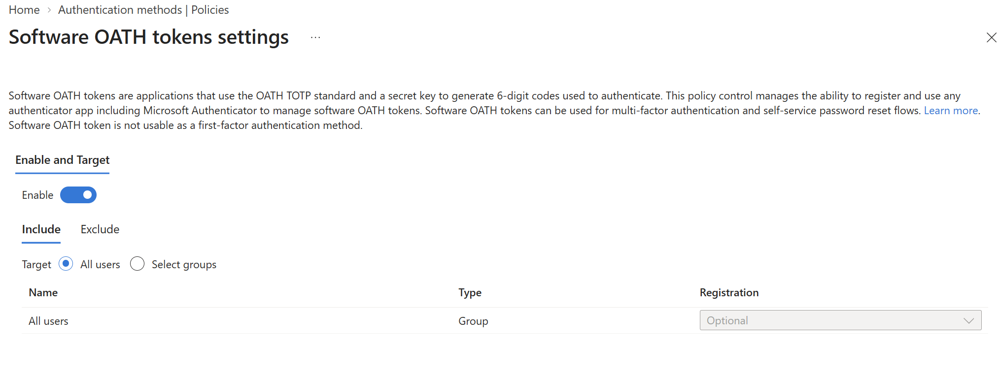
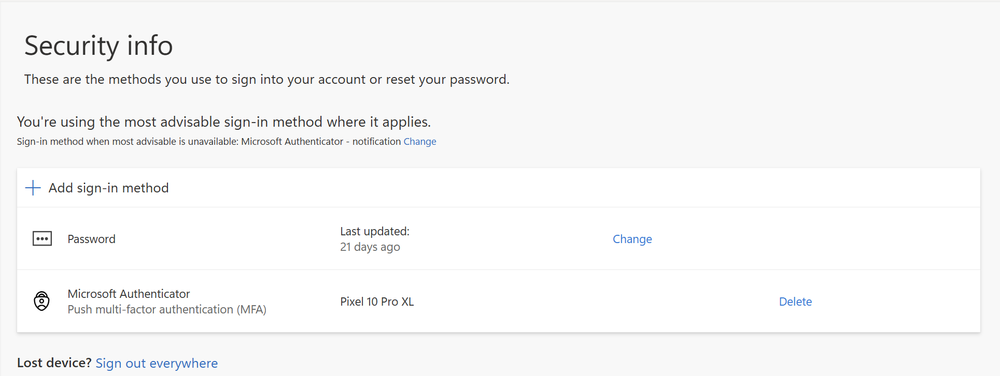

## Register a Separate TOTP Method

In Selina's Security info, I selected **Add sign-in method → Microsoft Authenticator → I want to use a different authenticator app**. In Microsoft Authenticator on my phone, I added an **Other account**, scanned the setup QR code, and entered its current six-digit code to complete registration.

Security info then listed **Authenticator app — Time-based one-time password (TOTP)** separately from **Microsoft Authenticator — Push multi-factor authentication (MFA)**. In the administrator view, I verified that both Software OATH token and Microsoft Authenticator were usable methods.

The original Software OATH registration ID was `f34a5577-3135-4919-bc97-92be2e635979`. This is a registration identifier, not the token's secret seed.

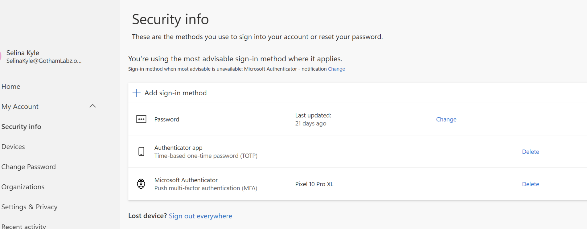
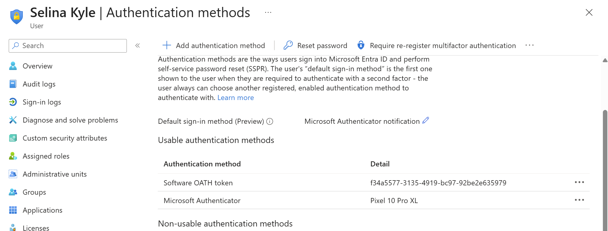

## Test Verification Codes

I used new Incognito sessions for sign-in tests. The initial prompt offered Microsoft Authenticator push. I selected **I can't use my Microsoft Authenticator app right now**, then **Use a verification code**, and entered the code from the separate TOTP entry. I successfully accessed My Apps.

For the negative test, I entered one deliberately incorrect code. Entra displayed **“You didn't enter the expected verification code. Please try again.”** I then entered the correct current code and successfully signed in.

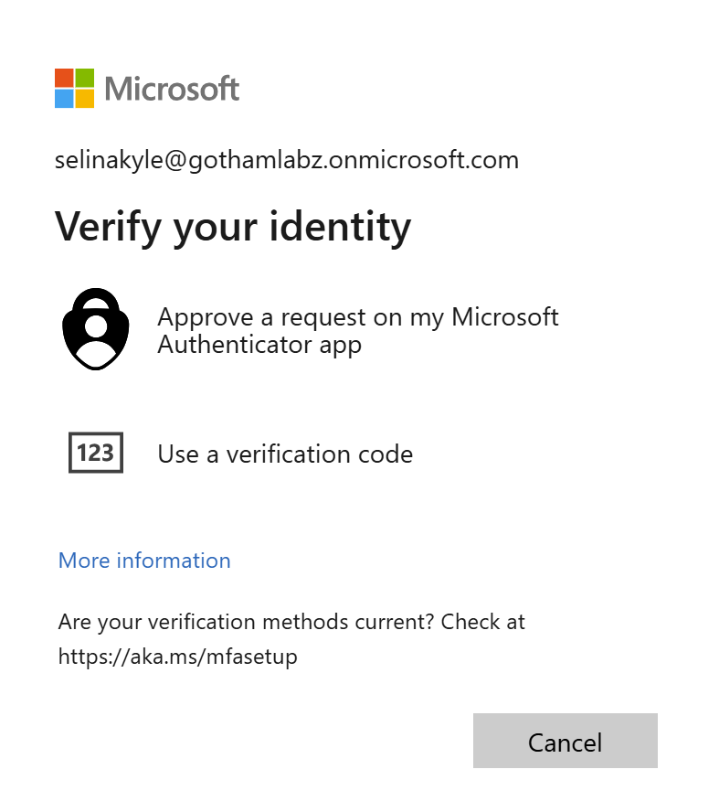
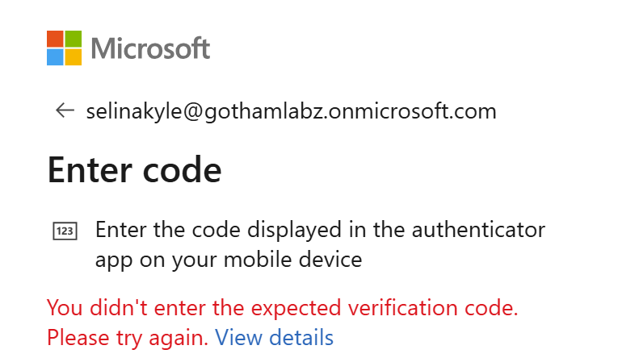

## Review the Sign-in Logs

I reviewed Selina's interactive sign-in logs. The captured My Apps event at **09:12:32 local time** showed **Success**, and the list also included successful Azure Portal and Microsoft Account Controls V2 events. The detail pages recorded **MFA requirement satisfied by claim in the token**; the captured Authentication Details row showed **Previously satisfied**.

These logs establish successful sign-in records and existing-claim satisfaction for the captured events. They do not independently identify a fresh software OATH challenge. I observed successful access after entering TOTP codes during testing, but I did not obtain a log entry explicitly showing the software OATH method for those challenges.

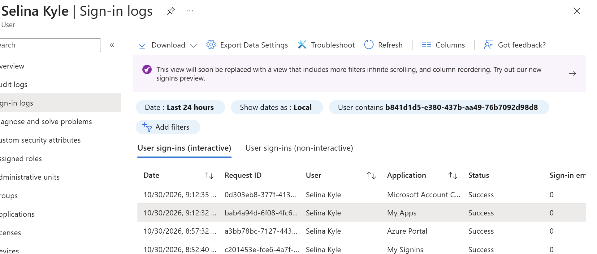
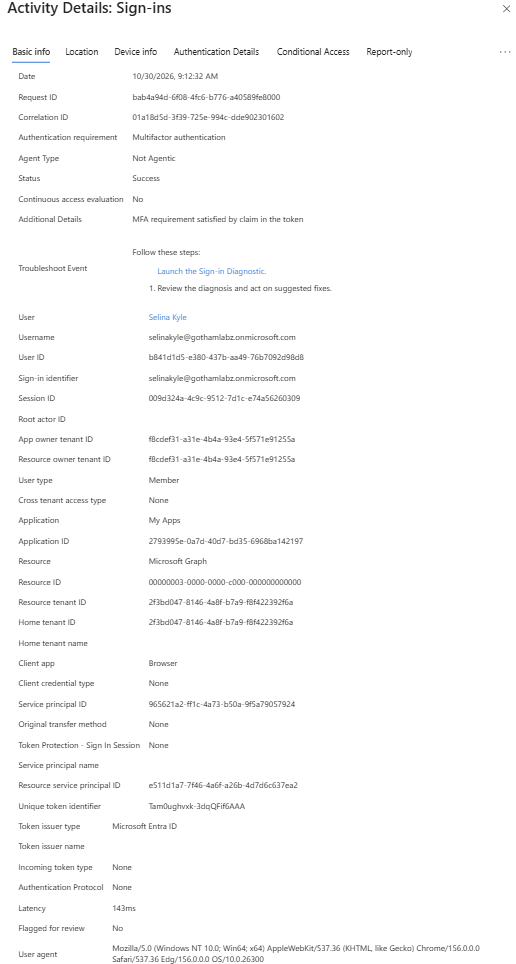
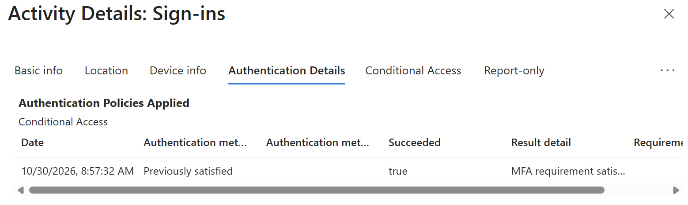

## Delete the Registration and Test Its Old Code

From **Selina Kyle → Authentication methods**, I deleted only the **Software OATH token** and confirmed the deletion. The administrator list then showed Microsoft Authenticator on Pixel 10 Pro XL as the remaining usable method.

I temporarily retained the old TOTP entry on my phone. In a new sign-in attempt, I submitted a current code from that old entry. Entra rejected it with the verification-code error shown below. The phone could still generate codes, but the deleted registration no longer authenticated successfully in this test.

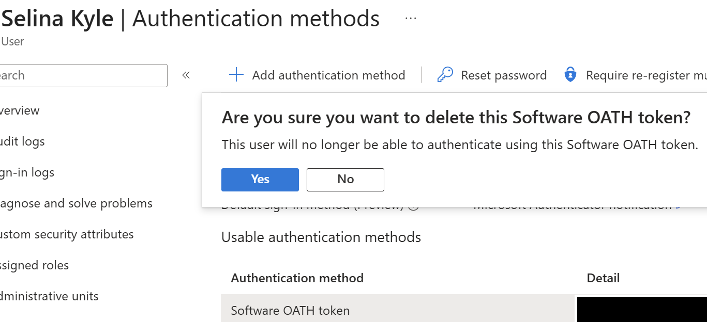
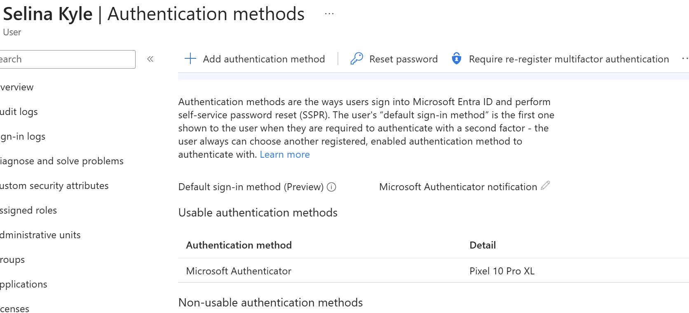
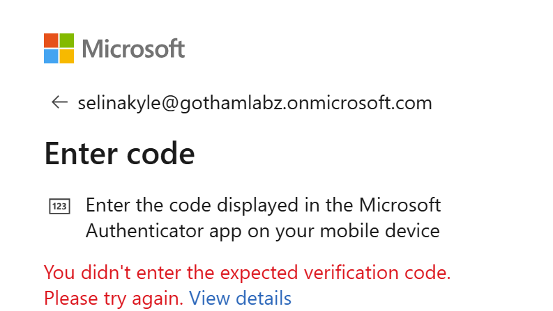

## Register and Validate the Replacement

I returned to Selina's Security info and registered a replacement TOTP method through the different-authenticator-app flow. The resulting list again showed both the separate **Authenticator app (TOTP)** and the existing **Microsoft Authenticator push** method.

I tested the replacement in a new sign-in session using **Use a verification code**. The new TOTP code worked, and I successfully logged in. This final sign-in outcome is my recorded observation; I did not capture a separate success page or fresh OATH-specific Authentication Details row.

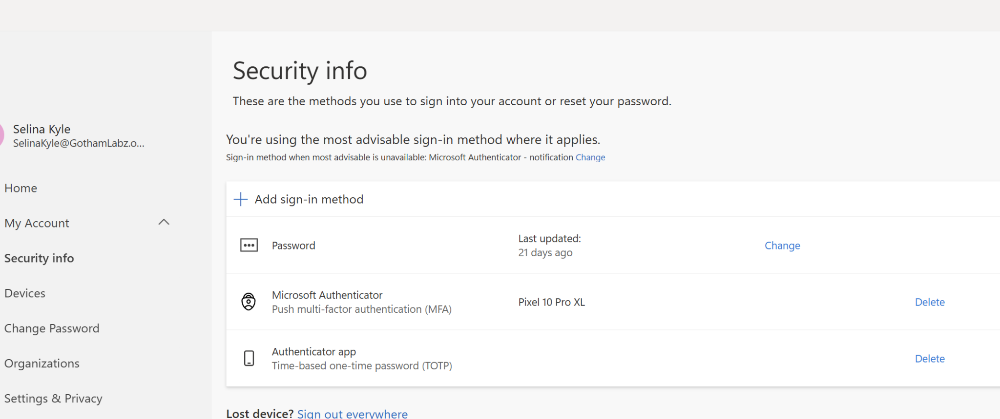

## Results

| Test | Outcome | Evidence |
|---|---|---|
| Register separate software OATH method | Completed; TOTP and push listed separately | User and administrator screenshots |
| Sign in with original valid TOTP | My Apps access succeeded | My observed result; captured logs do not independently identify the code challenge |
| Enter incorrect code | Rejected | Error screenshot |
| Retry with correct code | Sign-in succeeded | My observed result |
| Delete Software OATH registration | Removed; push retained | Administrator screenshots |
| Use old code after deletion | Rejected | Error screenshot following deletion |
| Register replacement TOTP | Completed; push retained | Final Security info screenshot |
| Sign in with replacement code | Successful | My observed result |

## Final State and Evidence Limits

- I retained the replacement TOTP registration and Microsoft Authenticator push. The Software OATH policy remained enabled for All users with registration Optional.
- My last confirmed test was successful sign-in using the replacement code. Removal of the old phone entry and final test-session sign-out were recommended but are not recorded as completed.
- I did not capture the replacement registration ID or registration/deletion audit events.
- This exercise tested registration removal against a subsequent code challenge. I did not test revocation of existing application sessions or previously issued access tokens.
- Both methods used the same phone. This demonstrates recovery while another registered method remains available; it does not demonstrate recovery after losing that phone or every authentication method.
- I excluded QR codes, setup secrets, passwords, and verification-code values from the published evidence.

## Skills Practiced

- Inspect authentication-method policy scope without changing an existing tenant policy.
- Distinguish a separate software OATH registration from Microsoft Authenticator push.
- Test valid, incorrect, and deleted-registration codes.
- Remove a specific authentication method while preserving another usable method.
- Register and validate a replacement method.
- Separate observed sign-in behavior from what the captured logs independently prove.

## References

- [Microsoft Learn: OATH tokens](https://learn.microsoft.com/en-us/entra/identity/authentication/concept-authentication-oath-tokens)
- [Microsoft Learn: Microsoft Authenticator](https://learn.microsoft.com/en-us/entra/identity/authentication/concept-authentication-authenticator-app)
- [Microsoft Learn: Manage user authentication methods](https://learn.microsoft.com/en-us/entra/identity/authentication/howto-mfa-userdevicesettings)

[Return to portfolio](../../README.MD)
