# Lab 14 — Entitlement Management: Approval-Based Temporary Application Access

**Date completed:** October 30, 2026  
**Environment:** GothamLabz.onmicrosoft.com — Microsoft Entra ID P2 free trial  
**Application:** Gotham Access Lab  
**Test account:** Tim Drake

## Outcome

I created an access package that let Tim Drake request one hour of Procurement Reader access to Gotham Access Lab. I verified that submitting a request did not grant access, approved the request through my administrator account, and validated the resulting application role and authorization. After the assignment expired, I confirmed that the direct application assignment disappeared and a fresh sign-in was denied with `AADSTS50105`.

I performed all configuration and testing myself. I used Tim's fictional account as the requester and my Phillip McQuinn administrator account as the approver in separate browser sessions. This demonstrated the configured approval workflow; it did not involve an independent human reviewer.

## Scenario

I used a temporary procurement task to test governed application access from request through expiry. I reused the existing Gotham Access Lab enterprise application and local Flask application from [Lab 08](../08-enterprise-application-integration/README.md). I added its application role directly to the access package, rather than granting group membership through the package.

## Configuration

| Setting | Configuration I used |
|---|---|
| Catalog | Gotham Application Access |
| Catalog enabled | Yes |
| Catalog enabled for external users | No |
| Access package | Gotham Procurement Reader - Temporary Access |
| Resource | Gotham Access Lab — Application |
| Resource role | Procurement Reader (`Procurement.Reader`) |
| Eligible requester scope | Specific users and groups: Tim Drake |
| Self-service requests | Enabled; administrator assignment remained available |
| Requestor justification | Required |
| Approval | One stage; specific approver Phillip McQuinn |
| Approval deadline | One day |
| Approver justification | Required |
| Assignment duration | One hour |
| User-selected timeline / extensions | Disabled |
| Access reviews | Not enabled for this package |
| Assignment emails | Not disabled |

## 1. I created the catalog and added the application

I created **Gotham Application Access** and configured it for internal users. I initially had external-user availability enabled, then corrected it to **No** before continuing. I added Gotham Access Lab as an application resource and confirmed it was onboarded.

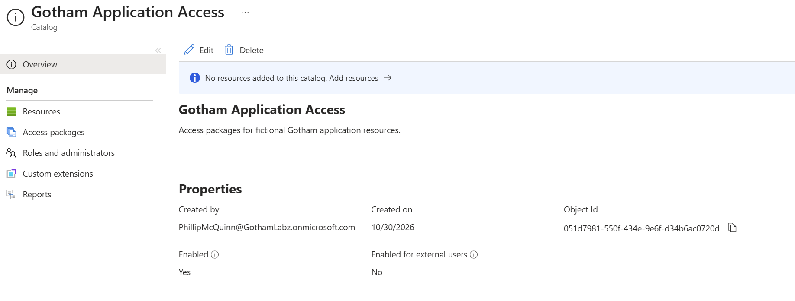

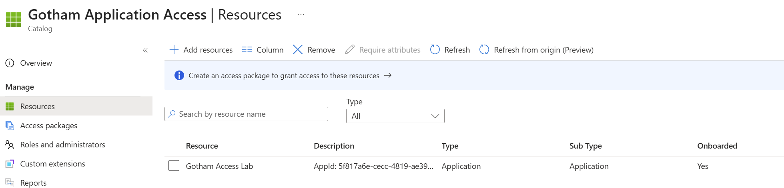

## 2. I configured the access package

I named the package **Gotham Procurement Reader - Temporary Access** and selected the application's **Procurement Reader** resource role.

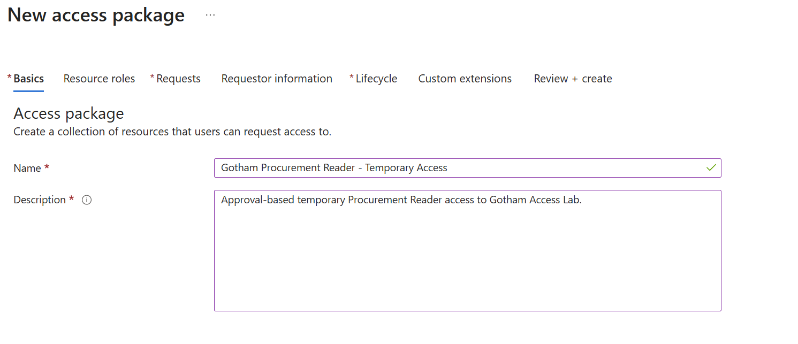

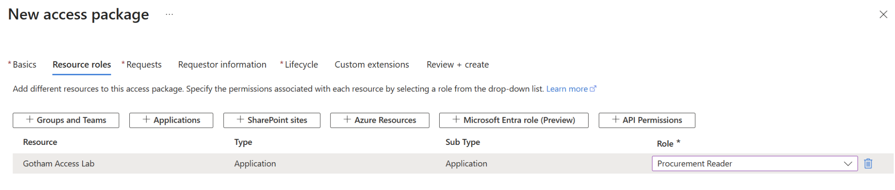

I scoped self-service requests to Tim Drake, required requestor justification, selected my administrator account as the single approver, and required an approval reason. I set the decision deadline to one day.

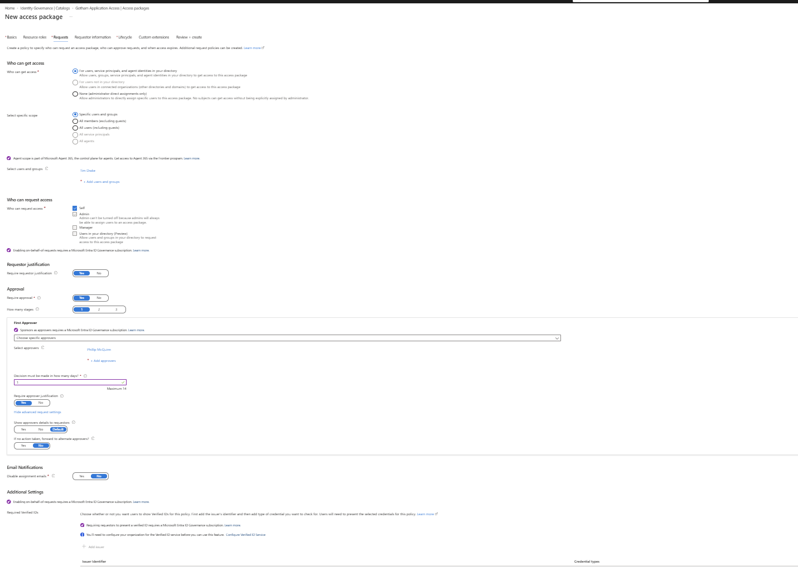

I initially selected one day on the Lifecycle page, then changed the assignment duration to **one hour**. I verified the final Review + create summary before creating the package. The one-day approval deadline and the one-hour assignment duration served different purposes.

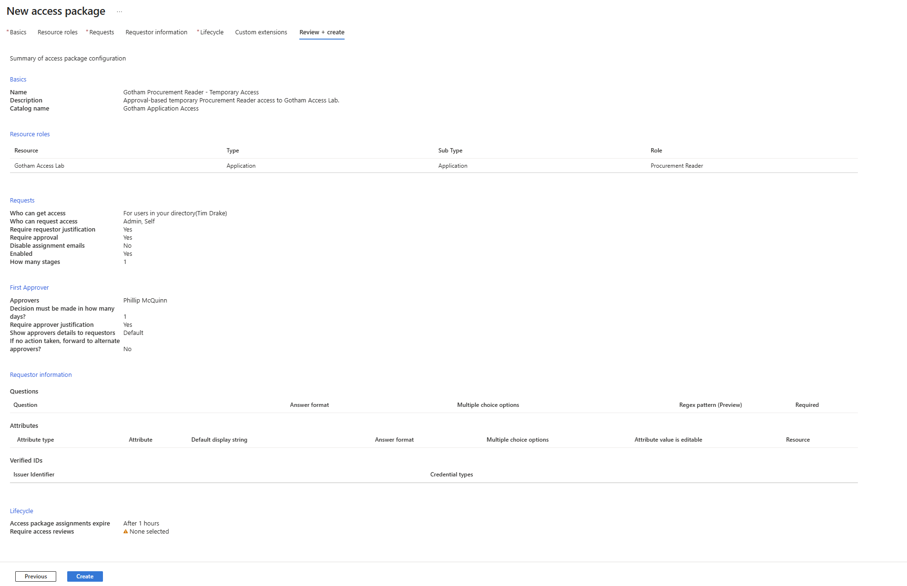

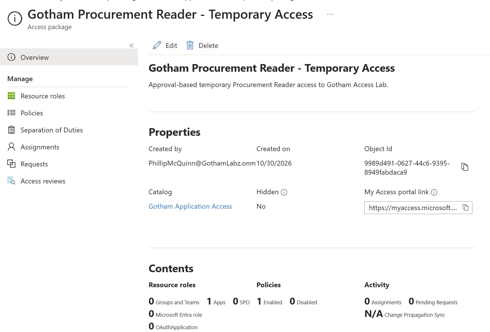

## 3. I verified the access baseline

Before Tim requested the package, I confirmed that the application had assignments for my administrator account and the existing IT and Procurement reader groups, with no direct assignment for Tim. His only listed group was `SG-CA-Lab-Users`; he belonged to neither application reader group.

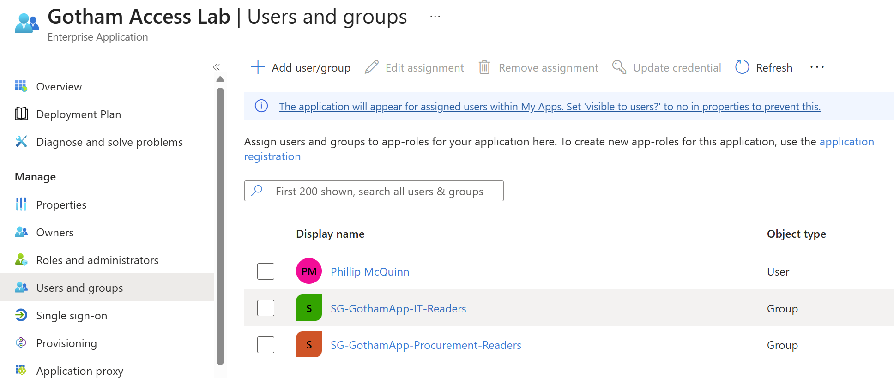

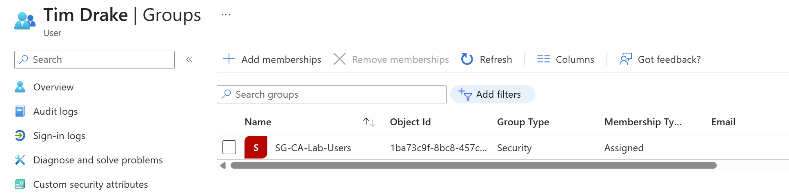

I restored the local Flask application, installed its dependencies, and configured its private `.env`. During startup I corrected the working directory and populated the required session secret and application credentials. I kept the configuration and secret values out of this repository.

Using Tim's account in an Incognito session, I attempted a fresh sign-in to `http://localhost:5000`. Entra denied the attempt with **AADSTS50105** because Tim had no qualifying application assignment.

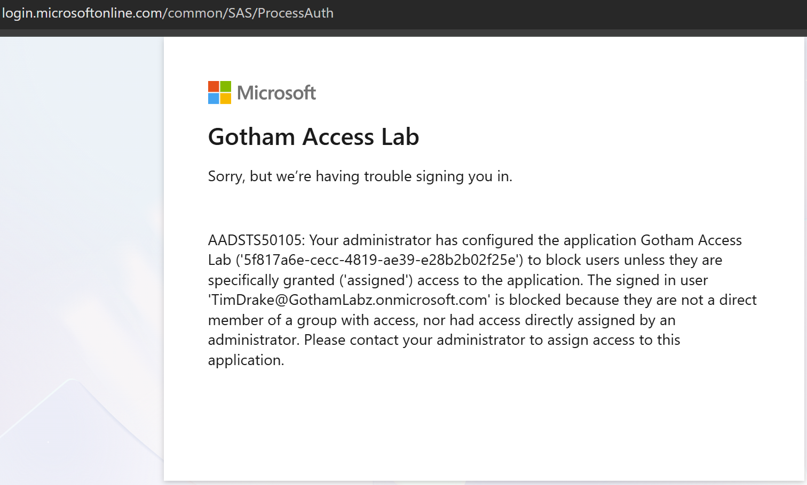

## 4. I submitted a self-service request and tested pending access

I opened the package's My Access portal link as Tim and confirmed that the package was available to him. I submitted a request and inspected Request history, which recorded **Pending approval** at **1:21 PM MDT on October 30, 2026**.

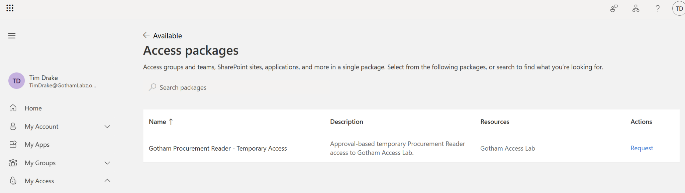

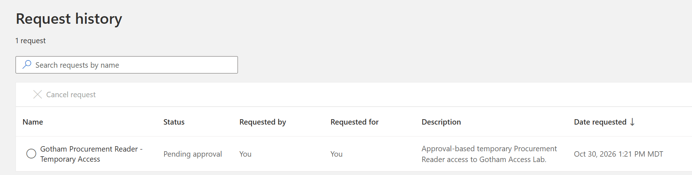

Before approving, I attempted application sign-in again as Tim. Entra still returned **AADSTS50105**. I verified that the pending request itself had not granted application access.

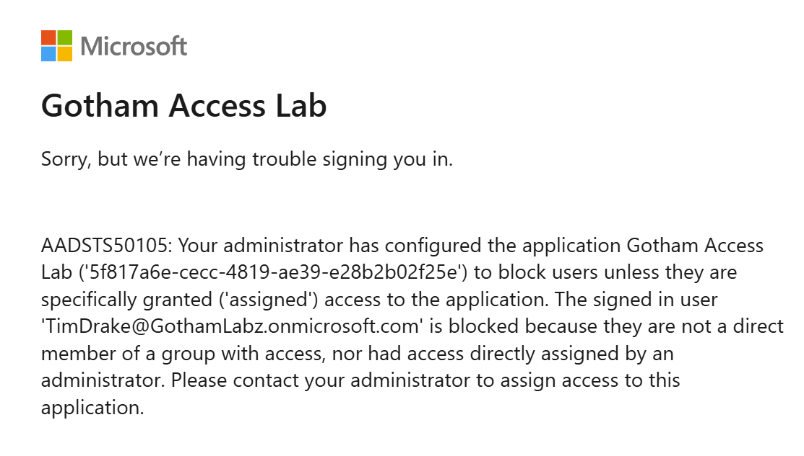

## 5. I approved the request and verified delivery

In my separate administrator session, I opened My Access approvals, selected **Approve**, and entered a reason for the one-hour procurement review. I submitted the decision and confirmed that the request showed **Approved**. The pending-list count had not yet refreshed in that screenshot, so I used the subsequent assignment state to verify delivery.

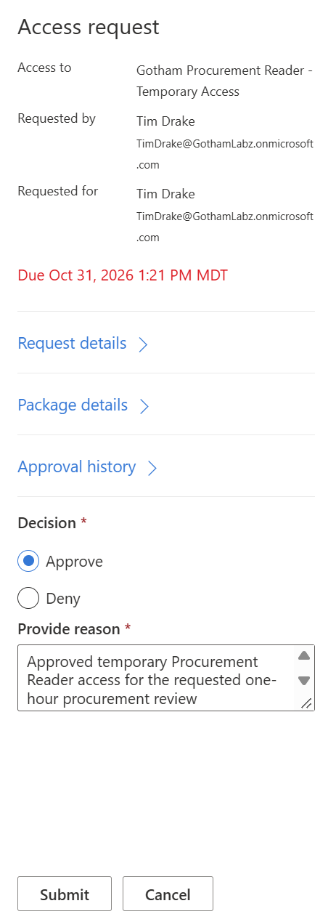

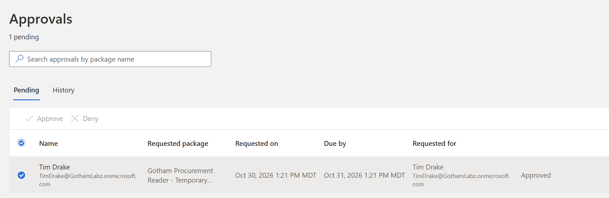

The access package assignment then showed **Delivered**, with an end time of **October 30, 2026, 2:28:50 PM** in my local MDT portal view. The captured assignment list did not display a start time, so I did not treat a calculated start time as separately verified evidence.

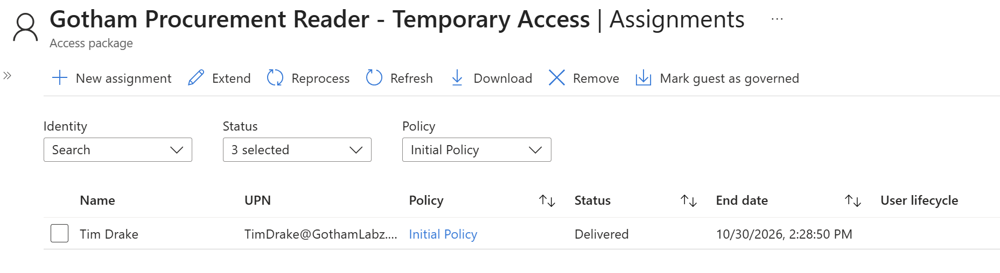

I refreshed the enterprise application's Users and groups page and confirmed that Tim now appeared as a direct user assignment. That screenshot did not show the role column; I verified the delivered role through the application's token-claim display and authorization tests next.

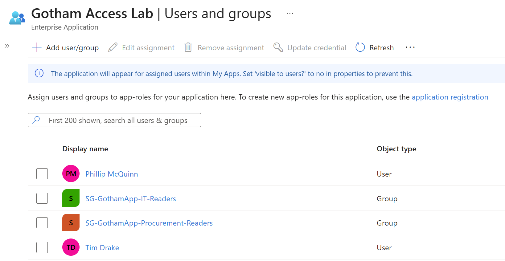

## 6. I tested the delivered role and least-privilege access

I signed in as Tim and inspected the application's identity page. It displayed only **Procurement.Reader** in the roles claim. I then tested both protected areas: IT Inventory returned **Forbidden** because Tim lacked `IT.Reader`, while Procurement reported **Procurement Reader access allowed**.

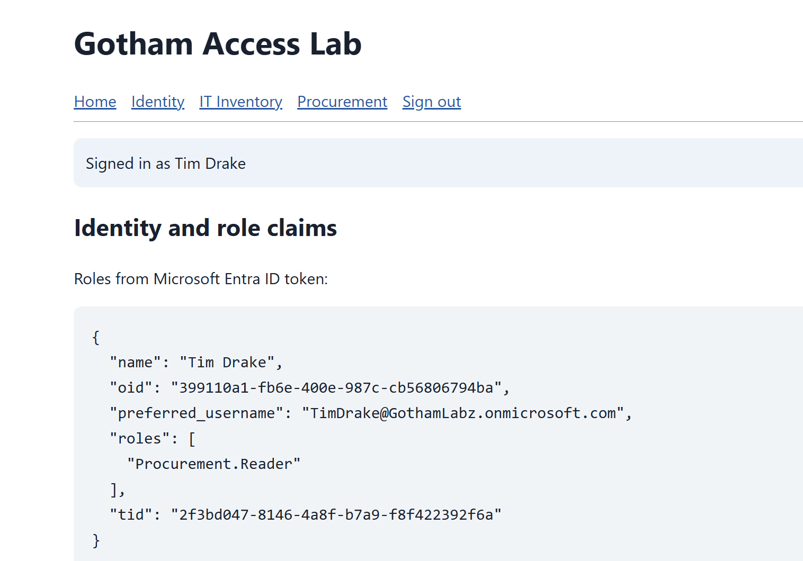

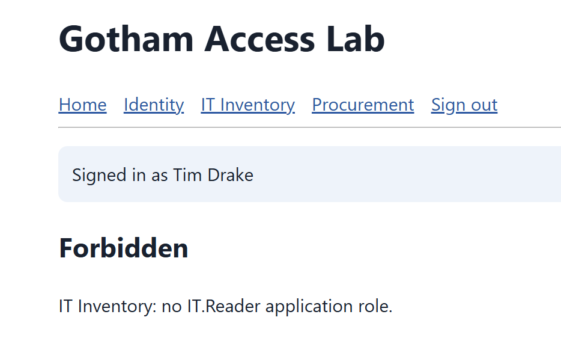

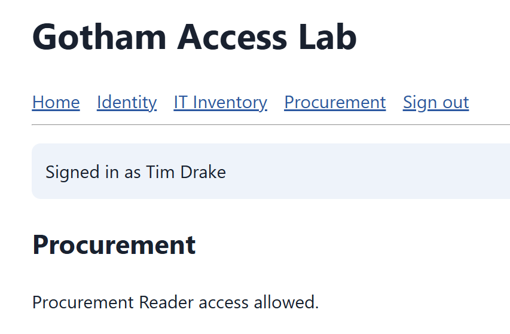

## 7. I verified automatic expiration and fresh-sign-in denial

I left the assignment unchanged and allowed its one-hour duration to expire. I observed roughly **four minutes before the Expired status appeared** after the scheduled end time. This was my observed portal-status delay; I did not measure the exact backend removal time or continuously test access during that interval.

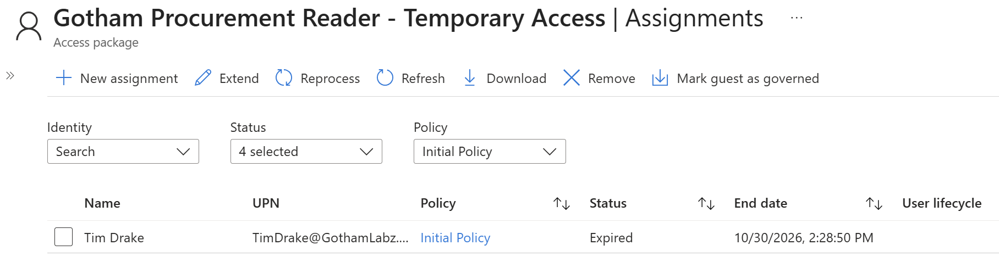

I refreshed the application's Users and groups page and confirmed that Tim's direct assignment was gone. My administrator assignment and the two original reader-group assignments remained.

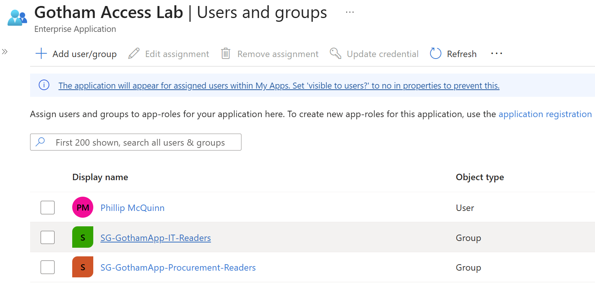

I closed the Incognito windows, opened a fresh one, and attempted another sign-in as Tim. Entra returned **AADSTS50105**, confirming that new access was denied after expiry and assignment removal. I then stopped the local Flask application.

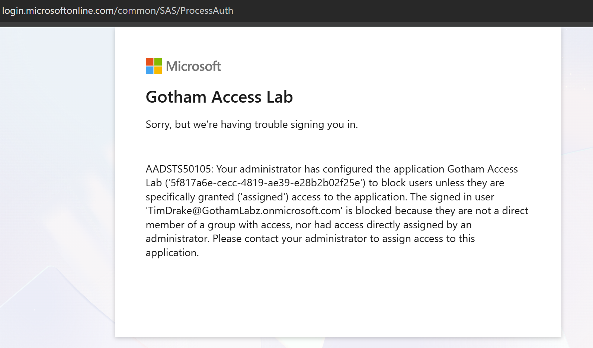

## Validation Matrix

| Test I performed | Observed result |
|---|---|
| Fresh sign-in before requesting access | AADSTS50105 — denied |
| Self-service package request | Pending approval |
| Sign-in while request was pending | AADSTS50105 — denied |
| Approver decision with justification | Approved |
| Package delivery | Delivered; end time 2:28:50 PM MDT |
| Application assignment after delivery | Tim appeared as a direct user assignment |
| Application roles claim | Procurement.Reader only |
| IT Inventory authorization | Forbidden; no IT.Reader role |
| Procurement authorization | Allowed |
| Automatic assignment expiry | Expired; roughly four-minute observed status delay |
| Application assignment after expiry | Tim no longer listed |
| Fresh sign-in after expiry | AADSTS50105 — denied |

## Final State and Evidence Limits

- I left the catalog and access package in place. Tim's temporary assignment expired and his direct application assignment was removed automatically.
- I did not add Tim to either application reader group or manually remove his package assignment to simulate expiry.
- I stopped the local Flask server after testing. The local `.env`, session secret, and client secret are private; deletion of the newly configured app credential was not recorded.
- I tested fresh sign-in denial after expiry. I did not test whether an already authenticated application session terminated automatically or whether existing tokens were revoked.
- I captured portal configuration, approval, assignment, role-claim, and application-result screenshots. I did not collect a separate entitlement-management audit-log export or correlated Entra sign-in-log entry for this lab.
- I did not test external requests, denial decisions, extensions, access reviews, or separation-of-duties policies in this exercise.

## What I Learned

I connected a self-service access request to a specific application role, enforced a justified approval decision, and verified both the granted permission and the permission Tim did not receive. I also distinguished approval from delivery, the approval deadline from assignment expiry, and portal expiration status from actual application access. The final fresh-sign-in test verified access removal beyond the package's status label.

## References

- [Create and manage catalogs](https://learn.microsoft.com/en-us/entra/id-governance/entitlement-management-catalog-create)
- [Create an access package](https://learn.microsoft.com/en-us/entra/id-governance/entitlement-management-access-package-create)

[Back to portfolio](../../README.md)
