# Lab 16 — PIM for Groups and Just-in-Time Application Access

**Date completed:** October 30, 2026  
**Environment:** GothamLabz.onmicrosoft.com — Microsoft Entra ID P2 free trial  
**Application:** Gotham Access Lab  
**Test account:** Tim Drake  
**Times below:** Mountain Daylight Time (MDT, UTC−6)

## Outcome

I used PIM for Groups to grant temporary Procurement Reader application access through an approval-controlled group membership. Tim could not sign in before activation or while approval was pending. After approval, his active group membership delivered only `Procurement.Reader`: Procurement allowed access and IT Inventory remained forbidden. When the one-hour activation expired, his membership disappeared and a fresh application sign-in failed with `AADSTS50105`.

I performed all administration, requesting, approving, and testing myself, using my administrator account and Tim's fictional account in separate browser sessions. This demonstrated the approval workflow with separate identities; it did not demonstrate review by an independent person.

## Scenario and Prerequisites

I reused the [Gotham Access Lab application from Lab 08](../08-enterprise-application-integration/app/README.md), including its private local `.env` configuration. The enterprise application requires assignment, and its protected pages check `IT.Reader` and `Procurement.Reader`.

[Lab 15](../15-dynamic-groups/README.md) already granted Tim department-based access through a dynamic group. I temporarily changed his Department to a nonmatching value so that this existing access path would not mask the PIM results. I retained the original assigned groups and the dynamic group-to-role assignments.

This exercise controlled membership of a dedicated security group. It did not activate an Entra directory administrator role or change my administrator accounts' permanent roles.

## 1. I created the group and configured PIM

I created the cloud security group **PIM-GothamApp-Procurement-Readers** with **Assigned** membership and the description “Approval-based temporary Procurement Reader access through PIM for Groups.” Its object ID was `642c23fd-62ee-4196-a2f0-01700833fe6b`. The initial overview showed zero direct members. I enabled management through PIM for Groups and configured its **Member** settings.

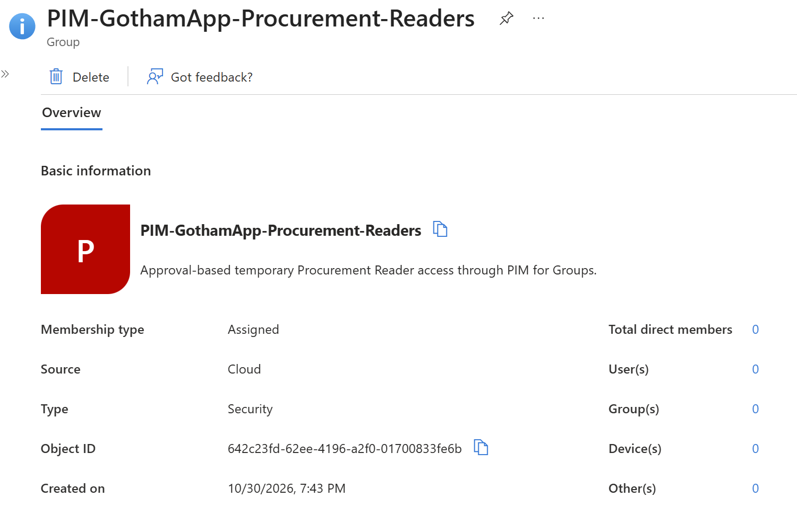

| Member activation setting I saved | Value |
|---|---|
| Maximum activation duration | 1 hour |
| Authentication requirement | Azure MFA |
| Require justification | Yes |
| Require ticket information | No |
| Require approval | Yes |
| Approver | Phillip McQuinn |
| Pre-approval / post-approval custom extensions | No / No |

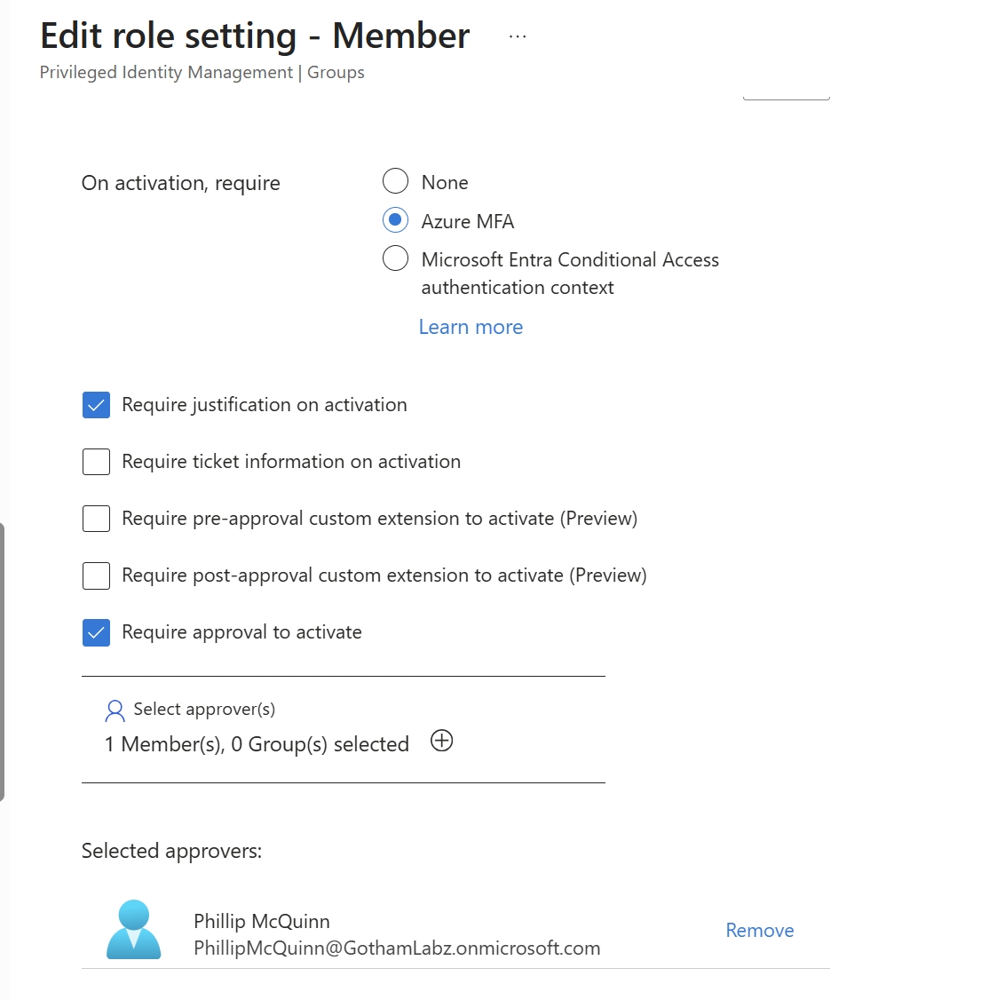

I disabled permanent eligible and permanent active Member assignments. The saved assignment-policy limits were one year for eligible assignments and six months for active assignments. Justification was required for an administrator-created active assignment; MFA on that assignment operation was not selected. These assignment limits were separate from the **one-hour activation maximum**.

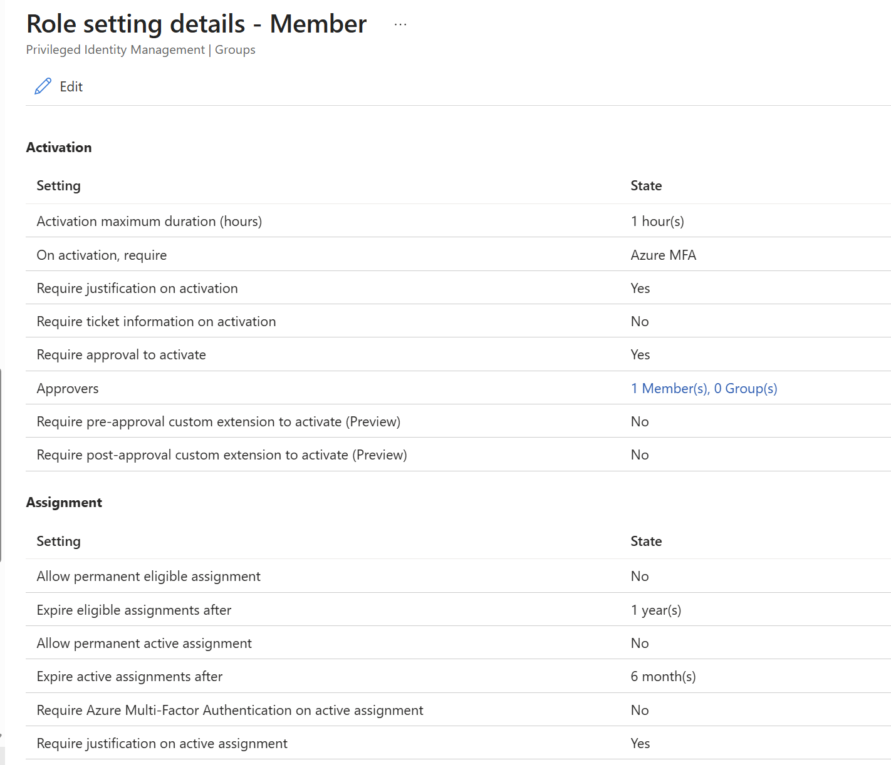

During editing, selecting Conditional Access authentication context without choosing a context produced a required-value error. I switched to **Azure MFA** and verified the saved settings above.

## 2. I connected the group to the application and assigned eligibility

In **Enterprise applications → Gotham Access Lab → Users and groups**, I assigned the PIM group to **Procurement Reader**, whose claim value is `Procurement.Reader`. I verified the role column rather than relying on the group name alone.

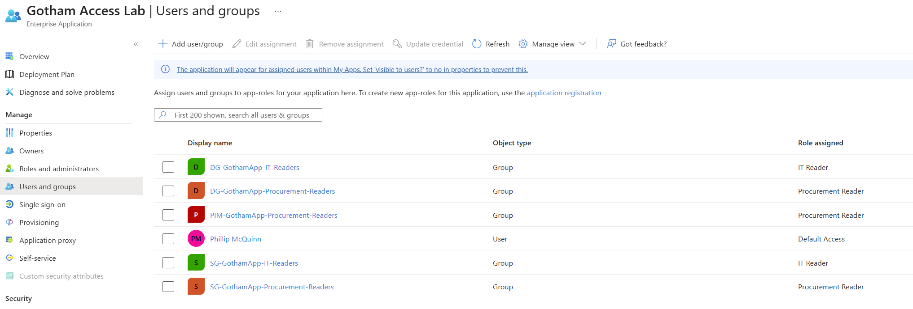

In **PIM → Groups → Assignments**, I added Tim as a direct **eligible Member**. His eligibility started October 30 at **8:04:17 PM** and ended October 31 at **8:03:00 PM**. Eligibility allowed him to request activation; it did not immediately make him an active group member.

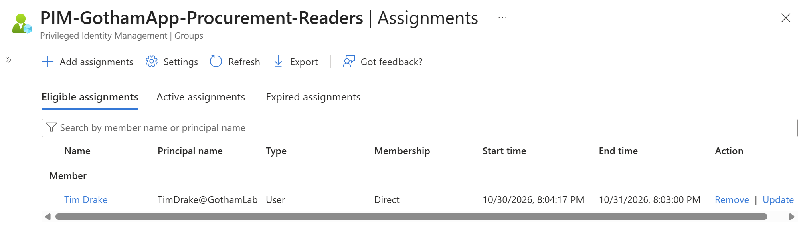

## 3. I isolated and tested the denied baseline

At **8:06 PM**, I changed Tim's Department from Procurement to **Lab-NoAccess**. I observed the Procurement dynamic group disappear within one minute. His group list then showed only `SG-CA-Lab-Users`, with neither a dynamic reader membership nor the PIM group.

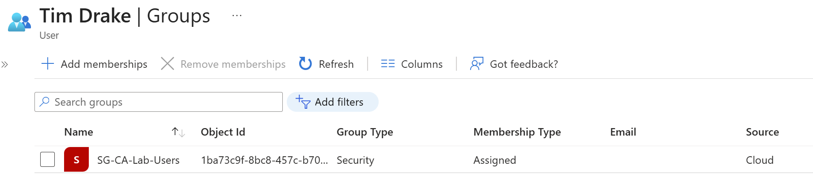

I started the local Flask application and attempted a fresh sign-in as Tim in Incognito. Entra denied sign-in with **AADSTS50105**, confirming he lacked an assigned application access path. I kept his account enabled and did not change Conditional Access policies for this test.

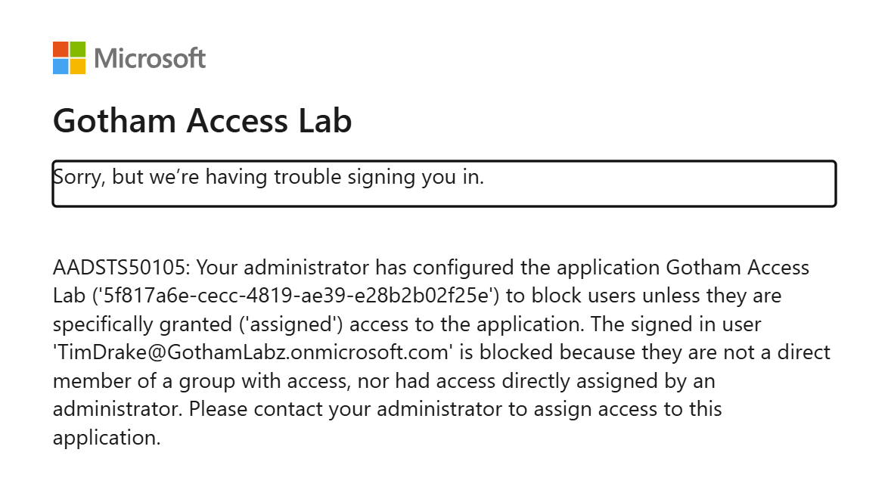

## 4. I requested activation and tested the approval gate

At **8:11:55 PM**, I requested a one-hour Member activation as Tim with the reason:

> Temporary Procurement Reader access to review procurement records for Lab 16.

The request appeared as **Member add — Pending approval**. I observed **no fresh MFA prompt** when submitting the request, despite Azure MFA being configured as an activation requirement. I did not collect a matching authentication log to establish why no new challenge appeared.

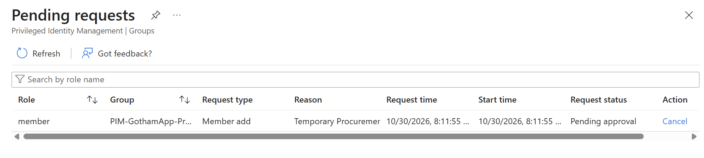

While approval was pending, I attempted another fresh application sign-in. It still failed with **AADSTS50105**.

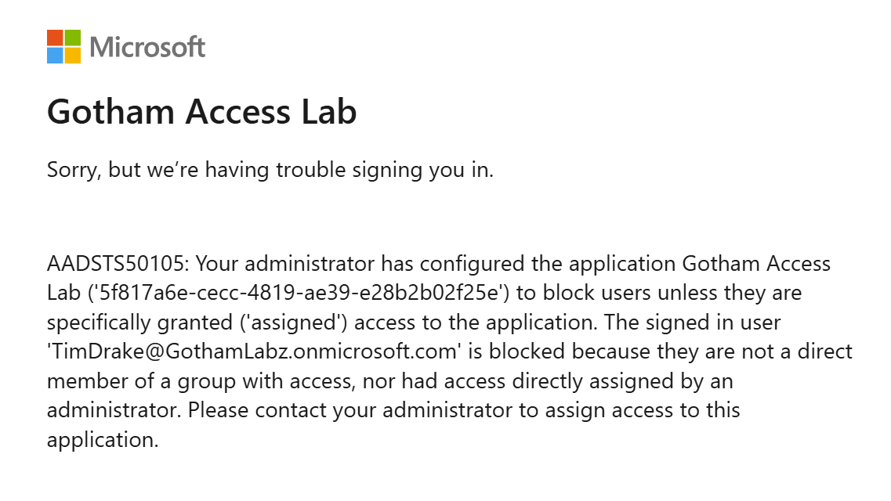

Using my administrator session, I reviewed Tim's request and approved it with this justification:

> Approved temporary Procurement Reader membership for the Lab 16 procurement review.

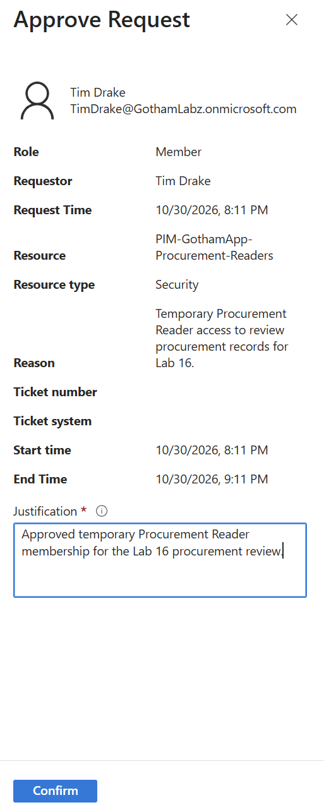

## 5. I verified active membership and least-privilege application access

The PIM Active assignments page subsequently showed Tim as a direct Member with state **Activated**, starting **8:18:54 PM** and ending **9:18:53 PM**. My permanent Owner assignment remained. The actual active-assignment window differed from the earlier requested window; I used the active assignment's end time for the expiry test.

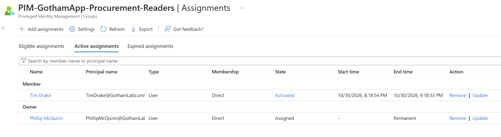

Tim's group list now contained the PIM group and `SG-CA-Lab-Users`, with no dynamic reader group. His Department remained Lab-NoAccess during the activation and expiry tests.

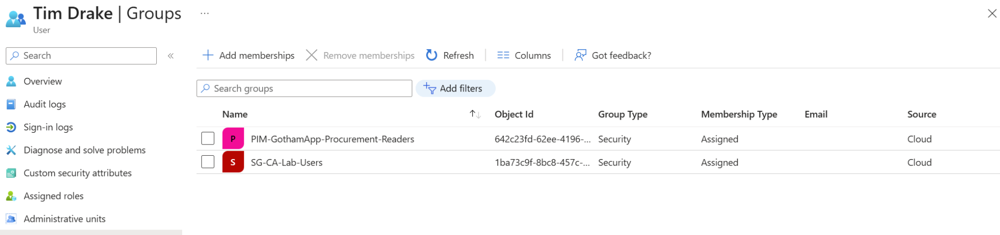

I signed in to the application in a fresh Incognito session. The identity page displayed only **Procurement.Reader**. IT Inventory returned **Forbidden** because Tim lacked `IT.Reader`, while Procurement displayed **Procurement Reader access allowed**.

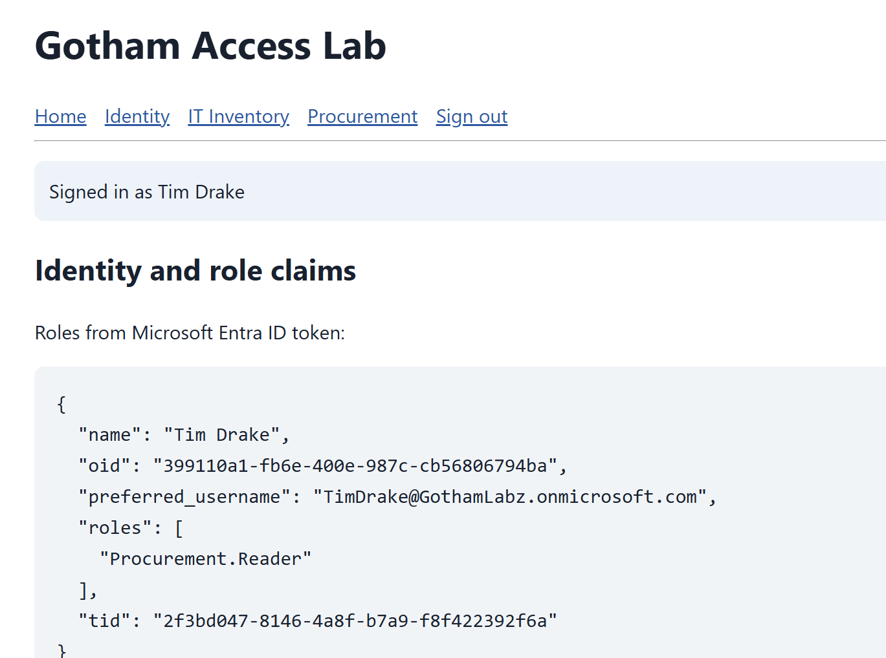

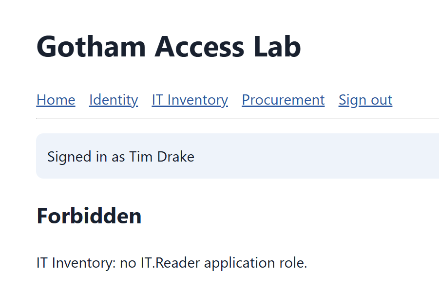

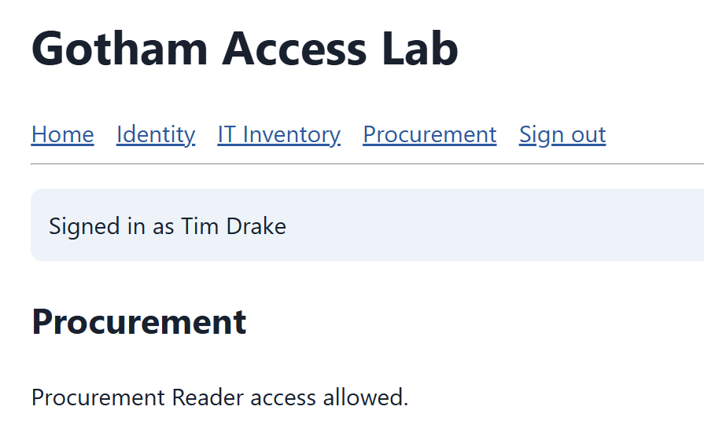

## 6. I tested automatic expiry

I waited beyond the scheduled **9:18:53 PM** end time without manually deactivating or removing Tim's active membership. When I loaded his Groups page after expiry, the PIM membership was already absent; only `SG-CA-Lab-Users` remained. I did not measure the exact removal latency.

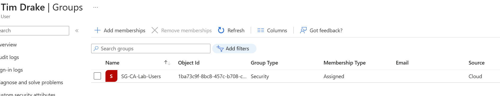

I also checked PIM Active assignments. Tim was no longer listed, while my permanent Owner assignment remained.

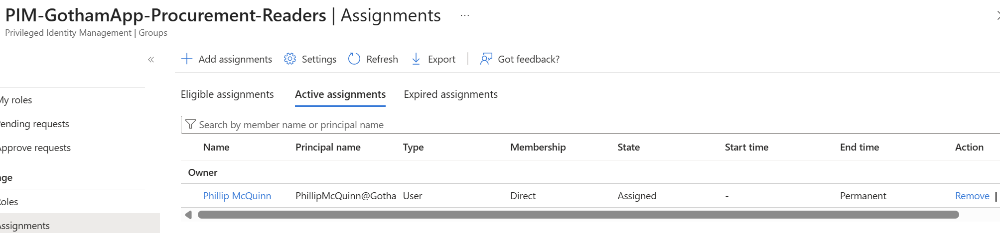

A fresh application sign-in then failed with **AADSTS50105**. This verified denial of a new sign-in after expiry; I did not test termination of the application session established while membership was active.

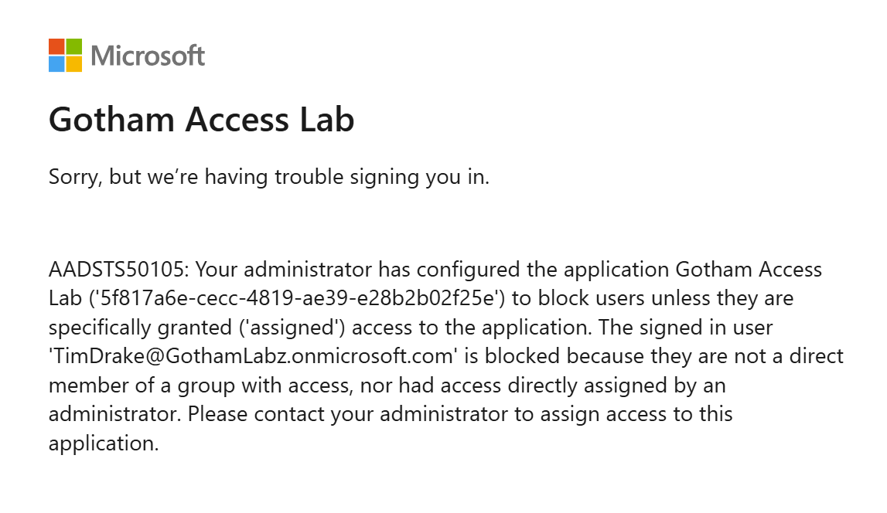

## Validation Matrix

| State I tested | Tim's active reader membership | Fresh application sign-in | IT Inventory | Procurement |
|---|---|---|---|---|
| Eligible, before request | None | AADSTS50105 | Sign-in blocked | Sign-in blocked |
| Request pending approval | None | AADSTS50105 | Sign-in blocked | Sign-in blocked |
| Approved and activated | PIM Procurement group | Succeeded; Procurement.Reader only | Forbidden | Allowed |
| Activation expired | None | AADSTS50105 | Sign-in blocked | Sign-in blocked |

## Cleanup and Final State

I removed Tim's remaining eligible assignment and verified **No results** on the group's administrator **Assignments → Eligible assignments** page. An empty My roles page alone would not have established group-wide eligibility cleanup.

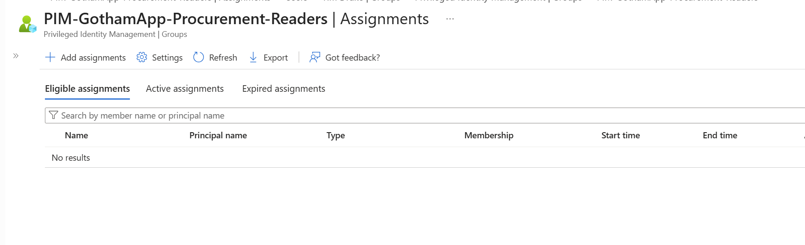

I restored Tim's Department to **Procurement** and confirmed that `DG-GothamApp-Procurement-Readers` returned alongside `SG-CA-Lab-Users`. The PIM group was absent from his membership list.

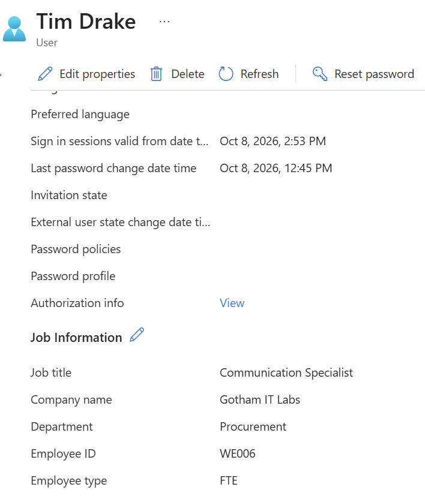

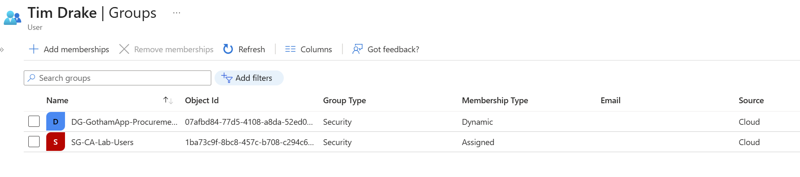

I stopped Flask and closed the test Incognito windows. I retained the PIM group, its saved settings, its Procurement Reader application assignment, and my permanent Owner assignment. I retained the earlier assigned and dynamic reader groups and application assignments. I did not repeat application authorization tests after restoring Department during cleanup.

## Evidence Limits and Lessons

- I verified saved policy, eligibility, pending approval, active membership, application-role display, allowed/forbidden pages, automatic expiry, and fresh-sign-in denial. I did not collect correlated PIM audit exports or Entra sign-in logs for these events.
- Azure MFA was configured, but no fresh prompt was observed. I did not independently verify existing-claim satisfaction or infer that the MFA requirement failed.
- The department membership change was observed within one minute. Post-expiry membership was already absent when the page loaded. Neither observation establishes exact backend processing times or a service guarantee.
- I did not test rejection, manual deactivation, extension, previously issued token revocation, or immediate termination of an existing Flask session in this lab.
- I kept local secrets and `.env` configuration private. The displayed claims were application output, not an independent raw-token signature-validation exercise.

I learned to separate **eligibility**, **approved active membership**, **application-role assignment**, and **the claims held by a session**. Isolating the existing department-based access path made it possible to show that PIM activation granted temporary access and that expiry removed that access path.

## References

- [Manage groups in PIM](https://learn.microsoft.com/en-us/entra/id-governance/privileged-identity-management/groups-discover-groups)
- [PIM for Groups concepts](https://learn.microsoft.com/en-us/entra/id-governance/privileged-identity-management/concept-pim-for-groups)
- [Configure PIM for Groups role settings](https://learn.microsoft.com/en-us/entra/id-governance/privileged-identity-management/groups-role-settings)

[Back to portfolio](../../README.md)
