# Lab 17 — Identity Protection and Controlled User-Risk Remediation

I marked a fictional test account as compromised, verified High user risk through Microsoft Graph, and completed a required password change during a new sign-in. Graph subsequently recorded the account as **remediated**, with **riskLevel: none** and **riskDetail: userPerformedSecuredPasswordChange**. A later fresh application sign-in succeeded and retained the expected Procurement Reader access.

I also investigated delayed sign-in visibility and distinguished intermediate authentication events from completed sign-ins. **The captured sign-in records do not directly show CA-06 enforcing remediation:** every captured CA-06 result was Not Applied. I therefore document the verified risk transition and observed password-change experience without claiming a captured CA-06 enforcement success.

## Environment and scope

I performed this exercise on **October 31, 2026**, in my personal GothamLabz Microsoft Entra ID P2 trial tenant. I operated both my administrator account and Tim Drake's fictional test account in separate browser sessions. Local times below are **MDT (UTC−6)**; Graph timestamps use UTC.

| Component | Configuration |
|---|---|
| Test identity | Tim Drake — `TimDrake@GothamLabz.onmicrosoft.com` |
| User object ID | `399110a1-fb6e-400e-987c-cb56806794ba` |
| Tenant ID | `2f3bd047-8146-4a8f-b7a9-f8f422392f6a` |
| Application | Gotham Access Lab, local Flask/OIDC application |
| Application ID | `5f817a6e-cecc-4819-ae39-e28b2b02f25e` |
| Existing application access | Procurement.Reader through the restored Department-based dynamic group |
| New policy | `CA-06-Lab-Tim-High-User-Risk-Remediation` |

I reused the [Gotham Access Lab source](../08-enterprise-application-integration/app/README.md). This was a controlled administrator-generated **user-risk** exercise. I did not generate an organic compromise or an actual High-risk sign-in detection.

## 1. Establish the baseline

I cleared the Risky users filters and searched for Tim. The portal returned No Results. This established that no record was returned in that view; it was not a positive API baseline showing riskLevel none.

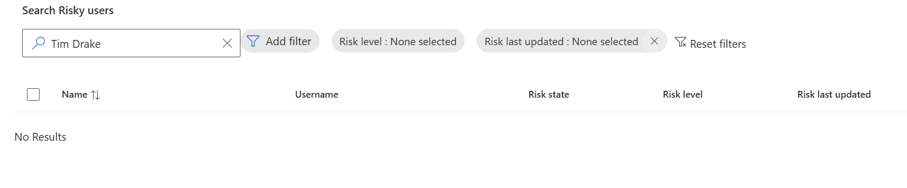

Before generating risk, I signed in to Gotham Access Lab. The Identity page displayed only `Procurement.Reader`, and the Procurement page allowed access.

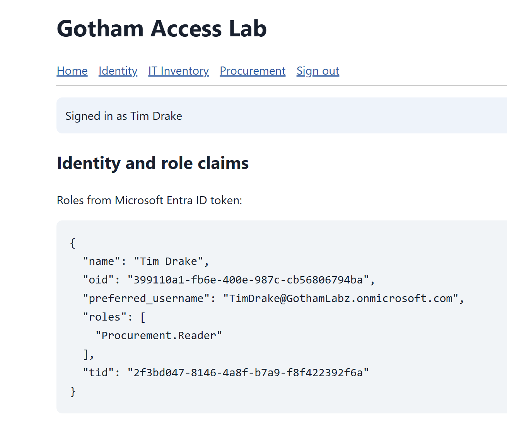

## 2. Configure a narrowly scoped policy

I created CA-06 in **Report-only**, verified that its selected identity was Tim alone, and then enabled it for the controlled test. I did not change the existing CA-00 through CA-05 policies.

| Setting | Saved configuration |
|---|---|
| Included identities | Tim Drake only; no excluded identities |
| Target resources | All resources |
| User risk | High |
| Network | Not configured |
| Grant requirements | Require risk remediation and Multifactor authentication strength |
| Session control | Sign-in frequency: Every time |
| Created | 9:42:44 AM MDT, initially Report-only |
| Enabled | Saved On at 9:55:24 AM MDT |

Selecting risk remediation added the authentication-strength requirement. I selected Multifactor authentication strength; the separate Require multifactor authentication checkbox remained unchecked. The saved summary displayed Require risk remediation and Require a new sign-in for each session. The summary also recorded one included client app; I do not infer broader client coverage from that count.

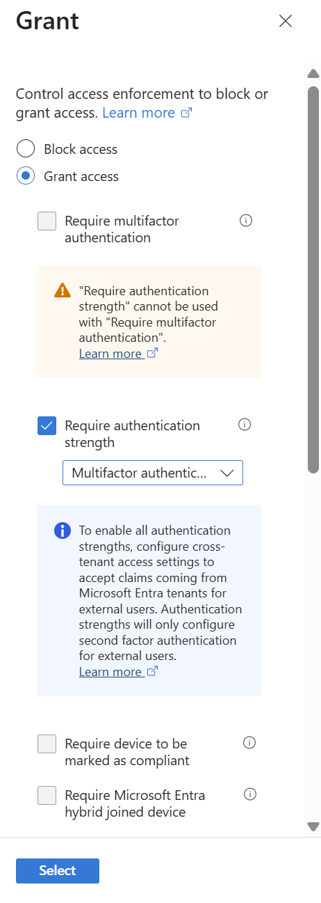

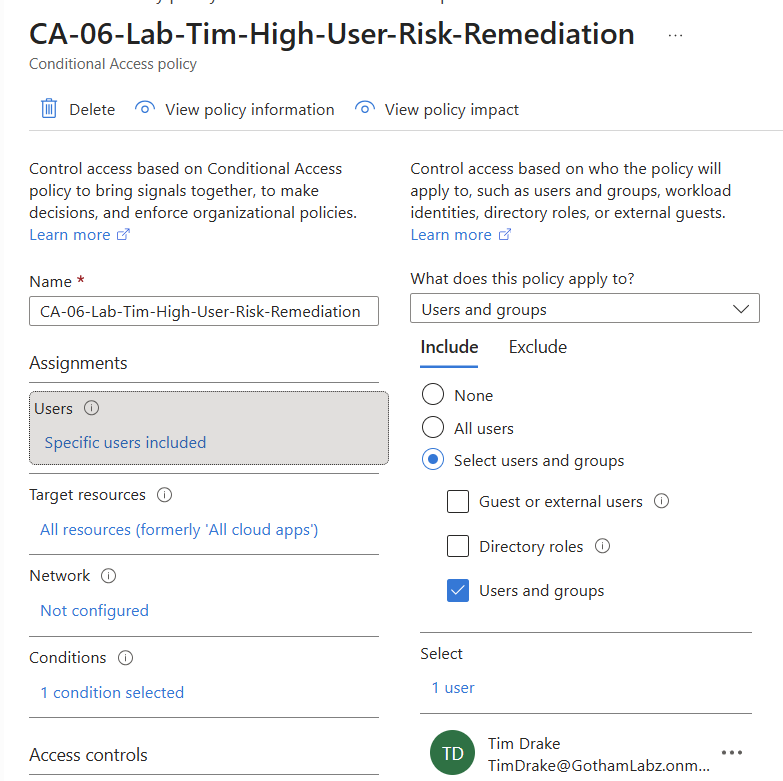

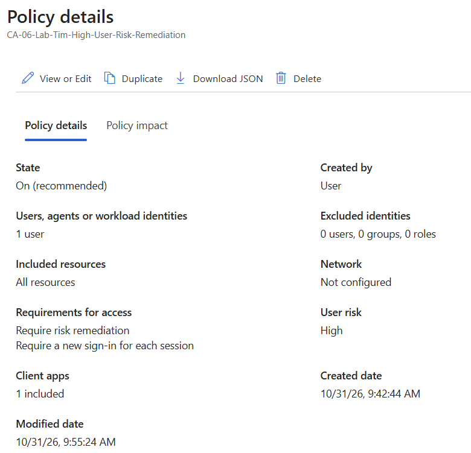

## 3. Compare High and Low in What If

I evaluated Tim, Gotham Access Lab, Windows, and Browser. I left sign-in risk unset and changed only the simulated user-risk value between the two runs.

| Simulated user risk | Policies that will apply | CA-06 result |
|---|---|---|
| High | CA-01-Lab-Users-MFA and CA-06 | Matches, while CA-06 was Report-only |
| Low | CA-01-Lab-Users-MFA only | Will not apply; reason: User risk |

These were policy-matching simulations, not actual risky authentication events. The High result's grant column displayed authentication strength; I used the saved policy settings to verify the additional remediation requirement.

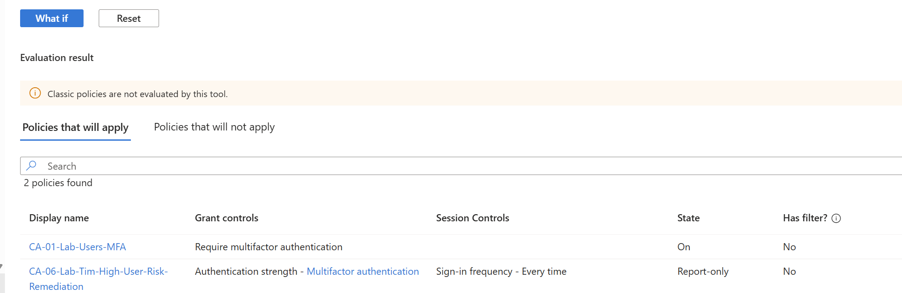

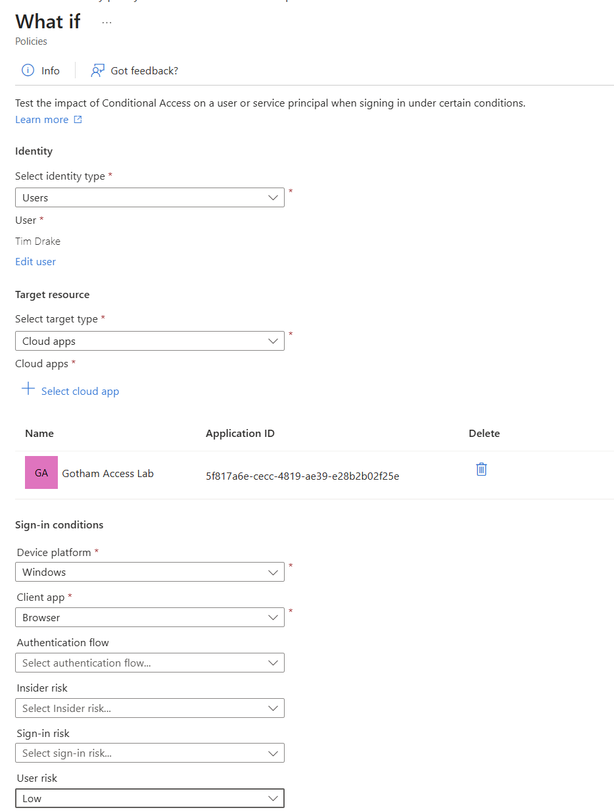

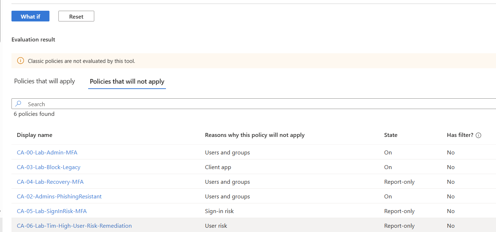

## 4. Investigate missing sign-in records

My initial October 31 Tim sign-ins did not immediately appear in the administrator log views. I checked interactive and non-interactive tabs, the preview experience, date/user filters, and Tim's My Sign-ins page. Signing out of my administrator account and back in did not immediately change the results.

I performed another sign-in at approximately 10:21 AM. Records later became visible during the investigation. I did not measure the exact ingestion delay or establish its cause, so I do not describe the gap as a confirmed service outage.

The eventual **10:21:32 AM** record showed Interrupted: the cloud password succeeded, while the mobile app notification was still Authentication in progress. CA-01 showed Failure for that event, and CA-06 was Not Applied. This record captures an incomplete MFA stage, not proof that I denied the notification or that the overall browser flow permanently failed. It also preceded the later confirmed High user-risk state.

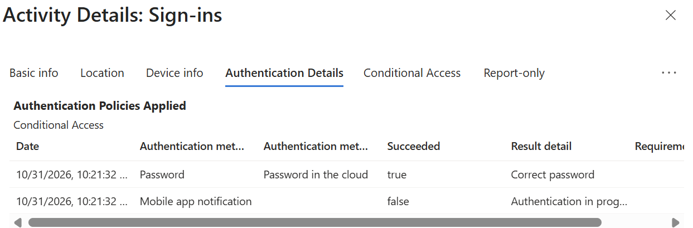

## 5. Set and verify High user risk through Graph

The empty Risky users list did not let me select Tim for the portal's Confirm compromised action. I used Graph Explorer instead, with the delegated `IdentityRiskyUser.ReadWrite.All` permission required for the action. I did not capture a separate permission-consent screenshot.

My first POST using the unqualified `/confirmCompromised` action returned 405 Method Not Allowed. The following qualified action returned **204 No Content** with Tim's object ID in the body:

```http
POST https://graph.microsoft.com/v1.0/identityProtection/riskyUsers/microsoft.graph.confirmCompromised
Content-Type: application/json
```

```json
{
  "userIds": [
    "399110a1-fb6e-400e-987c-cb56806794ba"
  ]
}
```

I record the endpoint that actually succeeded; I did not isolate the cause of the earlier 405. Graph Explorer displayed a possible URL warning even though the request succeeded.

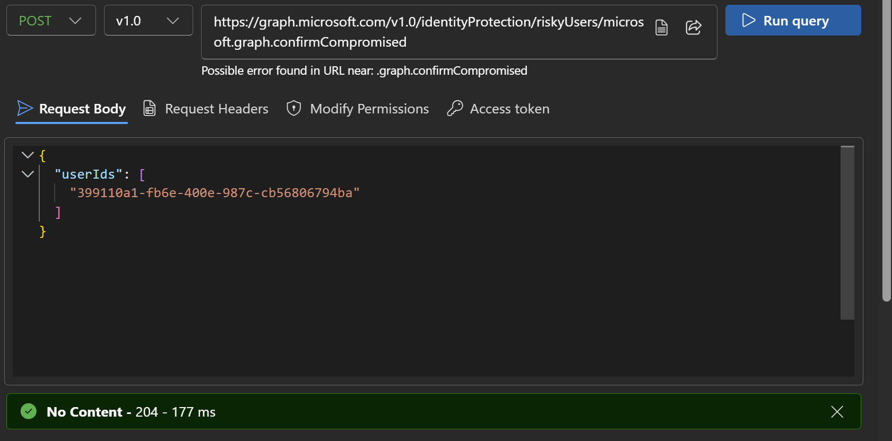

The portal still returned No Results, so I verified the account directly:

```http
GET https://graph.microsoft.com/v1.0/identityProtection/riskyUsers/399110a1-fb6e-400e-987c-cb56806794ba
```

I left the GET request body empty. During troubleshooting I initially put the GET URL in the body while leaving the action URL in the address field, which produced 400 Invalid user object id. Correcting the address field returned **200 OK**.

| Property | Verified value before remediation |
|---|---|
| riskLevel | high |
| riskState | confirmedCompromised |
| riskDetail | adminConfirmedUserCompromised |
| isProcessing | false |
| riskLastUpdatedDateTime | `2026-10-31T16:39:53.2905369Z` — 10:39:53 AM MDT |

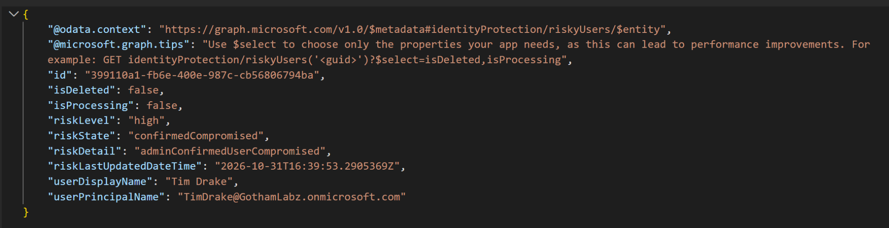

## 6. Complete remediation and verify access

During a new sign-in as Tim, I was required to change the password. I also received a user-at-risk email. These are my observations; I did not capture separate images of the password-change prompt or email.

After completing the change, I reached the application and verified the risk record again. Graph returned **200 OK** with:

| Property | Verified value after remediation |
|---|---|
| riskLevel | none |
| riskState | remediated |
| riskDetail | userPerformedSecuredPasswordChange |
| isProcessing | false |
| riskLastUpdatedDateTime | `2026-10-31T16:48:29.4482982Z` — 10:48:29 AM MDT |

I did not manually dismiss risk or perform an administrator password reset. The API state identifies a secured password change as the remediation mechanism.

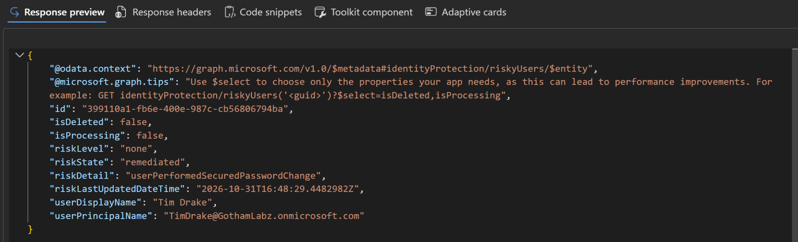

I closed the test Incognito windows and signed in again with the new password. This time I observed MFA without another required password change. The application still displayed only Procurement.Reader and allowed Procurement access. I did not repeat the IT Inventory denial test in this lab.

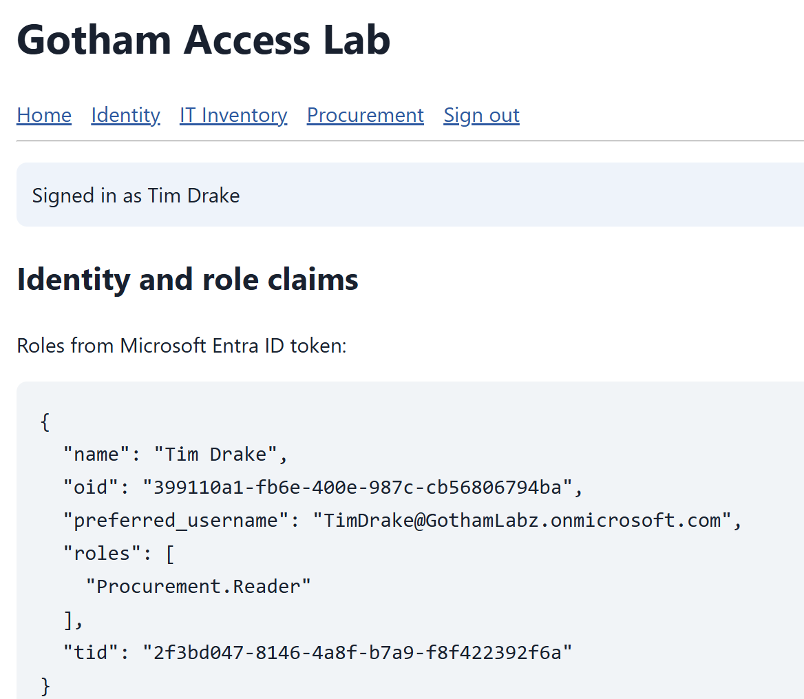

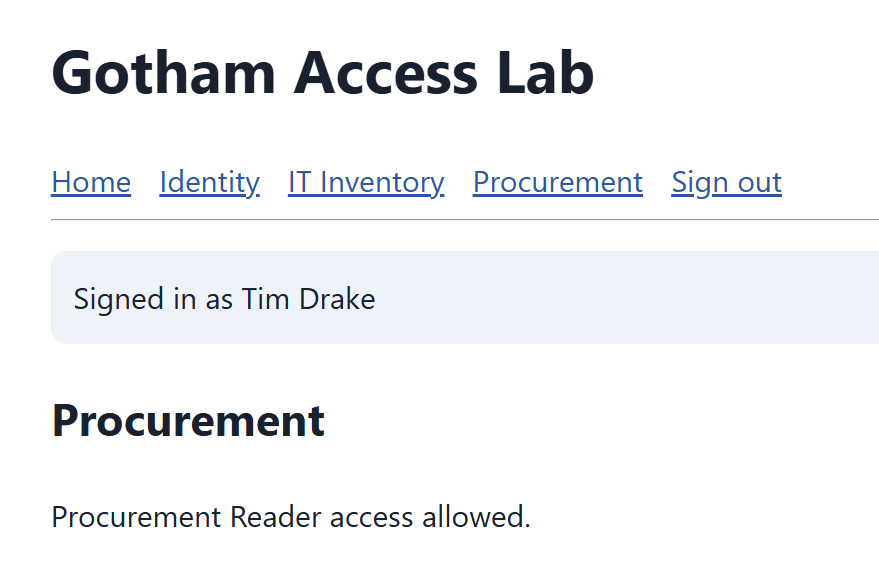

## 7. Interpret the available sign-in evidence

| Local event time | Observed result | CA-01 | CA-06 | Interpretation |
|---|---|---|---|---|
| 10:21:32 AM | Interrupted; password correct, mobile notification in progress | Failure | Not Applied | Incomplete MFA stage before the confirmed High-risk update |
| 10:48:29 AM | Interrupted; additional details describe the Stay signed in prompt | Success | Not Applied | Expected prompt stage; not proof of password-change failure |
| 10:51:34 AM | Success; MFA satisfied by a claim in the token | Success | Not Applied | Successful event after Graph recorded risk remediation |

The 10:48 and 10:51 Authentication Details tabs showed Previously satisfied. They establish claim-based MFA satisfaction for those records, rather than independently proving a fresh challenge at those timestamps. My observed MFA experience during the later fresh sign-in remains a separate observation.

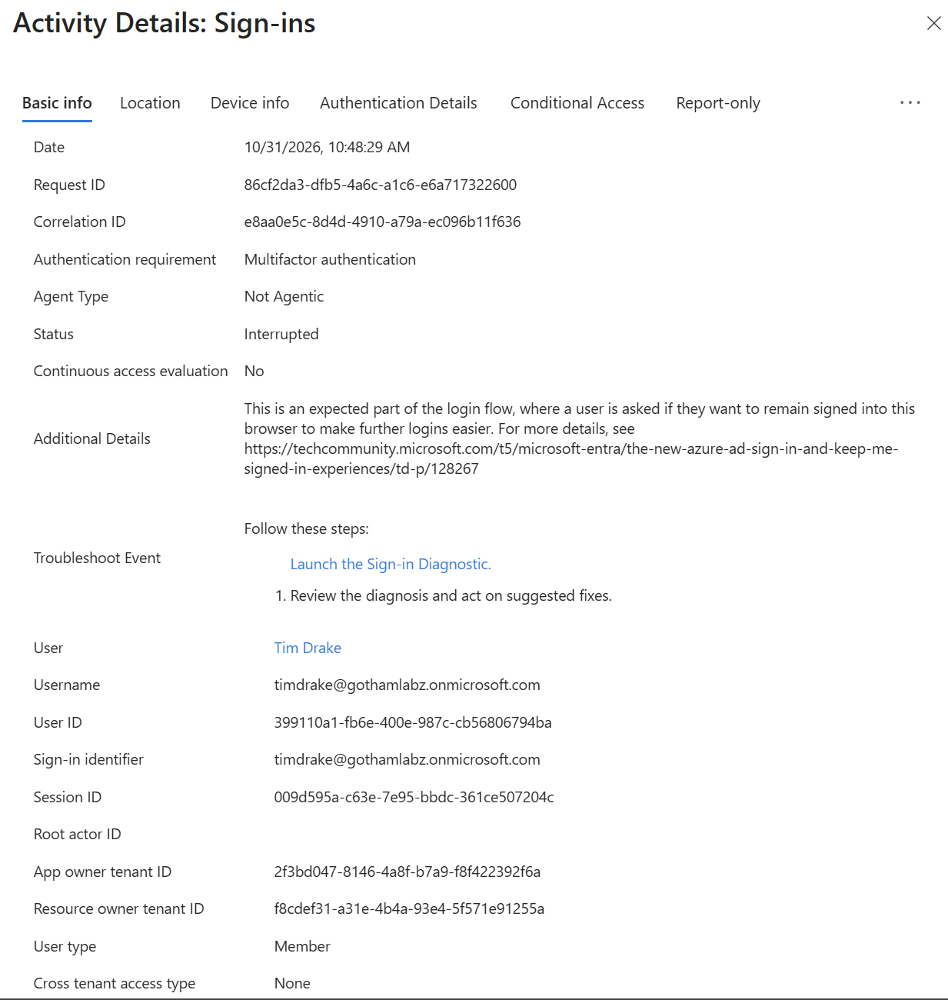

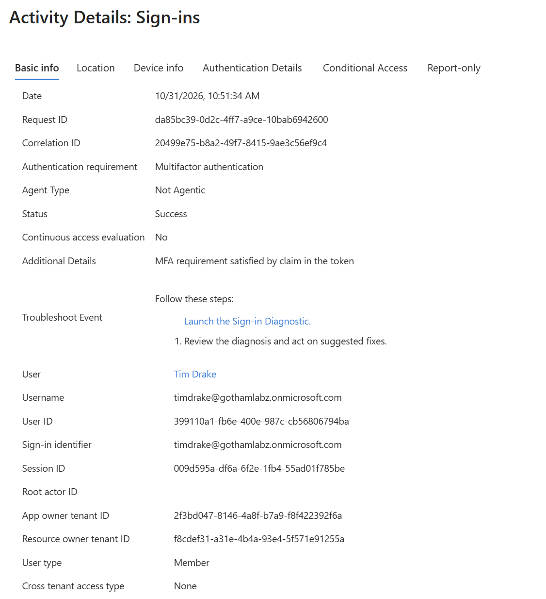

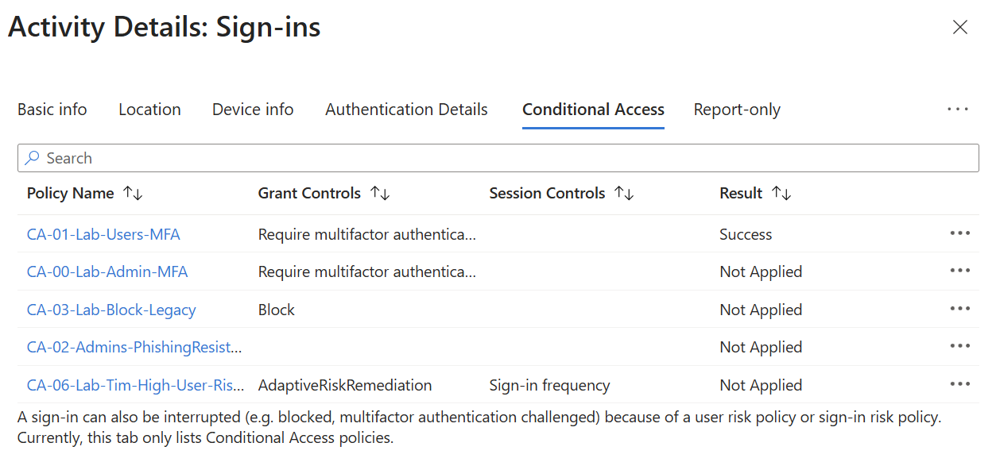

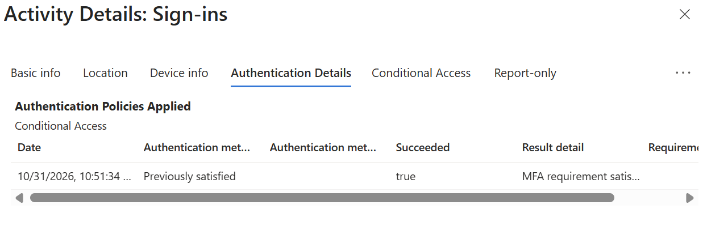

**Evidence boundary:** I verified the enabled policy configuration, the High-risk API state, the required password-change experience, the API's secured-password-change remediation result, and subsequent application access. I did not find a distinct captured sign-in record directly attributing remediation to CA-06. I therefore do not claim a CA-06 Success log, independently correlated enforcement, or measured existing-session revocation. The baseline and post-remediation Not Applied results alone do not demonstrate that remediation failed.

## Cleanup and final state

I restored CA-06 to **Report-only**; the saved summary shows modification at **11:10:17 AM MDT**. I retained the policy for future evaluation, left the other policies unchanged, and kept Tim's restored Procurement access and new password. Graph had already confirmed riskLevel none and riskState remediated.

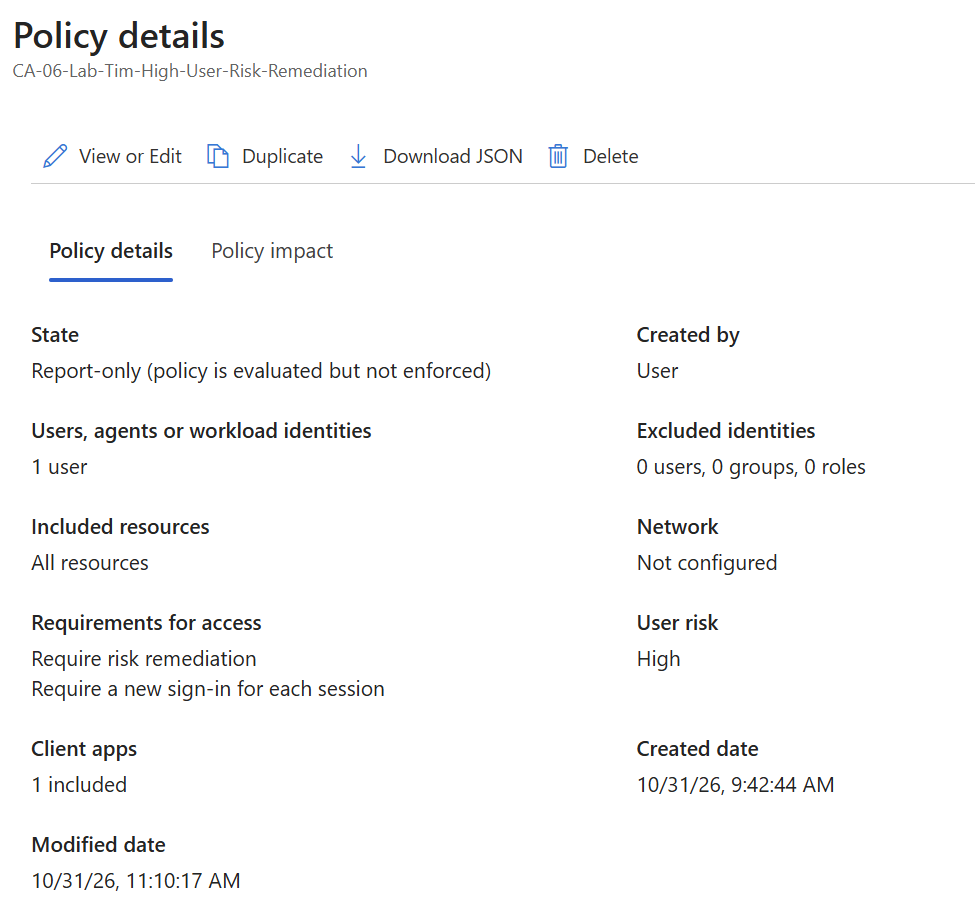

I stopped Flask, closed the test Incognito windows, and signed out of Graph Explorer. I did not verify removal of Graph Explorer's delegated consent. Security Defaults remained disabled; I did not perform the planned licensing-transition exercise in this lab.

## What I learned

I practiced scoped risk-policy configuration, High-versus-Low What If comparisons, Graph action and request troubleshooting, controlled user-risk creation, and API verification of self-remediation. I also learned to separate user risk from sign-in risk, incomplete authentication stages from completed sign-ins, and a verified remediation result from direct evidence of a particular policy's enforcement.

## References

- [Microsoft: Simulate risk detections](https://learn.microsoft.com/en-us/entra/id-protection/howto-identity-protection-simulate-risk)
- [Microsoft Graph: Confirm a risky user compromised](https://learn.microsoft.com/en-us/graph/api/riskyuser-confirmcompromised?view=graph-rest-1.0)
- [Microsoft Graph: Get riskyUser](https://learn.microsoft.com/en-us/graph/api/riskyuser-get?view=graph-rest-1.0)
- [Microsoft: User risk-based Conditional Access policy](https://learn.microsoft.com/en-us/entra/identity/conditional-access/policy-risk-based-user)

I selected screenshots without passwords, tokens, application secrets, or public IP addresses. Identifiers shown belong to my lab identities and resources. The sign-in list images containing my public IP are omitted.
